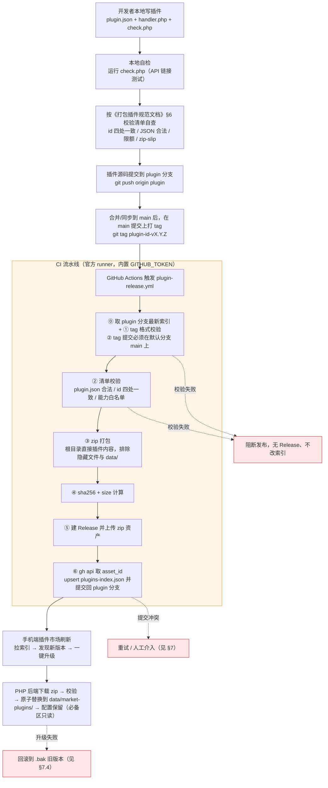
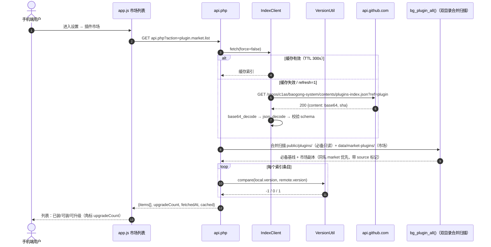
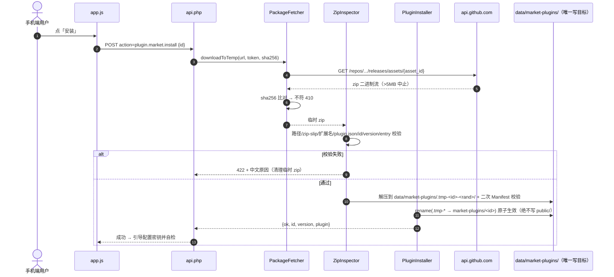

# 报工系统 · 打包工作流文档

> 文档版本：v1.1 ｜ 编写：寇豆码（Kou，软件工程师） ｜ 日期：2026-11-24
> 上游依据：《插件市场-架构设计》v1.1（高见远，双目录策略 D7/B.5）、《插件市场-PRD》v0.1（许清楚）
> 配套文档：《打包插件规范文档》（包的合法性基准，本文的姊妹篇）、《插件市场-架构设计》（索引/时序/安全权威定义）
> 目标仓库：`c1as/baogong-system`（本地 `/tmp/gl-system`）｜开发/发布分支：`plugin` ｜ CI 文件：`.github/workflows/plugin-release.yml`

---

## 1. 工作流总览

### 1.1 一句话流程

插件发布 = **本地按规范打包含自检 → 提交到 `plugin` 分支 → 打 `plugin-<id>-vX.Y.Z` tag 推送 → GitHub Actions 校验/打包/发 Release/更新索引 → 手机端插件市场刷新即可发现并升级**。

### 1.2 全链路流程图



> 手机端下载/安装/升级的详细时序见 §8（引用架构文档 A.4）。

---

## 2. tag 命名规范

插件发布用独立 tag，**与系统热更 tag 完全解耦**。

| 项 | 插件发布 tag | 系统热更 tag（对照） |
| --- | --- | --- |
| 格式 | `plugin-<id>-vX.Y.Z` | `web-vX.Y` |
| 示例 | `plugin-baidu-ocr-v1.3.0`、`plugin-mock-ocr-v0.1.0` | `web-v2.6` |
| 触发流水线 | `.github/workflows/plugin-release.yml` | 历史 `.gitlab-ci.yml` / App 仓 `build-release.yml` |
| 基线分支 | `plugin` | `main` |
| 版本来源 | `plugin.json.version` | 系统版本号 |
| 互相影响 | 无 | 无 |

**tag 规则细则：**

| 规则 | 说明 |
| --- | --- |
| 严格格式 | `^plugin-([a-z0-9][a-z0-9-]{0,31})-v(\d+\.\d+\.\d+)$`，大小写敏感，全小写 |
| id 一致 | tag 中的 `<id>` 必须等于 `plugin.json.id`、目录名、包名中的 id |
| 版本一致 | tag 中的 `X.Y.Z` 必须等于 `plugin.json.version`（容忍 `v` 前缀的最终归一） |
| 严格递增 | 新版本必须大于索引中同 id 的既有版本，否则 CI 阻断 |
| 打 tag 位置 | tag 必须打在**默认分支 `main`** 的提交上（`plugin` 分支提交上的 tag 不会触发工作流），且该提交的 `public/plugins/<id>/plugin.json` 版本必须等于 tag 版本；CI 会校验 tag 提交在 `origin/main` 祖先链上 |
| 唯一性 | 同名 tag 不可重复推送；重复发布需升版本或用新 tag |
| 推送节奏 | 必须**逐个推送并等上一个运行结束**：并发组只保留 1 个运行 + 1 个排队，一次性批量推送会取消排队中的运行 |

---

## 3. 开发者侧步骤

| 步骤 | 操作 | 命令/入口 | 通过标准 |
| --- | --- | --- | --- |
| 1. 写插件 | 在 `public/plugins/<id>/`（打包源/必备基线目录）放 `plugin.json` + `handler.php`（+ 可选 `check.php`）；市场安装落盘为 `data/market-plugins/<id>/` | 见《OCR插件接入文档》 | 设置页能发现插件 |
| 2. 本地自检 | 设置页点「API 链接测试」运行 `check.php` | WebView / `plugin.invoke` | 返回 `ok:true`，密钥/网络/接口可用 |
| 3. 规范自查 | 按《打包插件规范文档》§6 清单逐项核对 | 本地 `zip -l` / `sha256sum` 等 | 18 项全通过 |
| 4. 提交 plugin 分支并同步 main | 在 `plugin` 分支提交并推送，再把插件源码合并/同步到 `main` 并推送 | `git checkout plugin && git add ... && git commit -m "..." && git push origin plugin`，随后同步到 `main` | 远端 `origin/main` 已含本次插件版本（tag 打在这里） |
| 5. 打 tag 推送 | 在 **`main` 当前提交**上按 §2 命名打 tag 并**逐个**推送 | `git tag plugin-<id>-vX.Y.Z <main-sha> && git push origin plugin-<id>-vX.Y.Z` | CI 被触发 |
| 6. 观察 CI | 在 Actions 页看 `plugin-release.yml` 运行状态 | GitHub Actions UI | 全绿，Release 生成、索引更新 |

> 存量 6 插件是系统必备插件，随 `web-v*` 包整目录分发（不排除 `plugins/`），无需改代码，只需从现有打包源目录按基线版本打 tag（基线见《打包插件规范文档》§8）；市场升级只在 `data/market-plugins/` 生成同名副本（market 优先），绝不回写 `public/plugins/`。

---

## 4. GitHub Actions 流水线设计

### 4.1 文件与触发

- 文件：`.github/workflows/plugin-release.yml`（新增，本设计为落地蓝图，实际文件由 T07 任务实现）。
- 触发：`push` 到匹配 `plugin-*-v*.*.*` 的 tag；不响应 `web-v*` 或其它 tag。**tag 必须打在 `main` 的提交上**——GitHub 不会为默认分支之外的提交上的 tag 触发工作流。
- 备用触发：支持 `workflow_dispatch`（填 `id`/`version`），用于 tag 事件异常时补发，默认检出 `main`。
- 索引数据源：`plugins-index.json` 只以 `plugin` 分支为准，流程开始先取回该分支最新索引再 upsert，最后仍提交回 `plugin` 分支。
- 权限：`permissions.contents: write`（创建 Release、上传资产、推送索引提交所需）。
- 鉴权：**只用内置 `GITHUB_TOKEN`**，不新增任何 Secret（架构文档 D5/A.5）。
- 并发：`group: plugin-release`、`cancel-in-progress: false`；注意同一时间只保留 1 个排队运行，批量推 tag 会取消排队中的运行，因此需逐个推送并等上一个结束。

### 4.2 各 step 职责

| Step | 职责 | 失败即阻断 |
| --- | --- | --- |
| ⓪ 取索引 | `git fetch origin plugin` 并把该分支的 `plugins-index.json` 取到工作区，作为唯一索引数据源 | 否（不存在则视为首次发布） |
| ① 检出 | `actions/checkout@v4` 默认检出 tag 指向的提交（**不指定 `ref`**）；手动触发时 `ref: main`；需 `fetch-depth: 0` 供分支校验 | 是 |
| ② tag 校验 | 校验 tag 正则、解析 id/version；校验该提交位于 `origin/main` 祖先链（默认分支之外的 tag 不会触发工作流） | 是 |
| ③ 清单校验 | 读 `public/plugins/<id>/plugin.json`：JSON 合法、`id`=tag id=目录名、version 一致、capabilities 白名单、entry 存在；对照规范文档 §6 | 是 |
| ④ 版本冲突校验 | 读索引中同 id 最新版本，确保新版本严格递增 | 是 |
| ⑤ zip 打包 | 在插件目录内 `zip -r`，根目录直接是插件内容，排除隐藏文件与 `data/`；文件名 `plugin-<id>-v<version>.zip` | 是 |
| ⑥ 哈希/大小 | `sha256sum` + `stat` 生成 sha256 与 size；校验 ≤5,242,880 字节 | 是 |
| ⑦ 建 Release 上传资产 | `softprops/action-gh-release@v2` 按 tag 建 Release 并上传 zip | 是 |
| ⑧ 取 asset id | `gh api repos/c1as/baogong-system/releases/tags/<tag>` 查得该 zip 的 `asset_id` | 是 |
| ⑨ upsert 索引 | 用 `jq` 在 `plugins-index.json` 中按 id 插入/替换条目（含 package.url=API 资产端点、sha256、size） | 是 |
| ⑩ 提交索引 | 在 `origin/plugin` 的独立工作树中提交并 `git push` 回 `plugin` 分支（含冲突重试，见 §7.2） | 是 |

### 4.3 关键 YAML 片段示例（可运行风格）

> 以下为设计示例，展示核心逻辑；正式文件由 T07 落地。

```yaml
name: Plugin Release

on:
  push:
    tags:
      - 'plugin-*-v*.*.*'        # 仅插件 tag，web-v* 不触发

permissions:
  contents: write                # 建 Release + 上传资产 + 推送索引

concurrency:
  group: plugin-release          # 串行发布，避免索引提交冲突
  cancel-in-progress: false

jobs:
  release:
    runs-on: ubuntu-latest
    steps:
      - name: 检出（tag 提交，含完整历史供分支校验）
        uses: actions/checkout@v4
        with:
          fetch-depth: 0     # 默认检出 tag commit，不指定 ref；手动触发时 ref: main

      - name: ⓪ 取 plugin 分支最新索引
        run: |
          set -e
          git fetch origin plugin
          git checkout origin/plugin -- plugins-index.json 2>/dev/null || true

      - name: ① 校验 tag 格式并解析 id/version
        id: meta
        run: |
          set -e
          TAG="${GITHUB_REF_NAME}"
          echo "tag=$TAG"
          [[ "$TAG" =~ ^plugin-([a-z0-9][a-z0-9-]{0,31})-v([0-9]+\.[0-9]+\.[0-9]+)$ ]] \
            || { echo "tag 格式非法，应为 plugin-<id>-vX.Y.Z"; exit 1; }
          ID="${BASH_REMATCH[1]}"
          VER="${BASH_REMATCH[2]}"
          echo "id=$ID"; echo "version=$VER"
          echo "id=$ID" >> "$GITHUB_OUTPUT"
          echo "version=$VER" >> "$GITHUB_OUTPUT"

      - name: ② 分支校验（tag 提交必须在 main 上）
        run: |
          set -e
          ID="${{ steps.meta.outputs.id }}"
          VER="${{ steps.meta.outputs.version }}"
          TAG="plugin-${ID}-v${VER}"
          git fetch origin main
          git merge-base --is-ancestor "$GITHUB_SHA" origin/main \
            || { echo "tag 提交不在 main 祖先链上，拒绝发布"; exit 1; }
          echo "分支校验通过"

      - name: ③ 清单校验（plugin.json）
        run: |
          set -e
          ID="${{ steps.meta.outputs.id }}"
          VER="${{ steps.meta.outputs.version }}"
          PJ="public/plugins/${ID}/plugin.json"
          [ -f "$PJ" ] || { echo "缺少 $PJ"; exit 1; }
          jq -e . "$PJ" >/dev/null || { echo "plugin.json 非法"; exit 1; }
          [ "$(jq -r .id "$PJ")" = "$ID" ] || { echo "id 不一致"; exit 1; }
          [ "$(jq -r .version "$PJ")" = "$VER" ] || { echo "version 不一致"; exit 1; }
          ENTRY=$(jq -r '.entry // "handler.php"' "$PJ")
          [ -f "public/plugins/${ID}/${ENTRY}" ] || { echo "entry 不存在"; exit 1; }
          # capabilities 白名单
          BAD=$(jq -r '.capabilities // [] | map(select(. != "report.ocr" and . != "report.ocr.fusion" and . != "report.ocr.log")) | join(",")' "$PJ")
          [ -z "$BAD" ] || { echo "非法能力标签: $BAD"; exit 1; }
          echo "清单校验通过"

      - name: ④⑤ zip 打包 + sha256/size
        id: pkg
        run: |
          set -e
          ID="${{ steps.meta.outputs.id }}"
          VER="${{ steps.meta.outputs.version }}"
          ZIP="plugin-${ID}-v${VER}.zip"
          ( cd "public/plugins/${ID}" && \
            zip -r -9 "../../../${ZIP}" . -x '.*' '*/.*' 'data/*' '*.log' )
          SIZE=$(stat -c %s "$ZIP")
          [ "$SIZE" -le 5242880 ] || { echo "包超过 5MB: $SIZE"; exit 1; }
          SHA=$(sha256sum "$ZIP" | awk '{print $1}')
          echo "zip=$ZIP" >> "$GITHUB_OUTPUT"
          echo "size=$SIZE" >> "$GITHUB_OUTPUT"
          echo "sha=$SHA" >> "$GITHUB_OUTPUT"
          echo "产物 $ZIP ($SIZE bytes, sha256=$SHA)"

      - name: ⑦ 建 Release 上传 zip
        uses: softprops/action-gh-release@v2
        with:
          tag_name: ${{ github.ref_name }}
          name: "插件 ${{ steps.meta.outputs.id }} v${{ steps.meta.outputs.version }}"
          files: ${{ steps.pkg.outputs.zip }}
          body: "插件包由 CI 自动生成，索引已同步更新。"

      - name: ⑧ 取 asset id
        id: asset
        env:
          GH_TOKEN: ${{ github.token }}
        run: |
          set -e
          TAG="${GITHUB_REF_NAME}"
          ZIP="${{ steps.pkg.outputs.zip }}"
          AID=$(gh api "repos/c1as/baogong-system/releases/tags/${TAG}" \
                 --jq ".assets[] | select(.name==\"${ZIP}\") | .id")
          [ -n "$AID" ] || { echo "未找到资产 $ZIP"; exit 1; }
          echo "id=$AID" >> "$GITHUB_OUTPUT"
          echo "asset_id=$AID"

      - name: ⑨ upsert 索引条目（首次建骨架 + 合并展示字段 + 按 id 去旧增新）
        env:
          ID: ${{ steps.meta.outputs.id }}
          VER: ${{ steps.meta.outputs.version }}
          AID: ${{ steps.asset.outputs.id }}
          SHA: ${{ steps.pkg.outputs.sha }}
          SIZE: ${{ steps.pkg.outputs.size }}
          TAG: ${{ github.ref_name }}
        run: |
          set -e
          ZIP="plugin-${ID}-v${VER}.zip"
          PJ="public/plugins/${ID}/plugin.json"
          NOW=$(date -u +%Y-%m-%dT%H:%M:%SZ)

          # E2：从 plugin.json 同步展示字段，再叠加 CI 生成字段（tag/releasedAt/package.*）
          # --slurpfile 把整个 plugin.json 读成数组 $pj，取 $pj[0]；
          # with_entries(select(.value != null)) 过滤掉 plugin.json 中缺省的可选字段，避免写入 null。
          ENTRY=$(jq -n \
            --slurpfile pj "$PJ" \
            --arg id "$ID" --arg ver "$VER" --arg zip "$ZIP" \
            --arg url "https://api.github.com/repos/c1as/baogong-system/releases/assets/${AID}" \
            --arg sha "$SHA" --argjson size "$SIZE" --arg tag "$TAG" --arg now "$NOW" \
            '($pj[0]
              | {name, version, description, author, capabilities, entry, check, defaultEnabled, settings}
              | with_entries(select(.value != null)))
             + {id:$id, version:$ver, tag:$tag, releasedAt:$now,
                package:{name:$zip, url:$url, sha256:$sha, size:$size}}')

          # E3：首次发布若索引不存在，先创建骨架（§5.4 步骤1，schema/generatedAt/source/空 plugins）
          if [ ! -f plugins-index.json ]; then
            jq -n --arg now "$NOW" \
              '{schema:"baogong-plugin-index/1", generatedAt:$now,
                source:{repo:"c1as/baogong-system", branch:"plugin", tagPattern:"plugin-<id>-vX.Y.Z"},
                plugins:[]}' > plugins-index.json
          fi

          # 按 id 过滤旧条目后追加新条目（有则更新、无则新增），并更新 generatedAt
          jq --arg id "$ID" --argjson e "$ENTRY" --arg now "$NOW" \
            '.generatedAt = $now
             | .plugins = ( [ .plugins[] | select(.id != $id) ] + [ $e ] )' \
            plugins-index.json > plugins-index.json.tmp
          mv plugins-index.json.tmp plugins-index.json

      - name: ⑩ 提交索引回 plugin 分支
        env:
          GH_TOKEN: ${{ github.token }}
        run: |
          set -e
          git config user.name  "github-actions[bot]"
          git config user.email "41898282+github-actions[bot]@users.noreply.github.com"
          git add plugins-index.json
          git diff --staged --quiet && { echo "索引无变化"; exit 0; }
          git commit -m "chore: 更新插件索引（${{ github.ref_name }}）"
          git push origin HEAD:plugin
```

> 生产落地时建议在 ③④ 之间增加"版本递增校验"（读索引比较 `VersionUtil` 规则），并在 ⑩ 增加 pull --rebase 重试（见 §7.2）。

---

## 5. `plugins-index.json` 索引更新机制

### 5.1 定位

| 项 | 说明 |
| --- | --- |
| 存放位置 | `c1as/baogong-system` 仓库根、`plugin` 分支 |
| 运行时地址 | `https://api.github.com/repos/c1as/baogong-system/contents/plugins-index.json?ref=plugin` |
| schema | 固定 `baogong-plugin-index/1`，不匹配则手机端 502 拒绝解析 |
| 生成方式 | **由 CI 自动生成/更新，人工不手改** |
| 作用 | 市场列表与版本比对的唯一数据源 |

### 5.2 结构（权威定义见架构文档 A.3.2）

| 字段 | 类型 | 必填 | 说明 |
| --- | --- | --- | --- |
| `schema` | string | 是 | 固定 `baogong-plugin-index/1` |
| `generatedAt` | string | 是 | ISO 8601 带时区，如 `2026-11-24T10:00:00+08:00` |
| `source.repo` | string | 是 | `c1as/baogong-system` |
| `source.branch` | string | 是 | `plugin` |
| `source.tagPattern` | string | 是 | `plugin-<id>-vX.Y.Z`，仅供展示 |
| `plugins[]` | array | 是 | 插件条目数组 |
| `plugins[].id` | string | 是 | `^[a-z0-9][a-z0-9-]{0,31}$`，与目录名、包内 `plugin.json.id` 一致 |
| `plugins[].name` | string | 否 | 展示名，≤40 字，CI 从 `plugin.json` 同步 |
| `plugins[].version` | string | 是 | 语义化版本，CI 从 `plugin.json` 同步 |
| `plugins[].description` | string | 否 | ≤200 字，从 `plugin.json` 同步 |
| `plugins[].author` | string | 否 | ≤40 字 |
| `plugins[].capabilities` | string[] | 否 | 白名单：`report.ocr` / `report.ocr.fusion` / `report.ocr.log` |
| `plugins[].entry` / `check` / `defaultEnabled` / `settings` | — | 否 | 从 `plugin.json` 同步，供详情页展示，避免下载包才能渲染 |
| `plugins[].changelog` | string | 否 | 本版本变更说明，≤500 字 |
| `plugins[].minSystemVersion` | string | 否 | 最低系统版本，如 `2.6.0` |
| `plugins[].releasedAt` | string | 否 | ISO 8601 |
| `plugins[].tag` | string | 是 | `plugin-<id>-v<version>` |
| `plugins[].package.name` | string | 是 | `plugin-<id>-v<version>.zip` |
| `plugins[].package.url` | string | 是 | **API 资产端点**：`https://api.github.com/repos/c1as/baogong-system/releases/assets/<asset_id>` |
| `plugins[].package.browserUrl` | string | 否 | Release 直链，仅展示/兜底，不优先使用 |
| `plugins[].package.sha256` | string | 是 | 64 位十六进制，下载后强制校验 |
| `plugins[].package.size` | int | 是 | 字节数，>5242880 直接拒绝 |

### 5.3 单条目示例

```json
{
  "schema": "baogong-plugin-index/1",
  "generatedAt": "2026-11-24T10:00:00+08:00",
  "source": {
    "repo": "c1as/baogong-system",
    "branch": "plugin",
    "tagPattern": "plugin-<id>-vX.Y.Z"
  },
  "plugins": [
    {
      "id": "baidu-ocr",
      "name": "百度云 OCR",
      "version": "1.3.0",
      "description": "调用百度通用 OCR，含超时重试。",
      "author": "baogong",
      "capabilities": ["report.ocr"],
      "entry": "handler.php",
      "check": "check.php",
      "defaultEnabled": true,
      "changelog": "优化超时重试与错误提示",
      "minSystemVersion": "2.6.0",
      "releasedAt": "2026-11-24T09:30:00+08:00",
      "tag": "plugin-baidu-ocr-v1.3.0",
      "package": {
        "name": "plugin-baidu-ocr-v1.3.0.zip",
        "url": "https://api.github.com/repos/c1as/baogong-system/releases/assets/12345678",
        "browserUrl": "https://github.com/c1as/baogong-system/releases/download/plugin-baidu-ocr-v1.3.0/plugin-baidu-ocr-v1.3.0.zip",
        "sha256": "9f86d081884c7d659a2feaa0c55ad015a3bf4f1b2b0b822cd15d6c15b0f00a08",
        "size": 41233
      }
    }
  ]
}
```

### 5.4 CI 如何 upsert 一个条目

1. **读**：`plugin` 分支现有 `plugins-index.json`（首次发布若不存在则由 CI 创建骨架：`schema`/`generatedAt`/`source`/空 `plugins`）。
2. **组装**：从 `plugin.json` 同步 `name`/`version`/`description`/`author`/`capabilities`/`entry`/`check`/`defaultEnabled`/`settings`；从 tag/提交说明取 `changelog`/`releasedAt`；从上传结果取 `package.*`（`url` 用 asset id 拼 API 资产端点）。
3. **替换**：按 `id` 过滤掉旧条目，追加新条目（即"有则更新、无则新增"），更新 `generatedAt`。
4. **写回**：`git commit` + `git push` 到 `plugin` 分支（走并发串行 + 冲突重试，见 §7.3）。
5. **展示字段**：`changelog`/`minSystemVersion` 等不在 `plugin.json` 中，由发布者在 tag 提交说明或 `CHANGELOG.md` 提供（遵循《打包插件规范文档》§3.3）。

> 手机端取索引时走 Contents API，可能受缓存影响；运行时缓存 `public/.cache/plugins-index.json`，TTL 300 秒，`?refresh=1` 强制失效（架构文档 A.1.3）。CI 推送后用户若未立即看到，点"刷新列表"即可。

---

## 6. 鉴权与权限边界

| 项 | 约定 |
| --- | --- |
| CI 凭据 | **只用内置 `GITHUB_TOKEN`**，通过 `permissions.contents: write` 授予建 Release/上传资产/推送索引权限 |
| 新增 Secret | **不新增任何 Secret**（架构文档 D5）；签名类 Secret 仅 App 仓使用，与插件发布无关 |
| PAT | 不使用个人访问令牌；机器人提交身份 `github-actions[bot]` |
| 谁能打 tag | 对 `c1as/baogong-system` 有写权限的维护者（`main` 分支保护应限制可推送/打 tag 的角色），并与 CI 的分支校验双重把关 |
| tag 安全闸门 | CI 校验"tag 提交在 `origin/main` 祖先链上"，且该提交的 `plugin.json` 版本必须等于 tag 版本（架构文档 A.5） |
| 运行时下载鉴权 | 手机端下载一律走 `api.github.com` 资产端点；令牌可选，公开仓库默认留空，仅存 `data/plugin-market.json` 且回显掩码 `********`（架构文档 D4/A.5） |
| 令牌不落代码 | 令牌不写进 Release/索引/插件包/JS/日志（日志统一脱敏 `Bearer ***`） |
| HTTPS 边界 | 来源只允许 `https://`；curl 强制校验证书，CA 用 `lib/cacert.pem` |

---

## 7. 失败处理与回滚

> 来源：架构文档 A.3.6、A.5、A.3.3 错误码表。

### 7.1 CI 侧失败（发布前阻断）

| 失败场景 | CI 行为 | 处理 |
| --- | --- | --- |
| tag 格式非法 | ① 校验失败，直接退出 | 按 §2 重新命名 tag |
| 提交不在 `origin/main` 祖先链 | ② 校验失败，直接退出 | 把插件源码同步到 `main`，在 `main` 最新提交重新打 tag |
| `plugin.json` 非法 / id 不一致 / 能力标签非法 | ③ 校验失败，直接退出 | 按《打包插件规范文档》§6 修正后重提 |
| 版本未递增 / 版本冲突 | ④ 校验失败，直接退出 | 升版本（§2 严格递增）重发；已有版本不可覆盖 |
| 包超过 5MB | ⑤/⑥ 校验失败，直接退出 | 精简资源，大文件独立下载 |
| Release 重复（同名 tag 已存在） | `softprops` 会尝试复用/更新；若策略禁止覆盖则失败 | 升版本用新 tag，或删除旧 Release 后重发（需维护者权限） |

> 上述失败均为**阻断式**：不产生新 Release、不改动索引，市场侧无感知。

### 7.2 索引提交冲突

| 场景 | 处理 |
| --- | --- |
| 多个 CI 并发写索引 | `concurrency.group: plugin-release` 串行化，`cancel-in-progress: false` |
| push 时远端已更新（非 CI 并发，如人工改了索引） | 提交步骤加 `git pull --rebase origin plugin` 后重试；仍冲突则失败告警，人工介入 |
| 索引 JSON 损坏 | CI 校验 `jq -e .` 失败即阻断；从 `plugin` 分支历史恢复上一版索引 |

### 7.3 手机端下载/校验失败

| 错误码 | 场景 | 处理 |
| --- | --- | --- |
| 502 | 索引不可达 / JSON 解析失败 / schema 不匹配 | 提示"检查来源配置"，点刷新；不改动本地插件 |
| 410 | 包下载失败或 SHA256 不符 | 先校验后解压，恶意/损坏包不落盘；核对索引 sha256 |
| 422 | zip 结构不合规（zip-slip / 无 plugin.json / id 不一致 / 非法扩展名） | 静态校验阶段拒绝，清理临时 zip，本地插件保持原状 |
| 413 | 包 >5MB / 解压总量 / 文件数 / 深度超限 | 中止并清理临时文件 |
| 409 | 已是该版本 / 目标版本更低 / 并发冲突 | 提示"已是最新"，不加升级按钮 |
| 403 | 来源未配置或非 HTTPS | 配置合法 https 来源 |

### 7.4 安装/升级失败与回滚（手机端）

**升级 7 步（任一步失败即回滚，架构文档 A.3.6；全程只在 `data/market-plugins/` 内操作）：**

```
1. 取索引条目，校验 minSystemVersion 与 id
2. 下载到 public/.cache/pm-download-<rand>.zip（≤5MB），校验 SHA256
3. ZipInspector 静态校验（不解压）：路径/zip-slip/扩展名/plugin.json/id/version/entry
4. 解压到 data/market-plugins/.tmp-<id>-<rand>/，再跑一次 Manifest 校验（目录名必须 = id）
5. 若 data/market-plugins/<id> 已存在：rename(market-plugins/<id> → .bak-<id>-<oldver>-<ts>) 备份旧市场副本（首次安装跳过）；即使同名必备插件存在也只在 data/ 侧操作，绝不碰 public/
6. rename(.tmp-<id>-<rand> → market-plugins/<id>) 原子生效（同名以市场副本为准，market 优先）
7. 成功：删下载暂存、保留 .bak-*；失败：把 .bak-* 改回 market-plugins/<id>、删 .tmp-*、返回 500
```

| 保障 | 说明 |
| --- | --- |
| 原子替换 | 同分区 `rename`，瞬时完成；替换成功前旧版本始终可用 |
| 无半安装 | 全部写入 `data/market-plugins/.tmp-*` 与 `public/.cache/`；`public/plugins/` 内不产生任何临时/备份目录；异常一律清理临时、恢复备份 |
| 配置保留 | 不写 `data/plugins.json` 及其它 data 业务数据，市场仅写 `data/market-plugins/`；旧键原样用、新键取清单 `default`、移除键忽略；升级后可断言 state 文件哈希不变 |
| 并发互斥 | 以 id 为键的锁 `public/.cache/.lock-<id>`（`flock(LOCK_EX)`），拿不到锁返回 409 |
| 卸载边界 | 卸载只把 `data/market-plugins/<id>/` 移入 `.trash/`，删后回落 `public/plugins/` 必备基线（`fallbackToBuiltin:true`）；纯必备插件无市场副本时 409 拒删，绝不删 `public/` |
| 版本回退（P1） | 保留 `.bak-<id>-<oldver>-<ts>`，支持"回退到上一版本" |

---

## 8. 手机端消费侧说明

### 8.1 市场如何发现与升级

| 环节 | 机制 |
| --- | --- |
| 拉索引 | `GET api.php?action=plugin.market.list` → `IndexClient` 走 `api.github.com/contents/plugins-index.json?ref=plugin`（Contents API），base64 解码 + schema 校验 |
| 缓存 | `public/.cache/plugins-index.json`，TTL 300 秒；`?refresh=1` 强制失效 |
| 状态合并 | 索引为准；本地 `bg_plugin_all()` **合并扫描** `public/plugins/`（必备只读）+ `data/market-plugins/`（市场），同名 **market 优先**、带 `source` 标记；用 `VersionUtil::compare` 得出 `installable`/`installed`/`upgradable`/`local_newer`/`unmanaged` |
| 下载 | `PackageFetcher` 走 `api.github.com/repos/.../releases/assets/<asset_id>` + `Accept: application/octet-stream`，curl 跟随 302 到 CDN，流式写盘、字节上限 5MB |
| 校验 | `hash_file('sha256')` 比对索引 sha256（不符 410，先校验后解压）→ `ZipInspector::validate()` 静态校验 → 解压二次 Manifest 校验 |
| 安装/升级 | `PluginInstaller` 临时目录 + 原子替换（见 §7.4），写 `data/market-plugins/`，**不写 `data/plugins.json` 及其它 data 业务数据，不写 `public/plugins/`**，配置保留；同名必备插件存在时也只在 data 侧生成/替换市场副本（market 优先） |
| 自检 | 安装后引导运行 `check.php`（API 链接测试） |

### 8.2 时序图（引用架构文档 A.4）

**拉取索引并展示列表（A.4.1）：**



**安装插件（A.4.2）：**



> 升级（只更新 `data/market-plugins/` 副本、不写 `data/plugins.json`、保留配置）与卸载（只删 `data/market-plugins/<id>/` 副本并回落 `public/` 必备基线；纯必备插件受保护返回 409）的完整时序见《插件市场-架构设计》A.4.3、A.4.4。

---

## 9. 一次完整发布示例

**场景**：存量插件 `qwen35-ocr`（入库基线恰为 `1.0.0`）从 **v1.0.0 升到 v1.1.0**。步骤对任意插件通用，只需替换 id 与版本号。

> 前提：`compare(1.1.0, 1.0.0) > 0`，满足严格递增；tag 为 `plugin-qwen35-ocr-v1.1.0`，包名为 `plugin-qwen35-ocr-v1.1.0.zip`。

### 步骤 1：本地改插件

- 在 `public/plugins/qwen35-ocr/` 修改 `handler.php`（优化提示词/兜底解析），并把 `plugin.json.version` 从 `1.0.0` 改为 `1.1.0`。
- 更新 `CHANGELOG.md`：记录"优化提示词与文本兜底解析"。

### 步骤 2：本地自检 + 规范自查

- 设置页点「API 链接测试」，确认 `check.php` 返回 `ok:true`。
- 按《打包插件规范文档》§6 清单 18 项逐项核对，尤其：id 四处一致、JSON 合法、entry 存在、无 `data/`、体积 ≤5MB。

### 步骤 3：提交到 plugin 分支并同步 main

```bash
git checkout plugin
git add public/plugins/qwen35-ocr
git commit -m "feat(qwen35-ocr): 优化提示词与文本兜底解析 (v1.1.0)"
git push origin plugin
# 同步到默认分支（tag 必须打在 main 的提交上）
git checkout main
git merge plugin            # 或 cherry-pick 插件目录改动
git push origin main
```

### 步骤 4：在 main 提交上打 tag 并推送（逐个推送）

```bash
git tag plugin-qwen35-ocr-v1.1.0
git push origin plugin-qwen35-ocr-v1.1.0
# 多个插件发布：等上一个运行结束再推下一个，避免排队运行被取消
```

### 步骤 5：CI 自动执行

1. 解析 tag → `id=qwen35-ocr`、`version=1.1.0`，分支校验（tag 提交在 `origin/main` 上）通过。
2. 清单校验通过；索引中同 id 最新为 `1.0.0`，`1.1.0 > 1.0.0`，版本校验通过。
3. 打包 `plugin-qwen35-ocr-v1.1.0.zip`，sha256+size 计算完成。
4. 建 Release `plugin-qwen35-ocr-v1.1.0`，上传 zip，得到 `asset_id=87654321`。
5. upsert 索引：`qwen35-ocr` 条目替换为 `version=1.1.0`、`package.url=.../assets/87654321`、新 sha256/size、`tag=plugin-qwen35-ocr-v1.1.0`。
6. 提交索引回 `plugin` 分支：`chore: 更新插件索引（plugin-qwen35-ocr-v1.1.0）`。

### 步骤 6：手机端升级

- 用户进入「插件市场」，点"刷新列表"（或等待缓存 300 秒自然失效）。
- `qwen35-ocr` 状态由 `installed` 变为 `upgradable`，入口角标 +1。
- 详情页显示"本地 v1.0.0 → 可升级 v1.1.0"，点「升级」并二次确认（提示保留密钥与启用状态）。
- 后端下载新包 → SHA256/结构校验 → 解压到 `data/market-plugins/.tmp-*` → 备份旧市场副本 `.bak-qwen35-ocr-1.0.0-*` → 原子替换到 `data/market-plugins/qwen35-ocr/`；即使 `public/plugins/qwen35-ocr/` 必备基线仍存在，也只在 `data/` 侧操作（同名 market 优先，绝不写 `public/`）。
- 升级完成，API Key 与启用状态不变（不写 `data/plugins.json` 及其它 data 业务数据，市场仅写 `data/market-plugins/`），引导运行 `check.php` 验证。

### 步骤 7：验证与回滚预案

- 验证：识别一张报工单，确认结果与日志正常；核对 `data/plugins.json` 哈希未变（安装器全程不写该文件）。
- 零覆盖验证：模拟一次系统更新（`web-v*` 覆盖 `public/` 必备基线）后，`data/market-plugins/qwen35-ocr/` 市场副本仍留存且版本仍为 `1.1.0`，列表按同名 market 优先显示；若删除该市场副本则回落 `public/` 的 `1.0.0` 必备基线，纯必备插件无副本时卸载返回 409。
- 若新版本异常：用 P1"回退到上一版本"把 `.bak-qwen35-ocr-1.0.0-*` 改回 `market-plugins/qwen35-ocr`；CI 侧如需撤销可删除该 Release 并回滚索引提交（人工操作，需维护者权限）。

---

> **回看规范**：包的合法性约束见《打包插件规范文档》；索引/时序/安全的权威定义见《插件市场-架构设计》A.3/A.4/A.5；产品目标见《插件市场-PRD》。三份文档口径一致：id 规则 `^[a-z0-9][a-z0-9-]{0,31}$`、tag `plugin-<id>-vX.Y.Z`、索引 schema `baogong-plugin-index/1`、单包 ≤5MB。
