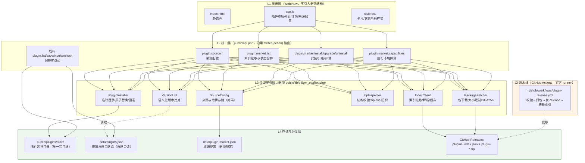
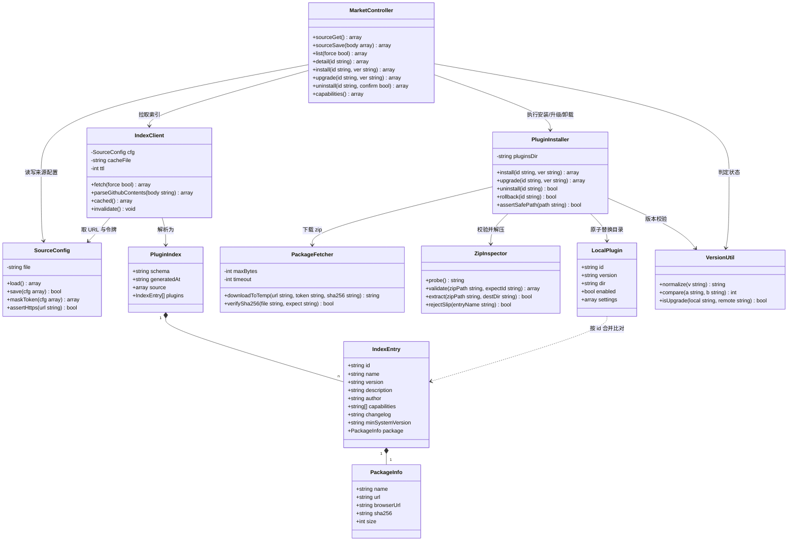
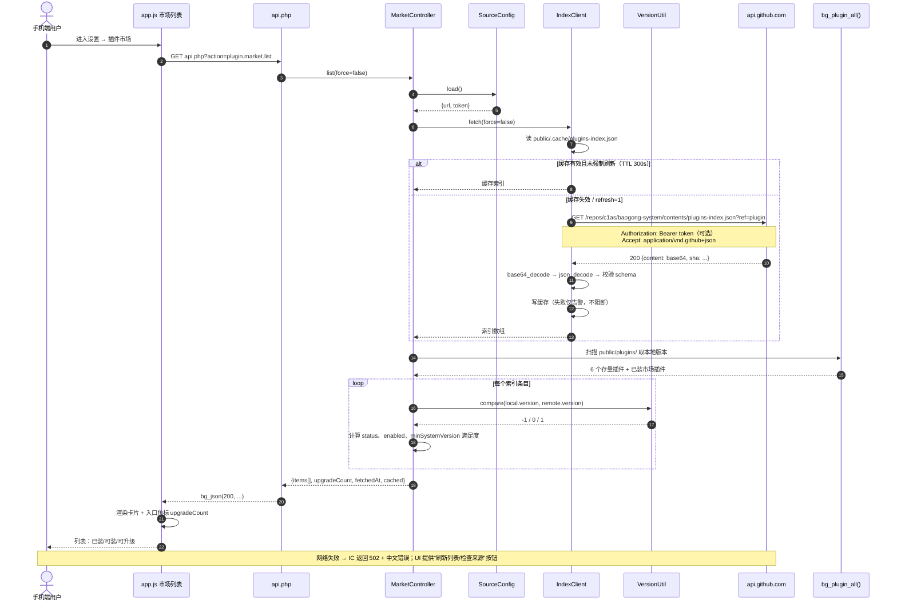
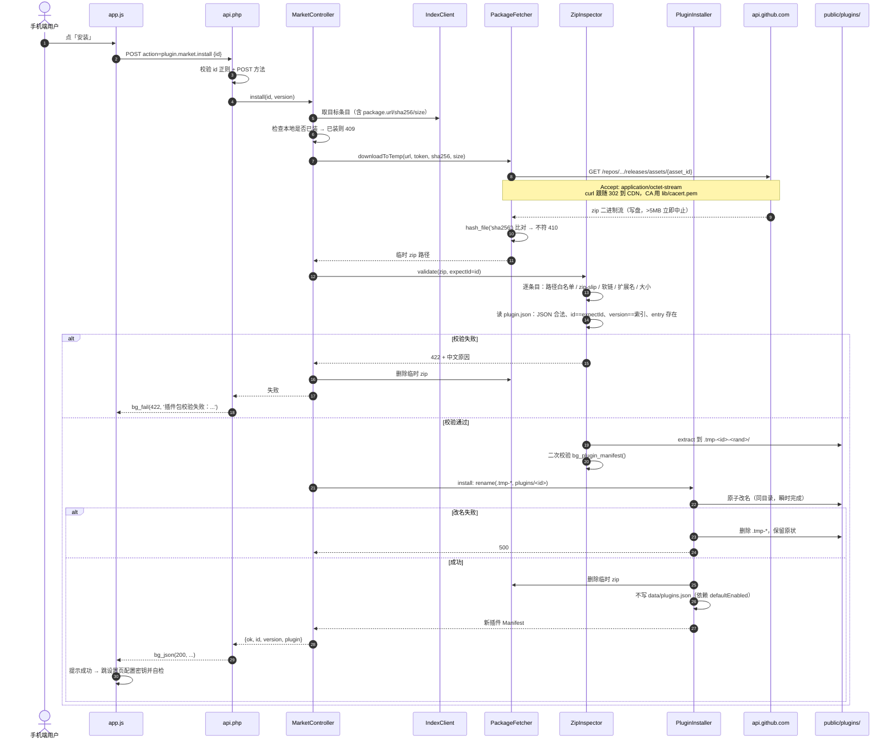
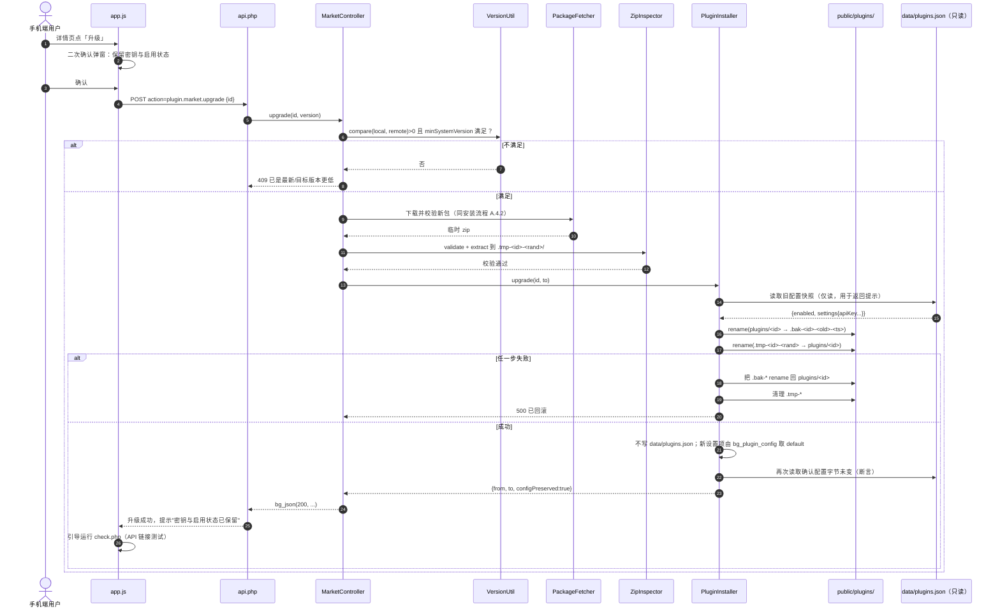
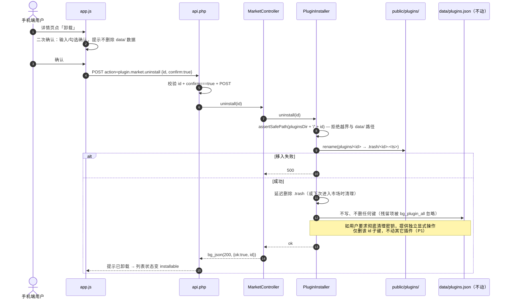
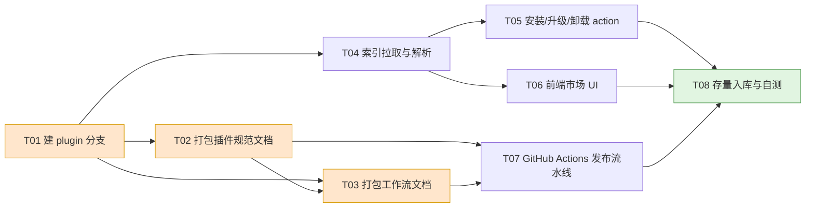

# 报工系统 · 插件市场 架构设计与任务分解

> 文档版本：v1.0 ｜ 作者：高见远（Gao，架构师） ｜ 日期：2026-11-24
> 上游输入：许清楚（Xu）《插件市场-PRD》v0.1
> 目标仓库：`c1as/baogong-system`（本地 `/tmp/gl-system`）｜开发分支：`plugin`
> 关联仓库：`c1as/baogong-server`（安卓壳，本地 `/workspace/BaogongServer`，App v2.5）
> 本文只做设计，不含实现代码；所有路径均相对 `baogong-system` 仓库根目录。

---

## 0. 决策基线（已确认，设计不再推翻）

| # | 已定事项 | 本设计的落点 |
| --- | --- | --- |
| D1 | 分发平台**统一 GitHub Releases**，不用 GitLab Generic Package Registry | 索引与插件包都挂 GitHub Release；`.gitlab-ci.yml` 仅作历史参考，不沿用其鉴权方式 |
| D2 | 服务端仓 `c1as/baogong-system`，App 仓 `c1as/baogong-server`；插件包与索引发布在 baogong-system 的 Release | `plugin-<id>-vX.Y.Z` tag 触发；与 `web-v*` 系统热更 tag 互不干扰 |
| D3 | App v2.5 已从 GitHub Releases 拉 `web-v*`，可选版本/可回退，导入多选/整文件夹，只覆盖 `public/` 不碰 `data/` | 插件市场**完全在 PHP 后端实现**，不改 APK、复用同一出网与 CA 约定 |
| D4 | 沙箱直连 `github.com` 超时，但 `api.github.com` 可达；GitHub MCP（账号 c1as）已认证 | **运行时下载一律走 `api.github.com`**，连包资产也用 API 资产端点；CI 在官方 runner 上可直连 |
| D5 | 签名等 Secrets 由 GitHub Actions Secrets 管理（App 仓已配 4 个） | 插件发布 CI 只用内置 `GITHUB_TOKEN`，**不新增任何 Secret** |
| D6 | 新建插件分支，建议名 `plugin` | T01 为首个交付任务，是所有后续任务的基线 |

---

# Part A · 系统架构设计

## A.1 实现方案：整体架构分层

插件市场不是新建一套系统，而是在**现有单文件 PHP 路由 + 纯 PHP 插件机制**上增加一层"分发与安装"能力。共四层 + 一条 CI 流水线：



### A.1.1 各层职责与边界

| 层 | 职责 | 明确不做 |
| --- | --- | --- |
| L1 展示层 | 只发 `api.php?action=...` 请求、渲染列表/详情、来源配置表单、二次确认弹窗 | 不解析 zip、不拼 GitHub URL、不接触令牌 |
| L2 接口层 | 参数强校验、方法校验、调用 L3、用现有 `bg_json`/`bg_fail` 输出 | 不写下载/解压逻辑（api.php 已 15 万字节，不再膨胀） |
| L3 服务层 | 新文件 `public/lib/plugin_market.php` 承载全部领域逻辑，可独立测试 | 不碰 `data/plugins.json` 的写操作 |
| L4 存储层 | `plugins/` 是唯一安装写目标；`data/` 除新增来源配置外只读 | 安装/升级/卸载绝不写 `data/` |
| CI | tag 驱动打包、检索引擎生成、索引 upsert | 不覆盖 `web-v*` 的任何资产 |

### A.1.2 关键决策：插件热更新的执行主体 = **PHP 后端直接下载 + 解压**（不改 APK）

| 论证维度 | PHP 后端（采用） | App 原生介入（不采用） |
| --- | --- | --- |
| 出网能力 | `lib/net.php` 已有 `bg_http()`：curl + `cacert.pem` + 跟随 3 次跳转 + 超时，自检已验证可用；新增下载函数复用 `bg_ca_file()` 即可 | 需改 Java/Kotlin 并随 APK 发版，用户不一定升级 APK |
| 写权限 | `public/plugins/` 与前端静态资源同目录，App 写入 `public/` 的热更流程已证明该路径可写（RepoUpdater 用 `public_new → public` 替换） | 原生需重复实现 zip 解压与目录替换，逻辑与 PHP 侧割裂 |
| 与现有机制契合 | 插件发现是 `bg_plugin_all()` 扫描目录，解压完即自动生效，**零注册、零重启** | 原生装完仍要通知 WebView 刷新，多一层桥接 |
| 回滚 | 目录级 `rename` 即可原子替换，和 App 更新 `public_old` 思路一致 | 需 Java 侧再写一套回滚 |
| 可测试 | 用 `plugin.market.*` action 直接 curl 测试，无需模拟器 | 强依赖设备调试 |
| 成本 | 新增 1 个 PHP 文件 + 若干 action | 至少改 3~4 个 Java 文件 + APK 发布 |

> **结论**：采用 PHP 后端方案。唯一前置风险是**内嵌 PHP 是否编译了 zip 扩展**（现有代码未见 `ZipArchive` 使用，App 侧解压由 Java 完成）。对策见 A.2 技术选型：优先 `ZipArchive`，缺失时回退到**纯 PHP 最小 ZIP 读取器**，并通过 `plugin.market.capabilities` 在真机上先探测，不让用户在安装时才发现能力缺失。

### A.1.3 关键技术选型与取舍

| 主题 | 选型 | 理由 / 取舍 |
| --- | --- | --- |
| 后端语言 | PHP 原生，无 Composer | 与 `api.php`/插件运行时完全一致，避免引入 autoload 与依赖目录 |
| HTTP | 复用 `lib/net.php` 的 `bg_ca_file()` + curl 选项；新增 `bg_pm_download_to_file()` 流式写盘 | `bg_http()` 返回内存字符串，5MB 包可用但流式更安全、可做字节上限 |
| 索引/包地址 | **一律 `api.github.com`**：索引用 `/repos/{o}/{r}/contents/plugins-index.json?ref=plugin`；包用 `/repos/{o}/{r}/releases/assets/{asset_id}` + `Accept: application/octet-stream` | 绕开沙箱与部分网络下 `github.com` / `raw.githubusercontent.com` 不通的问题；`bg_http` 已跟随跳转，最终 CDN 地址由 302 给出 |
| zip 解压 | 优先 `ZipArchive`；`class_exists('ZipArchive')` 为假时用纯 PHP 读取 local file header + `gzinflate` | 不新增 `.so`、不依赖 App 改动；纯 PHP 读取器只支持 store/deflate，正好覆盖 `zip`/`jar` 产物 |
| 版本比对 | 语义化版本 `X.Y.Z`（容忍前缀 `v`、预发布后缀），自实现整数三段比较 | PHP `version_compare` 对预发布规则不够直观，自实现可明确"预发布 < 正式" |
| 状态合并 | 索引为准、本地 `bg_plugin_all()` 为实；比对结果在响应里给出，前端不做版本判断 | 前后端职责清晰，前端样式再复杂也不影响正确性 |
| 前端 | 现有 `app.js` 单文件加模块函数 + `style.css` 加样式，**不引 React** | PRD 明确约束；`index.html` 只把缓存号 `?v=2.6` → `?v=2.7` |
| 索引更新 | CI 把 `plugins-index.json` 提交回 `plugin` 分支；运行时从 Contents API 读 | 索引与代码同仓、可审计；Contents API 有缓存，注意加 `?ref=plugin&t=<ts>` 或用 `Cache-Control: no-store` |
| 索引缓存 | `public/.cache/plugins-index.json`，TTL 300 秒，`?refresh=1` 强制失效 | 隐藏目录不会被 `bg_plugin_all()` 发现；放 `public/` 而非 `data/` 以保持"data 零覆盖"；系统更新后自然重建 |

---

## A.2 文件列表（相对 `baogong-system` 仓库路径）

### A.2.1 本次核心交付（T01–T03，用户明确要求）

| 文件 | 动作 | 职责（一句话） |
| --- | --- | --- |
| `plugin` 分支 | 新建 | 从 `main` 切出插件开发/发布基线分支，承载以下全部交付与后续插件发布。 |
| `docs/打包插件规范文档.md` | 新增 | 定义插件目录/id 规则、`plugin.json` 契约（完全沿用现有文档 §3）、zip 根层级布局、大小上限、版本规则与入库校验清单。 |
| `docs/打包工作流文档.md` | 新增 | 定义"本地自检 → 打 `plugin-<id>-vX.Y.Z` tag → CI 校验/打包/发 Release/更新索引 → 手机端升级"的完整流程、失败处理与权限边界。 |

> 两份文档落在 `docs/` 下的**正式文件名即上表名称**；PRD §6.3/§6.4 的要点大纲作为章节骨架，不新建其他同义文档。

### A.2.2 后端

| 文件 | 动作 | 职责（一句话） |
| --- | --- | --- |
| `public/api.php` | 修改 | 在 `switch ($action)` 中新增 8 个 `plugin.source.*` / `plugin.market.*` 分支，参数校验后委托给服务层。 |
| `public/lib/plugin_market.php` | 新增 | 插件市场全部领域逻辑：索引拉取解析、版本比对、下载校验、zip 检查、原子安装/升级/卸载、来源配置。 |
| `public/lib/net.php` | 不改（可选微调） | 仅复用 `bg_http()`/`bg_ca_file()`；若需下载字节上限，在 `plugin_market.php` 内封装，不改本文件。 |

### A.2.3 前端

| 文件 | 动作 | 职责（一句话） |
| --- | --- | --- |
| `public/index.html` | 修改 | 把 `style.css` / `app.js` 的缓存号由 `?v=2.6` 升到 `?v=2.7`，确保 WebView 加载新市场 UI。 |
| `public/app.js` | 修改 | 新增插件市场列表页、详情页、来源配置页与操作函数，并接上设置页入口与可升级角标。 |
| `public/style.css` | 修改 | 新增市场卡片、状态标签（可安装/可升级/已安装/来源无记录）、进度与错误条的样式。 |

### A.2.4 CI 与索引

| 文件 | 动作 | 职责（一句话） |
| --- | --- | --- |
| `.github/workflows/plugin-release.yml` | 新增 | 监听 `plugin-<id>-vX.Y.Z` tag，校验清单 → 打 zip → 建 Release 上传资产 → upsert 并提交 `plugins-index.json`。 |
| `plugins-index.json` | 新增（仓库根，`plugin` 分支） | 全量插件索引，市场列表与版本比对的唯一数据源，由 CI 自动生成/更新，人工不手改。 |
| `.gitignore`（如存在则修改） | 修改 | 忽略 `public/.cache/`、`public/plugins/.tmp-*`、`public/plugins/.bak-*`，避免临时目录被提交。 |

### A.2.5 种子插件（存量 6 个）

`public/plugins/{mock-ocr,baidu-ocr,qwen35-ocr,mimo-v26-flash,ocr-ensemble,ocr-log}/` —— **文件零改动**，仅由 CI 读取 `plugin.json` 生成首版索引与Release。

### A.2.6 文档补充

| 文件 | 动作 | 职责 |
| --- | --- | --- |
| `docs/插件市场-架构设计.md` | 新增 | 本文，设计与任务分解基线。 |

---

## A.3 数据结构与接口

### A.3.1 类图（服务层与数据模型）



### A.3.2 `plugins-index.json` 索引结构

存放位置：`c1as/baogong-system` 仓库根目录、`plugin` 分支；运行时默认地址：

```
https://api.github.com/repos/c1as/baogong-system/contents/plugins-index.json?ref=plugin
```

| 字段 | 类型 | 必填 | 说明 |
| --- | --- | --- | --- |
| `schema` | string | 是 | 固定 `baogong-plugin-index/1`，不匹配则拒绝解析 |
| `generatedAt` | string | 是 | ISO 8601 带时区，如 `2026-11-24T10:00:00+08:00` |
| `source.repo` | string | 是 | `c1as/baogong-system` |
| `source.branch` | string | 是 | `plugin` |
| `source.tagPattern` | string | 是 | `plugin-<id>-vX.Y.Z`，仅供展示 |
| `plugins[]` | array | 是 | 插件条目数组 |
| `plugins[].id` | string | 是 | `^[a-z0-9][a-z0-9-]{0,31}$`，与目录名、zip 内 `plugin.json.id` 三者一致 |
| `plugins[].name` | string | 否 | 展示名，≤40 字；CI 从 `plugin.json` 同步 |
| `plugins[].version` | string | 是 | 语义化版本；CI 从 `plugin.json` 同步 |
| `plugins[].description` | string | 否 | ≤200 字，从 `plugin.json` 同步 |
| `plugins[].author` | string | 否 | ≤40 字 |
| `plugins[].capabilities` | string[] | 否 | 白名单：`report.ocr` / `report.ocr.fusion` / `report.ocr.log` |
| `plugins[].entry` / `check` / `defaultEnabled` / `settings` | — | 否 | 从 `plugin.json` 同步，供详情页展示，避免下载包才能渲染 |
| `plugins[].changelog` | string | 否 | 本版本变更说明，≤500 字，来自 tag 提交说明或 `CHANGELOG.md` |
| `plugins[].minSystemVersion` | string | 否 | 最低系统版本，如 `2.6.0`；低于时不显示升级按钮 |
| `plugins[].releasedAt` | string | 否 | ISO 8601 |
| `plugins[].tag` | string | 是 | `plugin-<id>-v<version>` |
| `plugins[].package.name` | string | 是 | `plugin-<id>-v<version>.zip` |
| `plugins[].package.url` | string | 是 | **API 资产端点**：`https://api.github.com/repos/c1as/baogong-system/releases/assets/<asset_id>` |
| `plugins[].package.browserUrl` | string | 否 | Release 直链，仅展示/兜底，不优先使用 |
| `plugins[].package.sha256` | string | 是 | 64 位十六进制，下载后强制校验 |
| `plugins[].package.size` | int | 是 | 字节数，>5242880 直接拒绝 |

完整示例（单个条目）：

```json
{
  "schema": "baogong-plugin-index/1",
  "generatedAt": "2026-11-24T10:00:00+08:00",
  "source": {
    "repo": "c1as/baogong-system",
    "branch": "plugin",
    "tagPattern": "plugin-<id>-vX.Y.Z"
  },
  "plugins": [
    {
      "id": "baidu-ocr",
      "name": "百度云 OCR",
      "version": "1.3.0",
      "description": "调用百度通用 OCR，含超时重试。",
      "author": "baogong",
      "capabilities": ["report.ocr"],
      "entry": "handler.php",
      "check": "check.php",
      "defaultEnabled": true,
      "changelog": "优化超时重试与错误提示",
      "minSystemVersion": "2.6.0",
      "releasedAt": "2026-11-24T09:30:00+08:00",
      "tag": "plugin-baidu-ocr-v1.3.0",
      "package": {
        "name": "plugin-baidu-ocr-v1.3.0.zip",
        "url": "https://api.github.com/repos/c1as/baogong-system/releases/assets/12345678",
        "browserUrl": "https://github.com/c1as/baogong-system/releases/download/plugin-baidu-ocr-v1.3.0/plugin-baidu-ocr-v1.3.0.zip",
        "sha256": "9f86d081884c7d659a2feaa0c55ad015a3bf4f1b2b0b822cd15d6c15b0f00a08",
        "size": 41233
      }
    }
  ]
}
```

### A.3.3 新增 `api.php` action 接口

> **响应约定不新增风格**：成功沿用 `bg_json(200, {...})`，失败沿用 `bg_fail(status, '中文消息')` → HTTP 状态码 + `{"error":"..."}`。**不引入 `{code,data,message}` 包装**，避免前端大改。所有 action 位于现有 `bg_authed()` 之后，自动继承登录校验；写操作强制 `POST`。

| action | 方法 | 请求参数 | 成功响应 | 失败状态 |
| --- | --- | --- | --- | --- |
| `plugin.market.capabilities` | GET | — | `{zip: "ziparchive"\|"purephp"\|"none", curl: bool, pluginsWritable: bool}` | — |
| `plugin.source.get` | GET | — | `{source: {name, url, tokenMasked, updatedAt}}` | — |
| `plugin.source.save` | POST | `{name, url, token?}`（`token` 省略或 `********` 表示保持原值） | `{ok:true, source:{...}}` | 400/403 |
| `plugin.source.test` | POST | `{url, token?}`（可空=用已存配置） | `{ok:true, count:6, ms:320}` | 400/502 |
| `plugin.market.list` | GET | `?refresh=1` 强制绕过缓存 | `{source, items:[MarketItem], upgradeCount, fetchedAt, cached}` | 502 |
| `plugin.market.detail` | GET | `?id=baidu-ocr` | `{item:IndexEntry, local:{version,enabled}\|null, changelog, minSystemVersion}` | 400/404 |
| `plugin.market.install` | POST | `{id, version?}`（缺省取索引最新） | `{ok:true, id, version, plugin:bg_plugin_public(...)}` | 400/404/409/413/422/500/502 |
| `plugin.market.upgrade` | POST | `{id, version?}` | `{ok:true, id, from, to, configPreserved:true, plugin:{...}}` | 400/404/409/413/422/500/502 |
| `plugin.market.uninstall` | POST | `{id, confirm:true}` | `{ok:true, id}` | 400/404/500 |
| `plugin.market.rollback` | POST | `{id}`（P1） | `{ok:true, id, to}` | 404/500 |

**`MarketItem` 状态对象**：

| 字段 | 说明 |
| --- | --- |
| `id` / `name` / `version`（远端）/ `description` / `author` / `capabilities` / `changelog` | 来自索引 |
| `localVersion` | 本地 `plugin.json` 的 version，未安装为 `null` |
| `status` | `installable` / `installed` / `upgradable` / `local_newer` / `unmanaged` |
| `enabled` | 本地启用状态，未安装为 `null` |
| `hasCheck` | 本地是否有自检脚本 |
| `packageSize` | 包字节数，供 UI 提示 |

**状态判定表**（`VersionUtil::compare(local, remote)` 返回 -1/0/1）：

| 本地存在 | 比对结果 | `status` | UI 按钮 |
| --- | --- | --- | --- |
| 否 | — | `installable` | 详情 / 安装 |
| 是 | `local < remote` 且满足 `minSystemVersion` | `upgradable` | 详情 / 升级 / 设置 / 卸载 |
| 是 | 相等 | `installed` | 详情 / 设置 / 卸载 |
| 是 | `local > remote` | `local_newer` | 详情 / 设置 / 卸载（提示"本地较新"） |
| 是，索引无此 id | — | `unmanaged` | 仅设置 / 卸载（本地插件列表归并展示） |

**错误码语义表**（沿用 HTTP 状态码）：

| 状态 | 场景 |
| --- | --- |
| 400 | id/url/version 参数非法、请求方法不对、`confirm != true` |
| 403 | 来源未配置或不是 HTTPS、来源配置无写权限 |
| 404 | 索引无此 id、本地未安装、目标版本不存在 |
| 409 | 已是该版本、目标版本低于本地、并发操作冲突 |
| 410 | 包下载失败（网络/404）或 SHA256 不符 |
| 413 | 包 >5MB、解压后总量超限、文件数超限 |
| 422 | zip 结构不合规（zip-slip / 无 plugin.json / id 不一致 / 非法扩展名） |
| 500 | 目录重命名或解压失败（已尽力回滚） |
| 502 | 索引不可达 / JSON 解析失败 / schema 不匹配 |

### A.3.4 插件包 zip 布局规范

```
plugin-baidu-ocr-v1.3.0.zip          ← 文件名 = tag + .zip，仅用于展示
├── plugin.json                       ← 必填，id/version 与索引、tag 一致
├── handler.php                       ← 必填，文件名 = plugin.json.entry
├── check.php                         ← 可选，文件名 = plugin.json.check
├── lib.php / shared.php              ← 可选，由 handler 手动 require
├── README.md / CHANGELOG.md          ← 可选
└── (assets/*.png 等小型资源，可选)
```

硬性规则：

1. **根目录直接是插件内容**，禁止再套一层 `baidu-ocr/` 目录（避免解析歧义）。
2. 必须含且只含**一个** `plugin.json`，位于 zip 根。
3. `plugin.json.id` 必须与目标目录名、索引 id、`package.name` 中的 id 四者一致。
4. 禁止出现：`data/`、`../`、绝对路径 `/`、反斜杠 `\`、空字节、符号链接、`.user.ini`、`.htaccess`。
5. 扩展名白名单：`.php .json .md .txt .css .js .png .jpg .jpeg .webp .svg`；其余一律拒绝。
6. 单包 ≤ 5,242,880 字节（5MB）；解压后 ≤ 20MB；文件数 ≤ 100；目录深度 ≤ 3。
7. 存量 6 插件**按现有目录直接 `zip -r` 打包即可**，无需改一行代码。

### A.3.5 版本比对算法

```
normalize(v):
    s = trim(v)
    s = 去掉开头的 v / V
    core, sep, pre = 按第一个 '-' 或 '+' 切分
    parts = explode('.', core)  →  取前 3 段，不足补 '0'，每段转 int（非数字按 0）
    return { core: parts, hasPre: sep != '' && pre != '', pre: pre }

compare(a, b):
    na = normalize(a), nb = normalize(b)
    逐段比较 na.core[i] vs nb.core[i]：大者返回 1，小者返回 -1
    三段全等时：
      两者都无预发布 → 0
      a 有 b 无   → -1        （1.2.0-beta.1 < 1.2.0）
      a 无 b 有   → 1
      都有       → strcmp(na.pre, nb.pre) 符号化
```

示例：`v1.10.0 > 1.9.0`、`1.2.0-beta.1 < 1.2.0`、`1.3.0 == v1.3.0`、`0.1.0 < 1.0.0`。
`isUpgrade(local, remote)` 要求 `compare(remote, local) > 0` 且 `minSystemVersion` 满足，否则不给升级按钮。

### A.3.6 安装/升级原子替换与回滚目录结构

```
public/plugins/
├── baidu-ocr/                          ← 当前生效版本（替换成功前始终可用）
├── .tmp-baidu-ocr-a1b2c3/              ← 解压目标（'.' 开头被 bg_plugin_all() 自动忽略）
├── .bak-baidu-ocr-1.3.0-20261124/      ← 升级前的旧版本（保留供 P1 回退）
└── .trash/                             ← 卸载时先移入，确认无误后再删（可捡回）

public/.cache/
├── plugins-index.json                  ← 索引缓存（TTL 300s）
└── pm-download-<rand>.zip              ← 下载暂存（校验通过后解压，随后删除）
```

**升级 7 步（任一步失败即走回滚）**：

1. 以 `id` 从索引取目标条目，校验 `minSystemVersion` 与 id 合法性；
2. `PackageFetcher` 下载到 `public/.cache/pm-download-<rand>.zip`，字节上限 5MB，校验 SHA256；
3. `ZipInspector::validate()` 静态检查结构（不解压）：路径白名单、zip-slip、扩展名、`plugin.json` 合法、id/version 与索引一致、`entry` 存在；
4. 解压到 `public/plugins/.tmp-<id>-<rand>/`，再跑一次Manifest 校验（复用 `bg_plugin_manifest()`，它天然要求目录名 == id）；
5. `rename(plugins/<id>, plugins/.bak-<id>-<oldver>-<ts>)` 备份旧版（安装新插件时跳过此步）；
6. `rename(.tmp-<id>-<rand>, plugins/<id>)` 原子生效；
7. 成功：删除下载暂存；保留 `.bak-*` 供回退（P1，且清理策略见 G.3）。
   失败：若第 5 步已做则把 `.bak-*` rename 回 `<id>`；删除 `.tmp-*`；返回 500 + 中文错误。

> **配置保留的保证**：`data/plugins.json` 全程不打开写句柄。密钥与启用状态以 id 为键存在其中，升级后 `bg_plugin_config()` 按新清单的 settings 逐项取值——旧键原样使用，新增配置项取清单 `default`，被移除的键静默忽略。因此"密钥不丢 + 新配置项有合理默认值"自然成立。

---

## A.4 程序调用流程（Mermaid 时序图）

### A.4.1 拉取索引并展示列表



### A.4.2 安装插件



### A.4.3 升级插件（保留配置）



### A.4.4 卸载插件



---

## A.5 安全设计

| 风险 | 代码层防护 |
| --- | --- |
| **zip-slip** | `ZipInspector::rejectSlip()`：拒绝含 `..` 段、以 `/` 或盘符开头、含 `\`、含 `\0`、含冒号的条目；解压后对每个文件 `realpath()` 校验必须仍位于 `.tmp-<id>-*` 内；拒绝外部属性和 Unix mode 标记为符号链接/设备文件的条目。 |
| **id / 目录名强校验** | 统一正则 `^[a-z0-9][a-z0-9-]{0,31}$`；四 id 一致（tar 名/id/索引 id/`plugin.json.id`）；解压目录名强制来自 id 而非包内任意路径；`bg_plugin_manifest()` 的 `basename(dirname($file)) === $id` 作为二次闸门。 |
| **文件大小/结构** | 下载流式计数 >5,242,880 字节立即中止；解压后总量 >20MB、文件数 >100、深度 >3 中止；`plugin.json` 必须位于根且 JSON 合法；`entry` 必须存在且 `.php` 结尾；扩展名白名单；capabilities 白名单。 |
| **哈希校验** | 索引 `package.sha256` 必填；`hash_file('sha256')` 不符即 410，且**先校验后解压**，避免恶意包进入文件系统。 |
| **临时目录 + 原子替换** | 全部写入 `public/plugins/.tmp-*` 与 `public/.cache/`；同分区 `rename` 原子生效；升级保留 `.bak-*`；任何异常都执行"恢复备份 + 清理临时"的回滚函数。 |
| **并发冲突** | 以 id 为键的锁文件 `public/.cache/.lock-<id>`（`flock(LOCK_EX)`），install/upgrade/uninstall 互斥；拿不到锁返回 409。 |
| **GitHub 令牌不落插件代码** | 令牌只存在 `data/plugin-market.json`，API 读取时掩码为 `********`，不出现在 `plugin.market.list` 响应、不写进日志（错误信息统一脱敏 `Bearer ***`）、不写进 Release/索引/插件包/JS。公开仓库默认留空即可，令牌完全可选。 |
| **CI 鉴权** | 只用 GitHub 内置 `GITHUB_TOKEN`（`permissions.contents: write`），无 PAT、无新增 Secret；tag 须通过"提交在 `origin/plugin` 祖先链上"校验，防止任意 tag 发布。 |
| **HTTPS 边界** | `SourceConfig::assertHttps()` 只允许 `https://`；`api.github.com` 与 GitHub 资产 CDN 均 HTTPS；curl 强制 `CURLOPT_SSL_VERIFYPEER`，CA 用 `lib/cacert.pem`。 |
| **`data/` 零覆盖（代码保证）** | 安装服务只持有一个写根目录常量 `bg_plugins_dir()`；所有写操作前调用 `assertSafePath($path)`——规范化后必须位于 `public/plugins/` 内，且不得含 `/data/`、`..`、符号链接；升级/卸载**不打开 `data/plugins.json` 的写句柄**；安装成功后可加断言比对 state 文件哈希不变。 |
| **残留配置隐私** | 卸载保留 `data/plugins.json` 中的孤儿键（不写即不泄露），但提供独立、二次确认的"清除该插件残留配置"，只精确删除该 id 子键。 |

---

# Part B · 任务分解

## B.1 依赖包列表

| 依赖 | 版本 | 用途 | 引入方式 |
| --- | --- | --- | --- |
| PHP 原生函数 | 现有运行时 | `curl_*`、`json_*`、`hash_file`、`gzinflate`、`flock`、`rename`、`version_compare` | 零新增 |
| `lib/net.php` | 现有 | `bg_http()` / `bg_ca_file()` 出网与 CA 约定 | 已存在，`require_once` 即可 |
| `ZipArchive`（PHP zip 扩展） | 可选 | zip 解压首选路径 | 内嵌 PHP 若没有则用纯 PHP 回退，**零新增 .so** |
| `actions/checkout@v4` | v4 | CI 检出 `plugin` 分支 | GitHub Actions 内置 |
| `softprops/action-gh-release@v2` | v2 | 创建 Release 并上传 zip（风格对齐 App 仓 `build-release.yml`） | GitHub Actions |
| `GITHUB_TOKEN` | 内置 | 创建 Release + 推送索引提交 | 无需新增 Secret |
| `zip` 命令行 | runner 预装 | CI 打插件包（ubuntu-latest 自带） | 无需安装 |
| `sha256sum` / `jq` | runner 预装 | CI 生成哈希、拼索引条目 | 无需安装 |

> **第三方新增依赖：0**。前端不引 React/MUI/Tailwind，沿用现有 `app.js`/`style.css`。

## B.2 任务列表（有序，含依赖与估时）

> 估时单位为"人时"，含自测。**T01–T03 是本次用户明确要求的核心交付，必须最先完成并可独立验收。**

| 编号 | 任务 | 涉及文件 | 依赖 | 估时 | 优先级 |
| --- | --- | --- | --- | --- | --- |
| **T01** | **建 `plugin` 插件分支**：从 `main` 切出、推送到 `c1as/baogong-system`，设置后续任务基线；确认分支保护不阻断 CI 推送索引 | （仓库分支，无源码改动） | — | 0.5h | P0 |
| **T02** | **写《打包插件规范文档》**：目录/id 规则、`plugin.json` 契约（沿用现有文档 §3）、zip 根布局、5MB 上限、语义化版本、校验清单、6 个存量插件入库示例 | `docs/打包插件规范文档.md` | T01 | 2h | P0 |
| **T03** | **写《打包工作流文档》**：本地自检 → `plugin-<id>-vX.Y.Z` tag → CI 校验/打包/发 Release/更新索引 → 市场升级；失败处理与权限边界 | `docs/打包工作流文档.md` | T01、T02（引用其校验清单） | 2h | P0 |
| **T04** | 后端索引拉取与解析：来源配置存储、GitHub Contents API 拉取、base64 解析、schema 校验、缓存与强制刷新、语义化版本比对、能力探测 | `public/lib/plugin_market.php`（新建，含 `SourceConfig`/`IndexClient`/`VersionUtil`）、`public/api.php`（挂 source.get/save/test、market.list/detail、capabilities）、`public/index.html`（缓存号） | T01 | 5h | P0 |
| **T05** | 安装/升级/卸载 action：下载+SHA256+zip 校验、临时目录原子替换、回滚、锁、data/ 零覆盖断言、错误码 | `public/lib/plugin_market.php`（补 `PackageFetcher`/`ZipInspector`/`ZipReader`/`PluginInstaller`）、`public/api.php`（挂 install/upgrade/uninstall/rollback）、`.gitignore` | T04 | 7h | P0 |
| **T06** | 前端插件市场 UI：设置页入口+角标、列表页、详情页、来源配置页、二次确认、进度/错误提示；样式与缓存号 | `public/app.js`、`public/style.css`、`public/index.html` | T04（接口就绪） | 6h | P0 |
| **T07** | GitHub Actions 插件发布流水线：tag 校验、祖先链校验、清单校验、打包、建 Release 上传 zip、用 `gh api` 取 asset id 生成并提交 `plugins-index.json`、并发串行 | `.github/workflows/plugin-release.yml`（新建）、`docs/打包工作流文档.md`（回填 CI 实操细节）、`plugins-index.json`（首版占位） | T02、T03 | 5h | P0 |
| **T08** | 存量 6 插件入库与端到端自测：6 个 tag 发布、索引 6 条核对、安装/升级/卸载/回滚全链路、`data/` 哈希不变验证、真机探测 zip 能力 | `public/plugins/*`（只读打包，不改源码）、`plugins-index.json`、`docs/打包插件规范文档.md`（补入库结果表）、`docs/插件市场-架构设计.md`（回填实测结论） | T05、T06、T07 | 4h | P0 |

### B.2.1 任务依赖图



> 关键路径：T01 → T04 → T05 → T08；T02/T03/T06/T07 可并行穿插。T01–T03 三项为本次必须可独立交付的文档与分支成果。

## B.3 共享知识（跨文件约定，工程师必读）

1. **命名**：id 正则 `^[a-z0-9][a-z0-9-]{0,31}$`；tag `plugin-<id>-vX.Y.Z`；包名 `plugin-<id>-v<version>.zip`；临时目录 `.tmp-<id>-<8位随机>`；备份 `.bak-<id>-<oldver>-<yyyymmdd>`；索引 schema `baogong-plugin-index/1`。
2. **目录常量**：插件根只能用 `bg_plugins_dir()`（`public/plugins`）；状态文件只能用 `bg_plugin_state_file()`（`data/plugins.json`，市场只读）；来源配置 `data/plugin-market.json`；缓存与锁 `public/.cache/`（隐藏目录，被插件发现机制跳过）。
3. **响应格式**：沿用现有 `bg_json($status, $data)` 与 `bg_fail($status, '中文')` → `{"error":"..."}`；**不要**引入 `{code,data,message}`。所有中文错误需可读、可直接在 UI 展示。
4. **鉴权**：新增 action 放在 `bg_authed()` 之后；写操作必须 POST + 参数校验；令牌字段掩码串固定 `********`（与 `plugin.save` 的 password 规则一致）。
5. **版本**：语义化 `X.Y.Z`；`version` 只认 `plugin.json`，与系统 `web-v*` 版本完全解耦；比较统一走 `VersionUtil::compare`。
6. **出网**：所有外部请求走 `api.github.com`（沙箱可达）；CA 用 `lib/cacert.pem`；curl 跟随跳转、超时 15s；日志中令牌必须脱敏。
7. **安全闸门**：任何写文件系统前调 `assertSafePath()`；任何 zip 条目先 `rejectSlip()` 再解压；`install/upgrade/uninstall` 用 `flock` 按 id 加锁。
8. **data/ 零覆盖**：安装/升级/卸载不写 `data/plugins.json`；升级后配置由 `bg_plugin_config()` 按新清单合并默认值；卸载只删插件目录。
9. **CI 风格**：对齐 App 仓 `build-release.yml`——`actions/checkout@v4`、`softprops/action-gh-release@v2`、内置 `GITHUB_TOKEN`、`permissions.contents: write`；不新增 Secret，不复用 GitLab 的 Generic Package Registry。
10. **兼容性**：存量 6 插件不改名、不改 `plugin.json`、不升版本；首版索引版本 = 现有 `plugin.json` 的 version（mock-ocr 0.1.0、baidu-ocr 1.3.0、qwen35-ocr 1.0.0、mimo-v26-flash 1.0.0、ocr-ensemble 1.0.0、ocr-log 1.0.0）。

## B.4 待明确事项（Anything UNCLEAR）

| # | 事项 | 我的默认假设 / 建议 | 影响的任务 |
| --- | --- | --- | --- |
| U1 | **系统更新会整目录替换 `public/`**（App `RepoUpdater` 把 `public` 改名 `public_old`，再用 zip 覆盖），因此市场新装的插件若不在下一次 `web-v*` zip 内会消失。PRD §8 又说"系统升级不覆盖 plugins/"——两者矛盾。 | 初版按 PRD 约束不动 App：市场插件清单持久化在索引，`data/` 不动；建议后续让 `web-v*` 打包排除 `plugins/` 或让 RepoUpdater 保留该目录。**需用户拍板是否本轮处理** | T07、T08 |
| U2 | 内嵌 PHP 是否带 zip 扩展？现有代码未提供证据。 | 设计已给纯 PHP 回退与 `capabilities` 探测；T08 必须真机确认，若两者皆无则需改 App（超出本设计范围） | T04、T05、T08 |
| U3 | 升级时"新增配置项默认值"策略（PRD Q7）。 | 默认按"旧键原样保留、新键取清单 default、移除键忽略"，不覆盖插件自带文件——因为插件目录被整体替换，插件自带文件必然更新 | T05、T08 |
| U4 | 卸载是否清理 `data/plugins.json` 残留键（PRD P0-6 与 §8 的措辞冲突）。 | 默认**不写** data，残留键成为孤儿且被忽略；另提供显式清理操作（P1）。需用户确认是否满足"清理启用记录"验收 | T05、T06 |
| U5 | `plugin` 分支向 `main` 的合并节奏（PRD Q8）。 | 建议每个稳定版本合并一次"规范/工具/索引"，`web-v*` 打包时选择性排除 `plugins/` | T01、T07 |
| U6 | 索引缓存 TTL 与私有仓库访问。 | 默认 300s + `?refresh=1`；令牌可选、公开仓库匿名；若仓库保持私有，所有手机必须填令牌，需评估可用性 | T04、T06 |
| U7 | 是否需要包签名（PRD Q3，P2）。 | 初版依赖 HTTPS + SHA256 + 来源配置，不做 Ed25519 签名；如后续要求，签名公钥放索引、验签在 `ZipInspector` 之前 | T05（预留扩展点） |
| U8 | 插件商店是否需要搜索/分类/多来源（P1/P2）。 | 初版只做单来源 + 状态筛选；UI 预留筛选栏扩展位，不在本轮实现 | T06 |

---

## 附：交付验收清单（本次用户明确要求的三项）

| 交付项 | 验收标准 | 对应任务 |
| --- | --- | --- |
| `plugin` 分支 | 远端 `origin/plugin` 存在，从 `main` 切出，CI 可向其推送索引提交 | T01 |
| `docs/打包插件规范文档.md` | 含 id/目录规则、`plugin.json` 契约、zip 布局、5MB 上限、语义化版本、校验清单、6 个存量插件入库示例；工程师可据此独立打出一个合法包 | T02 |
| `docs/打包工作流文档.md` | 含 tag 命名、CI 步骤、索引更新机制、失败处理、权限/鉴权边界；工程师可据此独立发布一个插件到市场 | T03 |
