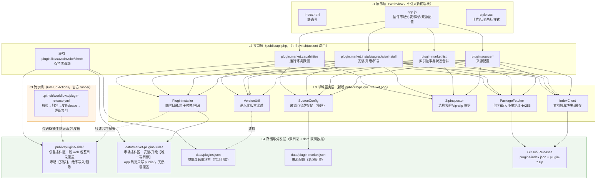
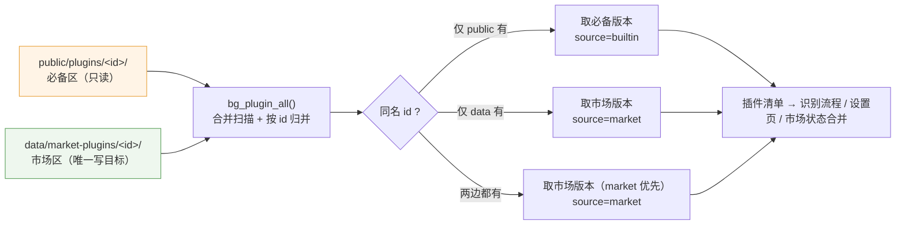
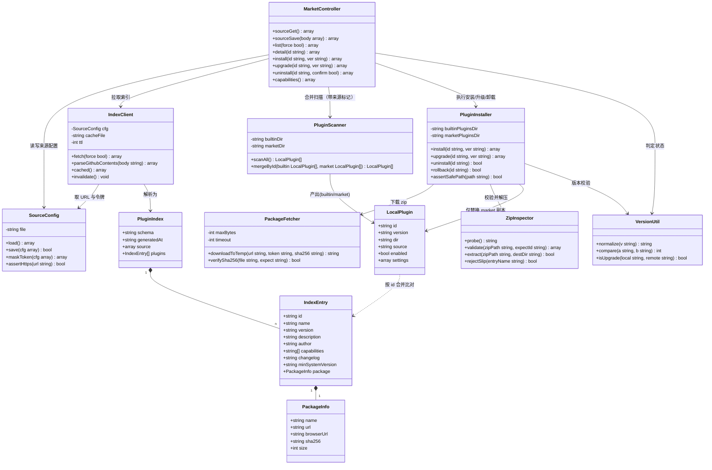
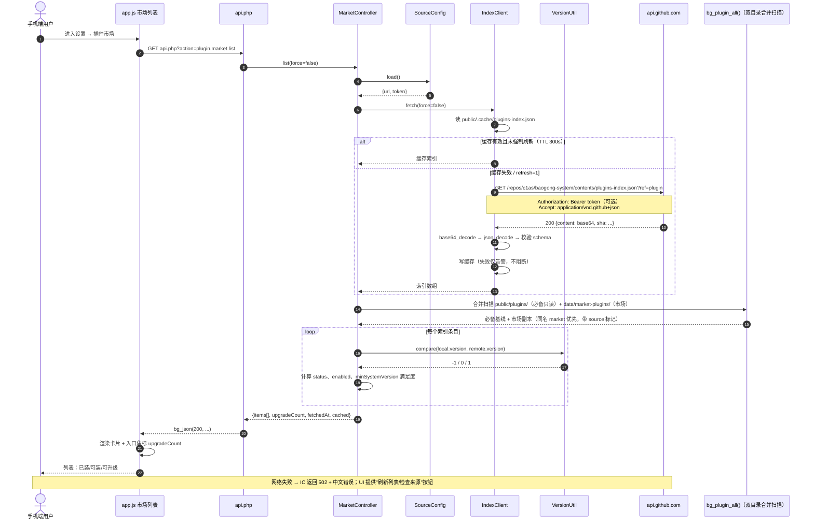
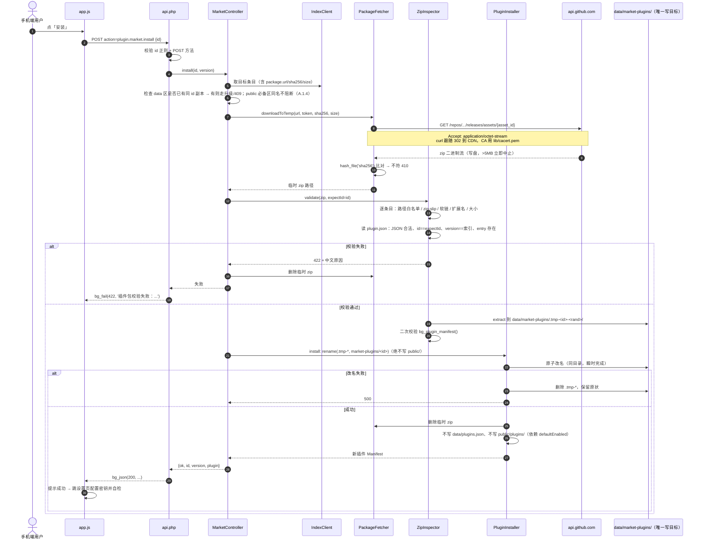
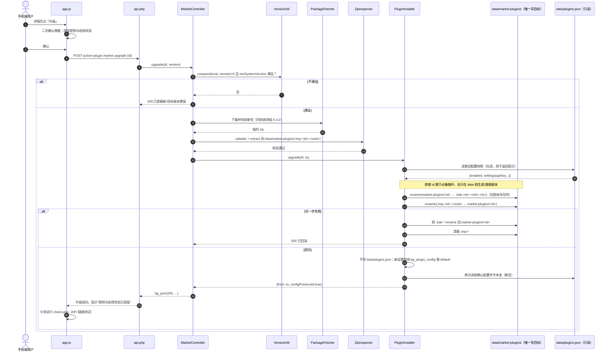
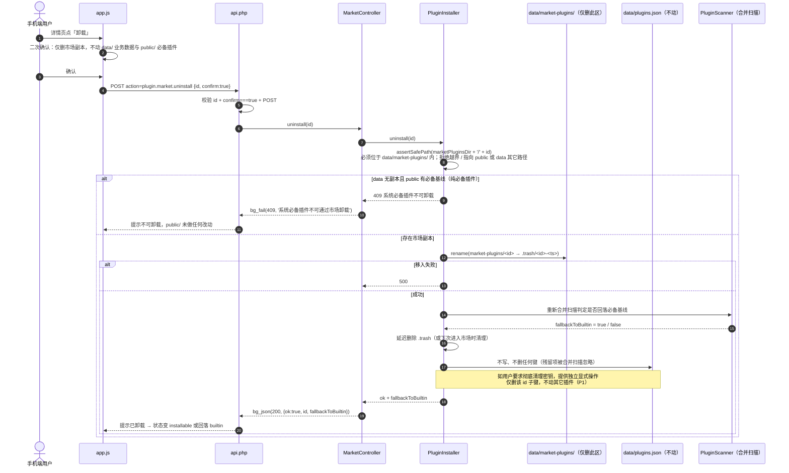
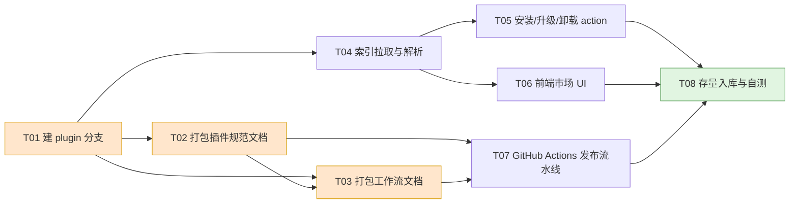

# 报工系统 · 插件市场 架构设计与任务分解

> 文档版本：**v1.1（增量修订）** ｜ 作者：高见远（Gao，架构师） ｜ 初版日期：2026-11-24 ｜ 修订日期：2026-11-24
> 上游输入：许清楚（Xu）《插件市场-PRD》v0.1
> 目标仓库：`c1as/baogong-system`（本地 `/tmp/gl-system`）｜开发分支：`plugin`
> 关联仓库：`c1as/baogong-server`（安卓壳，本地 `/workspace/BaogongServer`，App v2.5）
> 本文只做设计，不含实现代码；所有路径均相对 `baogong-system` 仓库根目录。

> **v1.1 修订摘要（本次）**：根据用户新决策「不能排除 plugins，里面还有必备插件」，把 v1.0 中"建议 `web-v*` 打包排除 `plugins/`"的方向**整体推翻**。改为**双目录策略**：必备插件继续放 `public/plugins/` 随 web 包整目录覆盖；市场新装/升级插件改放 `data/market-plugins/`（App 热更只写 `public/`，天然零覆盖）。相应对 A.1/A.2/A.3/A.4/A.5、B.2/B.3/B.4 做口径统一，并把 B.4 §U1 从"待明确"改为"已定案"，新增《规范文档同步修改清单》。**所有公共口径（id 正则、tag、索引 schema、限额、能力白名单、bg_json/bg_fail 响应）保持不变。**

> **v1.2 策略变更（2026-11-26，以本节为准，覆盖全文涉及"存量 6 插件"的表述）**
> - 主程序包**只内置 3 个插件**：`handwriting-lexicon`、`ocr-ensemble`、`ocr-log`（`public/plugins/`，随 `web-v*` 分发）。
> - 其余识别插件（`baidu-ocr`、`qwen35-ocr`、`mimo-v26-flash`、`tencent-vision`、`mock-ocr`）**不再内置**：源码迁到仓库根 `plugins-src/<id>/`（不进 web 热更包），只以插件包形式经 `plugin-<id>-vX.Y.Z` 流水线发布到市场。
> - `Modifier` 侧双目录机制、market 优先、卸载回落与 409 保护等**实现口径不变**，只是 builtin 区从 6 个缩减为 3 个。
> - 原 D7、A.1.4「存量 6 插件」行、A.2.5、A.3.6 目录树中的 6 插件描述均已按本节修订。

---

## 0. 决策基线（已确认，设计不再推翻）

| # | 已定事项 | 本设计的落点 |
| --- | --- | --- |
| D1 | 分发平台**统一 GitHub Releases**，不用 GitLab Generic Package Registry | 索引与插件包都挂 GitHub Release；`.gitlab-ci.yml` 仅作历史参考，不沿用其鉴权方式 |
| D2 | 服务端仓 `c1as/baogong-system`，App 仓 `c1as/baogong-server`；插件包与索引发布在 baogong-system 的 Release | `plugin-<id>-vX.Y.Z` tag 触发；与 `web-v*` 系统热更 tag 互不干扰 |
| D3 | App v2.5 已从 GitHub Releases 拉 `web-v*`，可选版本/可回退，导入多选/整文件夹，只覆盖 `public/` 不碰 `data/` | 插件市场**完全在 PHP 后端实现**，不改 APK、复用同一出网与 CA 约定 |
| D4 | 沙箱直连 `github.com` 超时，但 `api.github.com` 可达；GitHub MCP（账号 c1as）已认证 | **运行时下载一律走 `api.github.com`**，连包资产也用 API 资产端点；CI 在官方 runner 上可直连 |
| D5 | 签名等 Secrets 由 GitHub Actions Secrets 管理（App 仓已配 4 个） | 插件发布 CI 只用内置 `GITHUB_TOKEN`，**不新增任何 Secret** |
| D6 | 新建插件分支，建议名 `plugin` | T01 为首个交付任务，是所有后续任务的基线 |
| **D7**（v1.1 新增·用户已拍板；v1.2 修订） | **主程序包只内置 `handwriting-lexicon`、`ocr-ensemble`、`ocr-log` 三个插件，随 web 包分发、可被系统更新覆盖；其余识别插件不进 web 包，源码放 `plugins-src/`，只走市场发布** | 市场插件安装到 `data/market-plugins/`（App 热更只写 `public/`，天然零覆盖）；内置/市场双目录并存，详见 A.1.4 与 B.4 §U1 |

---

# Part A · 系统架构设计

## A.1 实现方案：整体架构分层

插件市场不是新建一套系统，而是在**现有单文件 PHP 路由 + 纯 PHP 插件机制**上增加一层"分发与安装"能力。共四层 + 一条 CI 流水线：



### A.1.1 各层职责与边界

| 层 | 职责 | 明确不做 |
| --- | --- | --- |
| L1 展示层 | 只发 `api.php?action=...` 请求、渲染列表/详情、来源配置表单、二次确认弹窗 | 不解析 zip、不拼 GitHub URL、不接触令牌 |
| L2 接口层 | 参数强校验、方法校验、调用 L3、用现有 `bg_json`/`bg_fail` 输出 | 不写下载/解压逻辑（api.php 已 15 万字节，不再膨胀） |
| L3 服务层 | 新文件 `public/lib/plugin_market.php` 承载全部领域逻辑，可独立测试 | 不碰 `data/plugins.json` 的写操作；对 `public/plugins/` 必备区只读 |
| L4 存储层 | **双目录**：`data/market-plugins/` 是市场安装/升级/卸载的**唯一写目标**；`public/plugins/` 必备区只读（由 web 包覆盖）；`data/` 其余既有数据只读 | 市场操作**绝不写 `public/plugins/`**，也绝不写 `data/` 下除 `market-plugins/` 与来源配置外的任何路径 |
| CI | plugin tag 驱动打包与索引 upsert（源目录 `plugins-src/<id>/`）；**web-v* 打包只含 `public/plugins/` 的 3 个内置插件** | 不覆盖 `data/market-plugins/`；不改 `web-v*` 的资产清单约定 |

### A.1.2 关键决策：插件热更新的执行主体 = **PHP 后端直接下载 + 解压**（不改 APK）

| 论证维度 | PHP 后端（采用） | App 原生介入（不采用） |
| --- | --- | --- |
| 出网能力 | `lib/net.php` 已有 `bg_http()`：curl + `cacert.pem` + 跟随 3 次跳转 + 超时，自检已验证可用；新增下载函数复用 `bg_ca_file()` 即可 | 需改 Java/Kotlin 并随 APK 发版，用户不一定升级 APK |
| 写权限 | `data/market-plugins/` 位于 `data/`，是 SQLite/密钥/图片所在的可写数据区；PHP 运行用户对其有写权限（与写 `data/plugins.json` 同级），且**该区不被 App 热更触碰** | 原生需重复实现 zip 解压与目录替换，逻辑与 PHP 侧割裂 |
| 与现有机制契合 | 插件发现 `bg_plugin_all()` 扩展为**合并扫描** `public/plugins/` + `data/market-plugins/`（同名 market 优先，见 A.1.4），解压完即自动生效，**零注册、零重启** | 原生装完仍要通知 WebView 刷新，多一层桥接 |
| **系统更新隔离**（v1.1 新增） | 用户决策要求 `plugins/` 不排除、必备插件随 web 包覆盖。市场插件放 `data/market-plugins/` 后，App 热更（RepoUpdater 只替换 `public/`）**天然不碰 data/**，无需改 APK 即解决"升级成果被系统更新冲掉"的问题 | 原生方案仍需解决同一覆盖矛盾，且要改 APK |
| 回滚 | 目录级 `rename` 即可原子替换，和 App 更新 `public_old` 思路一致 | 需 Java 侧再写一套回滚 |
| 可测试 | 用 `plugin.market.*` action 直接 curl 测试，无需模拟器 | 强依赖设备调试 |
| 成本 | 新增 1 个 PHP 文件 + 若干 action | 至少改 3~4 个 Java 文件 + APK 发布 |

> **结论**：采用 PHP 后端方案，市场插件写入 `data/market-plugins/`，内置 3 个插件（`handwriting-lexicon`/`ocr-ensemble`/`ocr-log`）留在 `public/plugins/` 随 web 包覆盖，其余引擎源码放 `plugins-src/` 只走市场发布——**既保证市场升级成果不被系统更新冲掉，又保持主程序包精简，且零改 APK**。唯一前置风险是**内嵌 PHP 是否编译了 zip 扩展**（现有代码未见 `ZipArchive` 使用，App 侧解压由 Java 完成）。对策见 A.2 技术选型：优先 `ZipArchive`，缺失时回退到**纯 PHP 最小 ZIP 读取器**，并通过 `plugin.market.capabilities` 在真机上先探测，不让用户在安装时才发现能力缺失。

### A.1.3 关键技术选型与取舍

| 主题 | 选型 | 理由 / 取舍 |
| --- | --- | --- |
| 后端语言 | PHP 原生，无 Composer | 与 `api.php`/插件运行时完全一致，避免引入 autoload 与依赖目录 |
| HTTP | 复用 `lib/net.php` 的 `bg_ca_file()` + curl 选项；新增 `bg_pm_download_to_file()` 流式写盘 | `bg_http()` 返回内存字符串，5MB 包可用但流式更安全、可做字节上限 |
| 索引/包地址 | **一律 `api.github.com`**：索引用 `/repos/{o}/{r}/contents/plugins-index.json?ref=plugin`；包用 `/repos/{o}/{r}/releases/assets/{asset_id}` + `Accept: application/octet-stream` | 绕开沙箱与部分网络下 `github.com` / `raw.githubusercontent.com` 不通的问题；`bg_http` 已跟随跳转，最终 CDN 地址由 302 给出 |
| zip 解压 | 优先 `ZipArchive`；`class_exists('ZipArchive')` 为假时用纯 PHP 读取 local file header + `gzinflate` | 不新增 `.so`、不依赖 App 改动；纯 PHP 读取器只支持 store/deflate，正好覆盖 `zip`/`jar` 产物 |
| 版本比对 | 语义化版本 `X.Y.Z`（容忍前缀 `v`、预发布后缀），自实现整数三段比较 | PHP `version_compare` 对预发布规则不够直观，自实现可明确"预发布 < 正式" |
| 状态合并 | 索引为准、本地 `bg_plugin_all()` 为实；比对结果在响应里给出，前端不做版本判断 | 前后端职责清晰，前端样式再复杂也不影响正确性 |
| 前端 | 现有 `app.js` 单文件加模块函数 + `style.css` 加样式，**不引 React** | PRD 明确约束；`index.html` 只把缓存号 `?v=2.6` → `?v=2.7` |
| 索引更新 | CI 把 `plugins-index.json` 提交回 `plugin` 分支；运行时从 Contents API 读 | 索引与代码同仓、可审计；Contents API 有缓存，注意加 `?ref=plugin&t=<ts>` 或用 `Cache-Control: no-store` |
| 索引缓存 | `public/.cache/plugins-index.json`，TTL 300 秒，`?refresh=1` 强制失效 | 隐藏目录不会被 `bg_plugin_all()` 发现；属纯派生数据，系统更新整目录替换 `public/` 后自然重建；与 `data/` 下的配置/业务数据分离 |

---

### A.1.4 双目录策略：必备插件 vs 市场插件（v1.1 核心决策）

> 本节是本次修订的论证主轴，回答用户决策引出的真问题：**在"plugins/ 不排除、必备插件随 web 包覆盖"硬约束下，如何保证市场新装/升级的插件不被系统更新冲掉。**

#### A.1.4.1 定义与存放位置

| 维度 | 必备插件（builtin） | 市场插件（market） |
| --- | --- | --- |
| 定义 | 随 `web-v*` 包分发、系统运行依赖的内置插件 | 用户通过插件市场安装/升级而落盘的插件副本 |
| 存放位置 | `public/plugins/<id>/` | `data/market-plugins/<id>/` |
| 内置插件现状 | ✅ 仅 3 个（`handwriting-lexicon` / `ocr-ensemble` / `ocr-log`）；其余引擎从市场安装 | — |
| 谁写入 | CI 随 web 包整目录覆盖；**市场安装器只读** | PHP 安装器 `PluginInstaller`（**唯一写目标**） |
| 系统更新影响 | 整目录刷新 = 必备基线被更新（**期望行为**） | App 热更只写 `public/`，**天然零覆盖** |
| 来源标记 | `LocalPlugin.source = 'builtin'` | `LocalPlugin.source = 'market'` |

#### A.1.4.2 扫描合并与同名优先级

`bg_plugin_all()` 扩展为**合并扫描**两个目录，以 `id` 为键归并，并给出来源标记：



| 场景 | `public/` 同名 | `data/` 同名 | 实际生效 | 说明 |
| --- | --- | --- | --- | --- |
| 仅内置 | 有 | 无 | 内置版本 | 3 个内置插件初始状态 |
| 仅市场 | 无 | 有 | 市场版本 | 市场新装的非内置插件 |
| 同名 | 有 | 有 | **市场版本（market 优先）** | 市场对必备插件的升级副本覆盖基线 |

**优先级结论：`data/market-plugins/`（市场）优先于 `public/plugins/`（必备）。** 论证：

1. **尊重用户意愿**：用户主动安装/升级某 id，代表其希望使用该版本。若让必备基线覆盖市场副本，则每次系统更新都会把用户的升级"打回原形"，直接违背"市场升级不被冲掉"的诉求。
2. **分层原则**：市场区是"用户态增量层"，必备区是"系统出厂基线层"，增量覆盖基线是通用且可预期的语义。
3. **不会降级**：安装器仅在 `compare(remote, local) > 0` 时落盘升级（A.3.5），因此进入 `data/` 的都是更高版本；同名时 market 优先不会把系统钉死在旧版本。

#### A.1.4.3 安装 / 升级 / 卸载语义

| 操作 | 写目标 | 遇到同名必备插件时 | `data/` 其它区 |
| --- | --- | --- | --- |
| 安装 | 新建 `data/market-plugins/<id>/` | 生成同名市场副本，按 market 优先生效 | 不写 |
| 升级 | 原子替换 `data/market-plugins/<id>/` | 对必备插件的市场升级 = 在 `data/` 生成/刷新副本 | 不写 `data/plugins.json` |
| 卸载 | **仅删** `data/market-plugins/<id>/` | 删除后自动回落 `public/` 必备基线；**纯必备插件（无 market 副本）拒绝卸载**，绝不删 `public/` | 不写、不删任何键 |

#### A.1.4.4 data/ 零覆盖的代码保证与 App 侧对齐

| 保证点 | 代码层落地 |
| --- | --- |
| 唯一写根 | 安装器只持有一个可写根常量 `bg_market_plugins_dir()` = `data/market-plugins/`；`bg_plugins_dir()`（= `public/plugins`）在市场中**只读**。 |
| 路径边界 | `assertSafePath()` 规范化后必须位于 `data/market-plugins/` 内；拒绝 `..`、符号链接、绝对路径；拒绝指向 `public/` 与 `data/` 下其它路径（含 `data/plugins.json`、`data/plugin-market.json`、数据库、图片、日志）。 |
| 配置不写 | 安装/升级/卸载全程不对 `data/plugins.json` 打开写句柄；升级后断言该文件哈希不变；新增配置项由 `bg_plugin_config()` 取清单 `default`。 |
| 与 App 对齐 | App v2.5 `RepoUpdater` 热更只替换 `public/`（`public_new → public`），`data/` 完全不动。因此放在 `data/market-plugins/` 的市场插件**天然享受既有零覆盖契约**——本方案零改 APK，仅复用这一既有行为。 |
| web 包边界 | `web-v*` 打包只含 `public/plugins/` 的 3 个内置插件；`plugins-src/` 不参与 web 包。系统更新只刷新内置基线，不触碰 `data/market-plugins/`。 |

---

## A.2 文件列表（相对 `baogong-system` 仓库路径）

### A.2.1 本次核心交付（T01–T03，用户明确要求）

| 文件 | 动作 | 职责（一句话） |
| --- | --- | --- |
| `plugin` 分支 | 新建 | 从 `main` 切出插件开发/发布基线分支，承载以下全部交付与后续插件发布。 |
| `docs/打包插件规范文档.md` | 新增 | 定义插件目录/id 规则、`plugin.json` 契约（完全沿用现有文档 §3）、zip 根层级布局、大小上限、版本规则与入库校验清单。 |
| `docs/打包工作流文档.md` | 新增 | 定义"本地自检 → 打 `plugin-<id>-vX.Y.Z` tag → CI 校验/打包/发 Release/更新索引 → 手机端升级"的完整流程、失败处理与权限边界。 |

> 两份文档落在 `docs/` 下的**正式文件名即上表名称**；PRD §6.3/§6.4 的要点大纲作为章节骨架，不新建其他同义文档。

### A.2.2 后端

| 文件 | 动作 | 职责（一句话） |
| --- | --- | --- |
| `public/api.php` | 修改 | 在 `switch ($action)` 中新增 8 个 `plugin.source.*` / `plugin.market.*` 分支，参数校验后委托给服务层。 |
| `public/lib/plugin_market.php` | 新增 | 插件市场全部领域逻辑：索引拉取解析、版本比对、下载校验、zip 检查、原子安装/升级/卸载（写 `data/market-plugins/`）、必备/市场双目录合并扫描、来源配置。 |
| `public/lib/net.php` | 不改（可选微调） | 仅复用 `bg_http()`/`bg_ca_file()`；若需下载字节上限，在 `plugin_market.php` 内封装，不改本文件。 |

### A.2.3 前端

| 文件 | 动作 | 职责（一句话） |
| --- | --- | --- |
| `public/index.html` | 修改 | 把 `style.css` / `app.js` 的缓存号由 `?v=2.6` 升到 `?v=2.7`，确保 WebView 加载新市场 UI。 |
| `public/app.js` | 修改 | 新增插件市场列表页、详情页、来源配置页与操作函数，并接上设置页入口与可升级角标。 |
| `public/style.css` | 修改 | 新增市场卡片、状态标签（可安装/可升级/已安装/来源无记录）、进度与错误条的样式。 |

### A.2.4 CI 与索引

| 文件 | 动作 | 职责（一句话） |
| --- | --- | --- |
| `.github/workflows/plugin-release.yml` | 新增 | 监听 `plugin-<id>-vX.Y.Z` tag，校验清单 → 打 zip → 建 Release 上传资产 → upsert 并提交 `plugins-index.json`。 |
| `plugins-index.json` | 新增（仓库根，`plugin` 分支） | 全量插件索引，市场列表与版本比对的唯一数据源，由 CI 自动生成/更新，人工不手改。 |
| `.gitignore`（如存在则修改） | 修改 | 忽略 `public/.cache/`、`data/market-plugins/.tmp-*`、`data/market-plugins/.bak-*`、`data/market-plugins/.trash-*`，避免临时/备份目录被提交（`data/` 通常整体忽略，此处显式声明边界）。 |

### A.2.5 种子插件（v1.2 起为市场 5 个引擎）

`plugins-src/{mock-ocr,baidu-ocr,qwen35-ocr,mimo-v26-flash,tencent-vision}/` —— **非内置插件源码目录，不进 web 热更包**，由 `plugin-<id>-vX.Y.Z` 流水线打包发布；市场安装/升级落盘 `data/market-plugins/<id>/`（见 A.1.4）。内置 3 个插件（`handwriting-lexicon`、`ocr-ensemble`、`ocr-log`）仍在 `public/plugins/`，随 web 包分发。

### A.2.6 文档补充

| 文件 | 动作 | 职责 |
| --- | --- | --- |
| `docs/插件市场-架构设计.md` | 新增 | 本文，设计与任务分解基线。 |

---

## A.3 数据结构与接口

### A.3.1 类图（服务层与数据模型）



> **v1.1 类图要点**：`builtinPluginsDir`（`public/plugins`，只读）与 `marketPluginsDir`（`data/market-plugins`，唯一写根）分离；`PluginScanner` 合并两目录并按"market 优先"归并，`LocalPlugin.source` 记录来源供 UI 与卸载判定；`assertSafePath()` 的允许根是 `marketPluginsDir`，越界到 `public/` 或 `data/` 其它路径一律拒绝。

### A.3.2 `plugins-index.json` 索引结构

存放位置：`c1as/baogong-system` 仓库根目录、`plugin` 分支；运行时默认地址：

```
https://api.github.com/repos/c1as/baogong-system/contents/plugins-index.json?ref=plugin
```

| 字段 | 类型 | 必填 | 说明 |
| --- | --- | --- | --- |
| `schema` | string | 是 | 固定 `baogong-plugin-index/1`，不匹配则拒绝解析 |
| `generatedAt` | string | 是 | ISO 8601 带时区，如 `2026-11-24T10:00:00+08:00` |
| `source.repo` | string | 是 | `c1as/baogong-system` |
| `source.branch` | string | 是 | `plugin` |
| `source.tagPattern` | string | 是 | `plugin-<id>-vX.Y.Z`，仅供展示 |
| `plugins[]` | array | 是 | 插件条目数组 |
| `plugins[].id` | string | 是 | `^[a-z0-9][a-z0-9-]{0,31}$`，与目录名、zip 内 `plugin.json.id` 三者一致 |
| `plugins[].name` | string | 否 | 展示名，≤40 字；CI 从 `plugin.json` 同步 |
| `plugins[].version` | string | 是 | 语义化版本；CI 从 `plugin.json` 同步 |
| `plugins[].description` | string | 否 | ≤200 字，从 `plugin.json` 同步 |
| `plugins[].author` | string | 否 | ≤40 字 |
| `plugins[].capabilities` | string[] | 否 | 白名单：`report.ocr` / `report.ocr.fusion` / `report.ocr.log` |
| `plugins[].entry` / `check` / `defaultEnabled` / `settings` | — | 否 | 从 `plugin.json` 同步，供详情页展示，避免下载包才能渲染 |
| `plugins[].changelog` | string | 否 | 本版本变更说明，≤500 字，来自 tag 提交说明或 `CHANGELOG.md` |
| `plugins[].minSystemVersion` | string | 否 | 最低系统版本，如 `2.6.0`；低于时不显示升级按钮 |
| `plugins[].releasedAt` | string | 否 | ISO 8601 |
| `plugins[].tag` | string | 是 | `plugin-<id>-v<version>` |
| `plugins[].package.name` | string | 是 | `plugin-<id>-v<version>.zip` |
| `plugins[].package.url` | string | 是 | **API 资产端点**：`https://api.github.com/repos/c1as/baogong-system/releases/assets/<asset_id>` |
| `plugins[].package.browserUrl` | string | 否 | Release 直链，仅展示/兜底，不优先使用 |
| `plugins[].package.sha256` | string | 是 | 64 位十六进制，下载后强制校验 |
| `plugins[].package.size` | int | 是 | 字节数，>5242880 直接拒绝 |

完整示例（单个条目）：

```json
{
  "schema": "baogong-plugin-index/1",
  "generatedAt": "2026-11-24T10:00:00+08:00",
  "source": {
    "repo": "c1as/baogong-system",
    "branch": "plugin",
    "tagPattern": "plugin-<id>-vX.Y.Z"
  },
  "plugins": [
    {
      "id": "baidu-ocr",
      "name": "百度云 OCR",
      "version": "1.3.0",
      "description": "调用百度通用 OCR，含超时重试。",
      "author": "baogong",
      "capabilities": ["report.ocr"],
      "entry": "handler.php",
      "check": "check.php",
      "defaultEnabled": true,
      "changelog": "优化超时重试与错误提示",
      "minSystemVersion": "2.6.0",
      "releasedAt": "2026-11-24T09:30:00+08:00",
      "tag": "plugin-baidu-ocr-v1.3.0",
      "package": {
        "name": "plugin-baidu-ocr-v1.3.0.zip",
        "url": "https://api.github.com/repos/c1as/baogong-system/releases/assets/12345678",
        "browserUrl": "https://github.com/c1as/baogong-system/releases/download/plugin-baidu-ocr-v1.3.0/plugin-baidu-ocr-v1.3.0.zip",
        "sha256": "9f86d081884c7d659a2feaa0c55ad015a3bf4f1b2b0b822cd15d6c15b0f00a08",
        "size": 41233
      }
    }
  ]
}
```

### A.3.3 新增 `api.php` action 接口

> **响应约定不新增风格**：成功沿用 `bg_json(200, {...})`，失败沿用 `bg_fail(status, '中文消息')` → HTTP 状态码 + `{"error":"..."}`。**不引入 `{code,data,message}` 包装**，避免前端大改。所有 action 位于现有 `bg_authed()` 之后，自动继承登录校验；写操作强制 `POST`。

| action | 方法 | 请求参数 | 成功响应 | 失败状态 |
| --- | --- | --- | --- | --- |
| `plugin.market.capabilities` | GET | — | `{zip: "ziparchive"\|"purephp"\|"none", curl: bool, marketPluginsWritable: bool, builtinPluginsDir:"public/plugins", marketPluginsDir:"data/market-plugins"}` | — |
| `plugin.source.get` | GET | — | `{source: {name, url, tokenMasked, updatedAt}}` | — |
| `plugin.source.save` | POST | `{name, url, token?}`（`token` 省略或 `********` 表示保持原值） | `{ok:true, source:{...}}` | 400/403 |
| `plugin.source.test` | POST | `{url, token?}`（可空=用已存配置） | `{ok:true, count:6, ms:320}` | 400/502 |
| `plugin.market.list` | GET | `?refresh=1` 强制绕过缓存 | `{source, items:[MarketItem], upgradeCount, fetchedAt, cached}` | 502 |
| `plugin.market.detail` | GET | `?id=baidu-ocr` | `{item:IndexEntry, local:{version,enabled}\|null, changelog, minSystemVersion}` | 400/404 |
| `plugin.market.install` | POST | `{id, version?}`（缺省取索引最新） | `{ok:true, id, version, plugin:bg_plugin_public(...)}` | 400/404/409/413/422/500/502 |
| `plugin.market.upgrade` | POST | `{id, version?}` | `{ok:true, id, from, to, configPreserved:true, plugin:{...}}` | 400/404/409/413/422/500/502 |
| `plugin.market.uninstall` | POST | `{id, confirm:true}` | `{ok:true, id, fallbackToBuiltin:bool}`（删市场副本后是否回落到必备基线） | 400/404/409/500（409=纯必备插件不可卸载） |
| `plugin.market.rollback` | POST | `{id}`（P1） | `{ok:true, id, to}` | 404/500 |

**`MarketItem` 状态对象**：

| 字段 | 说明 |
| --- | --- |
| `id` / `name` / `version`（远端）/ `description` / `author` / `capabilities` / `changelog` | 来自索引 |
| `localVersion` | 本地 `plugin.json` 的 version，未安装为 `null` |
| `status` | `installable` / `installed` / `upgradable` / `local_newer` / `unmanaged` |
| `enabled` | 本地启用状态，未安装为 `null` |
| `hasCheck` | 本地是否有自检脚本 |
| `source` | 当前生效副本来源：`builtin`（必备）/ `market`（市场）；同名时市场优先（A.1.4） |
| `packageSize` | 包字节数，供 UI 提示 |

**状态判定表**（`VersionUtil::compare(local, remote)` 返回 -1/0/1）：

| 本地存在 | 比对结果 | `status` | UI 按钮 |
| --- | --- | --- | --- |
| 否 | — | `installable` | 详情 / 安装 |
| 是 | `local < remote` 且满足 `minSystemVersion` | `upgradable` | 详情 / 升级 / 设置 / 卸载 |
| 是 | 相等 | `installed` | 详情 / 设置 / 卸载 |
| 是 | `local > remote` | `local_newer` | 详情 / 设置 / 卸载（提示"本地较新"） |
| 是，索引无此 id | — | `unmanaged` | 仅设置 / 卸载（本地插件列表归并展示） |

**错误码语义表**（沿用 HTTP 状态码）：

| 状态 | 场景 |
| --- | --- |
| 400 | id/url/version 参数非法、请求方法不对、`confirm != true` |
| 403 | 来源未配置或不是 HTTPS、来源配置无写权限 |
| 404 | 索引无此 id、本地未安装、目标版本不存在 |
| 409 | 已是该版本、目标版本低于本地、并发操作冲突、**卸载纯必备插件（无 market 副本，禁止删 `public/`）** |
| 410 | 包下载失败（网络/404）或 SHA256 不符 |
| 413 | 包 >5MB、解压后总量超限、文件数超限 |
| 422 | zip 结构不合规（zip-slip / 无 plugin.json / id 不一致 / 非法扩展名） |
| 500 | 目录重命名或解压失败（已尽力回滚） |
| 502 | 索引不可达 / JSON 解析失败 / schema 不匹配 |

### A.3.4 插件包 zip 布局规范

```
plugin-baidu-ocr-v1.3.0.zip          ← 文件名 = tag + .zip，仅用于展示
├── plugin.json                       ← 必填，id/version 与索引、tag 一致
├── handler.php                       ← 必填，文件名 = plugin.json.entry
├── check.php                         ← 可选，文件名 = plugin.json.check
├── lib.php / shared.php              ← 可选，由 handler 手动 require
├── README.md / CHANGELOG.md          ← 可选
└── (assets/*.png 等小型资源，可选)
```

硬性规则：

1. **根目录直接是插件内容**，禁止再套一层 `baidu-ocr/` 目录（避免解析歧义）。
2. 必须含且只含**一个** `plugin.json`，位于 zip 根。
3. `plugin.json.id` 必须与目标目录名、索引 id、`package.name` 中的 id 四者一致。
4. 禁止出现：`data/`、`../`、绝对路径 `/`、反斜杠 `\`、空字节、符号链接、`.user.ini`、`.htaccess`。
5. 扩展名白名单：`.php .json .md .txt .css .js .png .jpg .jpeg .webp .svg`；其余一律拒绝。
6. 单包 ≤ 5,242,880 字节（5MB）；解压后 ≤ 20MB；文件数 ≤ 100；目录深度 ≤ 3。
7. 非内置插件源码在 `plugins-src/<id>/`，**按该目录直接 `zip -r` 打包即可**，无需改一行代码；主程序内置的 3 个插件不参与市场发布。
8. **落盘目录与打包源无关**（v1.1 补充）：解压后一律装到 `data/market-plugins/<id>/`。即使打包源是 `plugins-src/` 下的非内置插件，市场升级也只在 `data/` 生成同名副本，**绝不回写 `public/` 或 `plugins-src/`**（见 A.1.4）。

### A.3.5 版本比对算法

```
normalize(v):
    s = trim(v)
    s = 去掉开头的 v / V
    core, sep, pre = 按第一个 '-' 或 '+' 切分
    parts = explode('.', core)  →  取前 3 段，不足补 '0'，每段转 int（非数字按 0）
    return { core: parts, hasPre: sep != '' && pre != '', pre: pre }

compare(a, b):
    na = normalize(a), nb = normalize(b)
    逐段比较 na.core[i] vs nb.core[i]：大者返回 1，小者返回 -1
    三段全等时：
      两者都无预发布 → 0
      a 有 b 无   → -1        （1.2.0-beta.1 < 1.2.0）
      a 无 b 有   → 1
      都有       → strcmp(na.pre, nb.pre) 符号化
```

示例：`v1.10.0 > 1.9.0`、`1.2.0-beta.1 < 1.2.0`、`1.3.0 == v1.3.0`、`0.1.0 < 1.0.0`。
`isUpgrade(local, remote)` 要求 `compare(remote, local) > 0` 且 `minSystemVersion` 满足，否则不给升级按钮。

### A.3.6 安装/升级原子替换与回滚目录结构（双目录）

```
public/plugins/                                   ← 内置插件区（仅 3 个）：市场【只读】，随 web 包整目录覆盖
├── handwriting-lexicon/  ocr-ensemble/  ocr-log/ ← 内置插件基线（文件零改动）
（市场安装器不在此创建 .tmp/.bak/.trash，绝不写入/删除任何文件）

plugins-src/                                      ← 非内置插件源码（不进 web 包）
├── mock-ocr/  baidu-ocr/  qwen35-ocr/  mimo-v26-flash/  tencent-vision/

data/market-plugins/                              ← 市场插件区：市场【唯一写目标】，App 热更零覆盖
├── baidu-ocr/                          ← 市场安装/升级副本（同名时优先于 public 基线）
├── .tmp-baidu-ocr-1.4.0-a1b2c3/        ← 解压目标（'.' 开头被合并扫描自动忽略）
├── .bak-baidu-ocr-1.3.0-20261124/      ← 升级前旧副本（保留供 P1 回退）
└── .trash/                             ← 卸载时先移入，确认无误后再删（可捡回）

data/plugin-market.json                           ← 来源配置（新增；唯一允许的其它 data 写入）
data/plugins.json                                 ← 密钥与启用状态（市场全程只读，不打开写句柄）

public/.cache/
├── plugins-index.json                  ← 索引缓存（TTL 300s；系统更新替换 public/ 后自然重建）
└── pm-download-<rand>.zip              ← 下载暂存（校验通过后解压，随后删除）
```

**升级 7 步（任一步失败即走回滚；全程只在 `data/market-plugins/` 内操作）**：

1. 以 `id` 从索引取目标条目，校验 `minSystemVersion` 与 id 合法性；确定写目标 = `bg_market_plugins_dir()/<id>`；
2. `PackageFetcher` 下载到 `public/.cache/pm-download-<rand>.zip`，字节上限 5MB，校验 SHA256；
3. `ZipInspector::validate()` 静态检查结构（不解压）：路径白名单、zip-slip、扩展名、`plugin.json` 合法、id/version 与索引一致、`entry` 存在；
4. 解压到 `data/market-plugins/.tmp-<id>-<rand>/`，再跑一次 Manifest 校验（复用 `bg_plugin_manifest()`，它天然要求目录名 == id）；
5. 若 `data/market-plugins/<id>` 已存在：`rename(market-plugins/<id>, market-plugins/.bak-<id>-<oldver>-<ts>)` 备份旧副本（首次安装跳过此步；**即使同名必备插件存在也只在 data 侧备份，绝不碰 public/**）；
6. `rename(.tmp-<id>-<rand>, market-plugins/<id>)` 原子生效；
7. 成功：删除下载暂存；保留 `.bak-*` 供回退（P1，且清理策略见 G.3）。
   失败：若第 5 步已做则把 `.bak-*` rename 回 `<id>`；删除 `.tmp-*`；返回 500 + 中文错误。

> **配置保留的保证**：`data/plugins.json` 全程不打开写句柄。密钥与启用状态以 id 为键存在其中，升级后 `bg_plugin_config()` 按新清单的 settings 逐项取值——旧键原样使用，新增配置项取清单 `default`，被移除的键静默忽略。因此"密钥不丢 + 新配置项有合理默认值"自然成立。

> **卸载与回落**（v1.1 新增）：`uninstall` 只把 `data/market-plugins/<id>/` 移入 `.trash/`；删除后 `PluginScanner` 重新合并扫描，若 `public/plugins/<id>/` 存在必备基线则自动回落生效（`fallbackToBuiltin:true`）。若 `data/` 无副本且仅 `public/` 有（纯必备插件），返回 409 + "系统必备插件不可卸载"，**绝不删除 `public/` 下任何文件**。

---

## A.4 程序调用流程（Mermaid 时序图）

### A.4.1 拉取索引并展示列表



### A.4.2 安装插件



### A.4.3 升级插件（保留配置）



### A.4.4 卸载插件（仅删 data 市场副本，必备插件受保护）



---

## A.5 安全设计

| 风险 | 代码层防护 |
| --- | --- |
| **zip-slip** | `ZipInspector::rejectSlip()`：拒绝含 `..` 段、以 `/` 或盘符开头、含 `\`、含 `\0`、含冒号的条目；解压后对每个文件 `realpath()` 校验必须仍位于 `.tmp-<id>-*` 内；拒绝外部属性和 Unix mode 标记为符号链接/设备文件的条目。 |
| **id / 目录名强校验** | 统一正则 `^[a-z0-9][a-z0-9-]{0,31}$`；四 id 一致（zip 包名/目录名/索引 id/`plugin.json.id`）；解压目录名强制来自 id 而非包内任意路径；`bg_plugin_manifest()` 的 `basename(dirname($file)) === $id` 作为二次闸门。 |
| **文件大小/结构** | 下载流式计数 >5,242,880 字节立即中止；解压后总量 >20MB、文件数 >100、深度 >3 中止；`plugin.json` 必须位于根且 JSON 合法；`entry` 必须存在且 `.php` 结尾；扩展名白名单；capabilities 白名单。 |
| **哈希校验** | 索引 `package.sha256` 必填；`hash_file('sha256')` 不符即 410，且**先校验后解压**，避免恶意包进入文件系统。 |
| **临时目录 + 原子替换** | 全部写入 `data/market-plugins/.tmp-*` 与 `public/.cache/`；同分区 `rename` 原子生效；升级保留 `.bak-*`；任何异常都执行"恢复备份 + 清理临时"的回滚函数。`public/plugins/` 内**不产生任何临时/备份目录**。 |
| **并发冲突** | 以 id 为键的锁文件 `public/.cache/.lock-<id>`（`flock(LOCK_EX)`），install/upgrade/uninstall 互斥；拿不到锁返回 409。 |
| **GitHub 令牌不落插件代码** | 令牌只存在 `data/plugin-market.json`，API 读取时掩码为 `********`，不出现在 `plugin.market.list` 响应、不写进日志（错误信息统一脱敏 `Bearer ***`）、不写进 Release/索引/插件包/JS。公开仓库默认留空即可，令牌完全可选。 |
| **CI 鉴权** | 只用 GitHub 内置 `GITHUB_TOKEN`（`permissions.contents: write`），无 PAT、无新增 Secret；tag 须通过"提交在 `origin/plugin` 祖先链上"校验，防止任意 tag 发布。 |
| **HTTPS 边界** | `SourceConfig::assertHttps()` 只允许 `https://`；`api.github.com` 与 GitHub 资产 CDN 均 HTTPS；curl 强制 `CURLOPT_SSL_VERIFYPEER`，CA 用 `lib/cacert.pem`。 |
| **`data/` 零覆盖（v1.1 精确定义 + 代码保证）** | 市场唯一可写根为 `bg_market_plugins_dir()` = `data/market-plugins/`（`bg_plugins_dir()` = `public/plugins` 在市场中**只读**）；所有写操作前调 `assertSafePath($path)`——规范化后必须位于该根内，拒绝 `..`、符号链接、绝对路径，拒绝指向 `public/` 与 `data/` 其它路径（含 `data/plugins.json`、`data/plugin-market.json`、数据库/图片/日志）；升级/卸载**不打开 `data/plugins.json` 的写句柄**，安装后断言 state 文件哈希不变。此处"零覆盖"指 **App 热更不碰 `data/`（既有契约，零改 APK）**，市场仅在 `data/market-plugins/` 这一新子目录写增量，二者不矛盾。 |
| **必备插件只读保护**（v1.1 新增） | 安装/升级遇同名 id 只在 `data/` 生成副本；卸载只删 `data/` 副本；纯必备插件（无 data 副本）卸载直接 409。从代码层杜绝写/删 `public/plugins/`，使 web 包对必备插件的整目录覆盖保持有效。 |
| **残留配置隐私** | 卸载保留 `data/plugins.json` 中的孤儿键（不写即不泄露），但提供独立、二次确认的"清除该插件残留配置"，只精确删除该 id 子键。 |

---

# Part B · 任务分解

## B.1 依赖包列表

| 依赖 | 版本 | 用途 | 引入方式 |
| --- | --- | --- | --- |
| PHP 原生函数 | 现有运行时 | `curl_*`、`json_*`、`hash_file`、`gzinflate`、`flock`、`rename`、`version_compare` | 零新增 |
| `lib/net.php` | 现有 | `bg_http()` / `bg_ca_file()` 出网与 CA 约定 | 已存在，`require_once` 即可 |
| `ZipArchive`（PHP zip 扩展） | 可选 | zip 解压首选路径 | 内嵌 PHP 若没有则用纯 PHP 回退，**零新增 .so** |
| `actions/checkout@v4` | v4 | CI 检出 `plugin` 分支 | GitHub Actions 内置 |
| `softprops/action-gh-release@v2` | v2 | 创建 Release 并上传 zip（风格对齐 App 仓 `build-release.yml`） | GitHub Actions |
| `GITHUB_TOKEN` | 内置 | 创建 Release + 推送索引提交 | 无需新增 Secret |
| `zip` 命令行 | runner 预装 | CI 打插件包（ubuntu-latest 自带） | 无需安装 |
| `sha256sum` / `jq` | runner 预装 | CI 生成哈希、拼索引条目 | 无需安装 |

> **第三方新增依赖：0**。前端不引 React/MUI/Tailwind，沿用现有 `app.js`/`style.css`。

## B.2 任务列表（有序，含依赖与估时）

> 估时单位为"人时"，含自测。**T01–T03 是本次用户明确要求的核心交付，必须最先完成并可独立验收。**

| 编号 | 任务 | 涉及文件 | 依赖 | 估时 | 优先级 |
| --- | --- | --- | --- | --- | --- |
| **T01** | **建 `plugin` 插件分支**：从 `main` 切出、推送到 `c1as/baogong-system`，设置后续任务基线；确认分支保护不阻断 CI 推送索引 | （仓库分支，无源码改动） | — | 0.5h | P0 |
| **T02** | **写《打包插件规范文档》**：目录/id 规则、`plugin.json` 契约（沿用现有文档 §3）、zip 根布局、5MB 上限、语义化版本、校验清单、6 个存量插件入库示例 | `docs/打包插件规范文档.md` | T01 | 2h | P0 |
| **T03** | **写《打包工作流文档》**：本地自检 → `plugin-<id>-vX.Y.Z` tag → CI 校验/打包/发 Release/更新索引 → 市场升级；失败处理与权限边界 | `docs/打包工作流文档.md` | T01、T02（引用其校验清单） | 2h | P0 |
| **T04** | 后端索引拉取与解析：来源配置存储、GitHub Contents API 拉取、base64 解析、schema 校验、缓存与强制刷新、语义化版本比对、能力探测 | `public/lib/plugin_market.php`（新建，含 `SourceConfig`/`IndexClient`/`VersionUtil`）、`public/api.php`（挂 source.get/save/test、market.list/detail、capabilities）、`public/index.html`（缓存号） | T01 | 5h | P0 |
| **T05** | 安装/升级/卸载 action：下载+SHA256+zip 校验、临时目录原子替换、回滚、锁、**双目录隔离与 data 零覆盖断言（写根限 `data/market-plugins/`，必备区只读）**、错误码 | `public/lib/plugin_market.php`（补 `PackageFetcher`/`ZipInspector`/`ZipReader`/`PluginInstaller`）、`public/api.php`（挂 install/upgrade/uninstall/rollback）、`.gitignore` | T04 | 7h | P0 |
| **T06** | 前端插件市场 UI：设置页入口+角标、列表页、详情页、来源配置页、二次确认、进度/错误提示；样式与缓存号 | `public/app.js`、`public/style.css`、`public/index.html` | T04（接口就绪） | 6h | P0 |
| **T07** | GitHub Actions 插件发布流水线：tag 校验、祖先链校验、清单校验、打包、建 Release 上传 zip、用 `gh api` 取 asset id 生成并提交 `plugins-index.json`、并发串行 | `.github/workflows/plugin-release.yml`（新建）、`docs/打包工作流文档.md`（回填 CI 实操细节）、`plugins-index.json`（首版占位） | T02、T03 | 5h | P0 |
| **T08** | 非内置插件入库与端到端自测：市场插件 tag 发布（源目录 `plugins-src/<id>/`）、索引核对、安装/升级/卸载/回滚全链路、`data/plugins.json` 哈希不变验证、**模拟 web 更新后市场副本留存 + 同名 market 优先 + 卸载回落内置基线**、真机探测 zip 能力 | `plugins-src/*`（打包源）、`plugins-index.json`、`docs/打包插件规范文档.md`（补入库结果表）、`docs/插件市场-架构设计.md`（回填实测结论） | T05、T06、T07 | 4h | P0 |

### B.2.1 任务依赖图



> 关键路径：T01 → T04 → T05 → T08；T02/T03/T06/T07 可并行穿插。T01–T03 三项为本次必须可独立交付的文档与分支成果。

## B.3 共享知识（跨文件约定，工程师必读）

1. **命名**：id 正则 `^[a-z0-9][a-z0-9-]{0,31}$`；tag `plugin-<id>-vX.Y.Z`；包名 `plugin-<id>-v<version>.zip`；临时目录 `.tmp-<id>-<8位随机>`；备份 `.bak-<id>-<oldver>-<yyyymmdd>`；索引 schema `baogong-plugin-index/1`。
2. **目录常量（v1.1 双目录）**：必备插件根 `bg_plugins_dir()`（`public/plugins`，**市场只读**、随 web 包整目录覆盖、**不排除**）；市场插件根 `bg_market_plugins_dir()`（`data/market-plugins`，安装/升级/卸载**唯一写目标**）；状态文件只能用 `bg_plugin_state_file()`（`data/plugins.json`，市场只读）；来源配置 `data/plugin-market.json`；缓存与锁 `public/.cache/`（隐藏目录，被插件发现机制跳过）。
3. **响应格式**：沿用现有 `bg_json($status, $data)` 与 `bg_fail($status, '中文')` → `{"error":"..."}`；**不要**引入 `{code,data,message}`。所有中文错误需可读、可直接在 UI 展示。
4. **鉴权**：新增 action 放在 `bg_authed()` 之后；写操作必须 POST + 参数校验；令牌字段掩码串固定 `********`（与 `plugin.save` 的 password 规则一致）。
5. **版本**：语义化 `X.Y.Z`；`version` 只认 `plugin.json`，与系统 `web-v*` 版本完全解耦；比较统一走 `VersionUtil::compare`。
6. **出网**：所有外部请求走 `api.github.com`（沙箱可达）；CA 用 `lib/cacert.pem`；curl 跟随跳转、超时 15s；日志中令牌必须脱敏。
7. **安全闸门**：任何写文件系统前调 `assertSafePath()`（**允许根 = `bg_market_plugins_dir()`，越界到 `public/` 或 `data/` 其它区即拒绝**）；任何 zip 条目先 `rejectSlip()` 再解压；`install/upgrade/uninstall` 用 `flock` 按 id 加锁。
8. **data/ 零覆盖（v1.1 精确口径）**：安装/升级/卸载不写 `data/plugins.json`；升级后配置由 `bg_plugin_config()` 按新清单合并默认值；**卸载只删 `data/market-plugins/<id>/`，绝不删 `public/plugins/`**。App 热更只写 `public/`、不碰 `data/`，故市场区天然零覆盖。
9. **CI 风格**：对齐 App 仓 `build-release.yml`——`actions/checkout@v4`、`softprops/action-gh-release@v2`、内置 `GITHUB_TOKEN`、`permissions.contents: write`；不新增 Secret，不复用 GitLab 的 Generic Package Registry。
10. **兼容性**：非内置插件源码在 `plugins-src/<id>/`，不改包内协议；首版索引版本以当时 `plugin.json` 为准（2026-11-24：mock-ocr 0.1.0、baidu-ocr 1.3.0、qwen35-ocr 1.0.0、mimo-v26-flash 1.0.0、ocr-ensemble 1.0.0、ocr-log 1.0.0；当前实际版本见 `plugins-index.json`）。
11. **双目录与同名优先级**（v1.1 新增）：合并扫描以 id 归并、**market 优先**；卸载市场副本后回落必备基线；纯必备插件不可卸载（409）；`LocalPlugin.source` 标记 `builtin`/`market`。**公共口径一律不变**：id 正则 `^[a-z0-9][a-z0-9-]{0,31}$`、tag `plugin-<id>-vX.Y.Z`、索引 schema `baogong-plugin-index/1`、限额 5MB/20MB/100 文件/深度 3、能力白名单、`bg_json`/`bg_fail` 响应。

## B.4 待明确事项（Anything UNCLEAR）与已定案事项

| # | 事项 | 我的默认假设 / 建议 | 影响的任务 |
| --- | --- | --- | --- |
| ✅ **U1（已定案 · v1.1）** | **系统更新整目录替换 `public/` vs 市场插件留存**（原 PRD §8"系统升级不覆盖 plugins/"与 App `RepoUpdater` 机制的矛盾，已由用户决策消解） | **用户决策（原话）：「不能排除 plugins，里面还有必备插件」**——6 个存量插件是系统必备插件，必须继续随 web 包分发、可被系统更新正常覆盖；**绝对不能打包排除 `plugins/`**。最终方案见下方 B.4.1：双目录策略，市场插件装 `data/market-plugins/`。v1.0 的"排除 plugins/""RepoUpdater 保留目录"两个假设**均已作废** | 已闭环（T05、T08 落实） |
| U2 | 内嵌 PHP 是否带 zip 扩展？现有代码未提供证据。 | 设计已给纯 PHP 回退与 `capabilities` 探测；T08 必须真机确认，若两者皆无则需改 App（超出本设计范围） | T04、T05、T08 |
| U3 | 升级时"新增配置项默认值"策略（PRD Q7）。 | 默认按"旧键原样保留、新键取清单 default、移除键忽略"，不覆盖插件自带文件——因为**市场副本目录**被整体替换，插件自带文件必然更新 | T05、T08 |
| U4 | 卸载是否清理 `data/plugins.json` 残留键（PRD P0-6 与 §8 的措辞冲突）。 | 默认**不写 `data/plugins.json`**（市场仅在 `data/market-plugins/` 写插件副本，不涉及配置数据），残留键成为孤儿且被忽略；另提供显式清理操作（P1）。需用户确认是否满足"清理启用记录"验收 | T05、T06 |
| U5 | `plugin` 分支向 `main` 的合并节奏（PRD Q8）。 | 建议每个稳定版本合并一次"规范/工具/索引"。**`web-v*` 打包继续整目录包含 `public/plugins/` 必备插件，不排除**（用户已拍板，见 U1）；市场插件在 `data/`，无需随 web 包处理 | T01、T07 |
| U6 | 索引缓存 TTL 与私有仓库访问。 | 默认 300s + `?refresh=1`；令牌可选、公开仓库匿名；若仓库保持私有，所有手机必须填令牌，需评估可用性 | T04、T06 |
| U7 | 是否需要包签名（PRD Q3，P2）。 | 初版依赖 HTTPS + SHA256 + 来源配置，不做 Ed25519 签名；如后续要求，签名公钥放索引、验签在 `ZipInspector` 之前 | T05（预留扩展点） |
| U8 | 插件商店是否需要搜索/分类/多来源（P1/P2）。 | 初版只做单来源 + 状态筛选；UI 预留筛选栏扩展位，不在本轮实现 | T06 |

### B.4.1 U1 定案说明（v1.1 · 用户决策已落定）

| 项 | 定案内容 |
| --- | --- |
| 用户决策 | 「不能排除 plugins，里面还有必备插件」——`public/plugins/` 的 6 个存量插件是系统必备插件，继续随 web 包分发、可被系统更新正常覆盖；**绝对不打包排除 `plugins/`**。 |
| 真问题 | 在 `plugins/` 不排除的前提下，防止市场新装/升级插件被下一次 `web-v*` 整目录替换冲掉。 |
| 最终方案 | **双目录**：必备留 `public/plugins/`（市场只读，随 web 覆盖）；市场装 `data/market-plugins/`（唯一写根，App 热更只写 `public/` 故天然零覆盖）。零改 APK。 |
| 扫描合并 | `bg_plugin_all()` 合并两目录按 id 归并，同名 **market 优先**；`LocalPlugin.source` 标记来源。 |
| 升级语义 | 市场升级只更新 `data/` 副本；web 包更新只更新 `public/` 必备基线；两者互不覆盖。 |
| 卸载语义 | 只删 `data/` 副本；删后回落必备基线；纯必备插件拒绝卸载（409）。 |
| 作废假设 | v1.0 中"让 `web-v*` 打包排除 `plugins/`""让 RepoUpdater 保留该目录"两条建议**全部作废，不再执行**。 |
| 落地任务 | T05（安装器写根与路径断言）、T08（模拟系统更新验证市场副本留存与同名优先级）。 |

---

## B.5 规范文档同步修改清单（本次修订新增 · 交工程师执行）

> **背景**：本次 v1.1 引入"必备插件 `public/plugins/` + 市场插件 `data/market-plugins/`"双目录策略，两份下游规范文档中凡涉及"安装写目标 / 卸载删哪里 / 扫描路径 / data 边界 / 与系统更新的关系"的表述均需同步，避免新旧口径冲突。
> **边界**：**本清单只列需要改的点；工程师执行时不得改动任何公共口径**（见 B.5.3）。本清单本身不含实现代码，规范文档正文由工程师按此修改。

### B.5.1 《打包插件规范文档》需同步的章节

| # | 位置 | 现口径（v1.0） | 改成（v1.1） | 性质 |
| --- | --- | --- | --- | --- |
| P1 | §1.2 适用范围表"不适用"行 | "服务端程序热更新包（`web-v*`）……与本规范无关" | 保留，补一句边界："本规范产出的 zip 由市场安装到 `data/market-plugins/<id>/`；`public/plugins/<id>/` 为必备插件打包源，随 web 包分发" | 建议 |
| P2 | §2.2 目录与文件结构（代码块） | `public/plugins/<id>/ ← 目录名必须 = id` | 保留该行作为**打包源/必备基线目录**示意，追加注："市场安装落盘目录为 `data/market-plugins/<id>/`；目录名=id 的四处一致规则不变" | 建议 |
| P3 | §4.5 禁止项表第 1 行 | "**禁止 `data/`**：市场写入目标只能是 `public/plugins/<id>/`，绝不触碰 `data/`" | **改为**："**禁止 `data/` 路径进包**：市场写入目标只能是 `data/market-plugins/<id>/`；包内禁带 `data/` 是为避免覆盖 data 下既有业务数据（数据库/图片/`plugins.json`/日志）并绕过安装器写根约束。`public/plugins/` 必备区由 web 包维护，市场只读、绝不写入" | **必改（硬冲突）** |
| P4 | §5.2 与系统版本解耦表"关系"行 | "系统发版也不改插件版本" | 改为："系统发版（`web-v*`）整目录覆盖 `public/plugins/` 必备基线；市场升级副本在 `data/market-plugins/`，**不受系统更新影响**。同名 id 以市场副本为准（market 优先）" | 建议 |
| P5 | §8 六插件基线表后 | 无双目录定位说明 | 追加一句："以上 6 项为**系统必备插件**，位于 `public/plugins/`，随 web 包分发、可被系统更新覆盖（**不排除 plugins/**）；市场对它们的升级在 `data/` 生成同名副本，卸载后回落基线" | 建议 |
| P6 | §9 排错表"升级后密钥丢失"行 | "包内禁止 `data/`；settings key 保持稳定" | 保留，补充"安装器不写 `data/plugins.json`；升级后可核对 state 文件哈希不变" | 建议 |

### B.5.2 《打包工作流文档》需同步的章节

| # | 位置 | 现口径（v1.0） | 改成（v1.1） | 性质 |
| --- | --- | --- | --- | --- |
| W1 | §7.4 "升级 7 步" 第 4/5/6 步 | 解压 `public/plugins/.tmp-<id>-*`；`rename(plugins/<id> → .bak-*)`；`rename(.tmp-* → plugins/<id>)` | **全部改为**：解压 `data/market-plugins/.tmp-<id>-*`；`rename(market-plugins/<id> → .bak-*)`；`rename(.tmp-* → market-plugins/<id>)`；并注明"即使同名必备插件存在也只在 `data/` 侧操作，绝不碰 `public/`" | **必改（硬冲突）** |
| W2 | §8.1 消费侧表"安装/升级"行 | "不写 `data/`，配置保留" | **改为**："写 `data/market-plugins/`，**不写 `data/plugins.json` 及其它 data 业务数据，不写 `public/plugins/`**，配置保留" | **必改（硬冲突）** |
| W3 | §8.1 表"状态合并"行 | "本地 `bg_plugin_all()` 为实" | 改为"本地**合并扫描** `public/plugins/`（必备只读）+ `data/market-plugins/`（市场），同名 **market 优先**，带 `source` 标记" | 建议 |
| W4 | §8.2 A.4.1 时序图片段 | `participant LOC as bg_plugin_all()`；"扫描 `public/plugins/` 取本地版本" | `participant LOC as bg_plugin_all()（双目录合并扫描）`；"合并扫描 `public/plugins/`（必备只读）+ `data/market-plugins/`（市场）"，返回"必备基线 + 市场副本（同名 market 优先，带 source 标记）" | **必改** |
| W5 | §8.2 A.4.2 时序图片段 | `participant FS as public/plugins/`；`ZI->>FS: 解压到 .tmp-*`；`PI->>FS: rename(.tmp-* → plugins/<id>)` | `participant FS as data/market-plugins/（唯一写目标）`；解压到 `data/market-plugins/.tmp-*`；rename 目标 `market-plugins/<id>`，加"（绝不写 public/）" | **必改** |
| W6 | §7.4 保障表"无半安装"行 | "全部写入 `.tmp-*` 与 `public/.cache/`" | 改为"全部写入 `data/market-plugins/.tmp-*` 与 `public/.cache/`；`public/plugins/` 内不产生任何临时/备份目录" | 建议 |
| W7 | §1.2 全链路流程图节点 N | "PHP 后端下载 zip → 校验 → 原子替换 → 配置保留" | "PHP 后端下载 zip → 校验 → 原子替换到 `data/market-plugins/` → 配置保留（必备区只读）" | 建议 |
| W8 | §3 开发者侧步骤 1 | "在 `public/plugins/<id>/` 放 `plugin.json` ..." | 保留（打包源），追加注"市场安装落盘为 `data/market-plugins/<id>/`" | 建议 |
| W9 | §9 步骤 6/7 | "解压 `.tmp-*` → 备份 → 原子替换"；"核对 `data/plugins.json` 哈希未变" | 补充落盘 `data/market-plugins/`、同名 market 优先、**模拟系统更新后市场副本仍留存**的验证；保留 state 哈希核对 | 建议 |
| W10 | §8.2 末注 | "升级（保留配置）与卸载（不动 `data/`）的完整时序见 A.4.3/A.4.4" | "升级（只更新 `data/` 副本、保留配置）与卸载（只删 `data/` 副本、必备插件受保护 409）见 A.4.3/A.4.4" | 建议 |

### B.5.3 公共口径不变清单（工程师修改时严禁改动）

| 公共口径 | 固定值 | 说明 |
| --- | --- | --- |
| id 正则 | `^[a-z0-9][a-z0-9-]{0,31}$` | 全文一致，四方 id 校验不变 |
| tag 格式 | `plugin-<id>-vX.Y.Z` | 与 `web-v*` 解耦，CI 触发规则不变 |
| 索引 schema | `baogong-plugin-index/1` | 索引结构、`package.*` 字段不变 |
| 限额 | 5MB / 20MB / 100 文件 / 深度 3 | 校验码 413 语义不变 |
| 能力白名单 | `report.ocr` / `report.ocr.fusion` / `report.ocr.log` | 不变 |
| 响应格式 | `bg_json` / `bg_fail` → `{"error":"..."}` | 不引入 `{code,data,message}` |
| `plugin.json` 契约 | 沿用《OCR插件接入文档》§3，不新增必填字段 | 不因双目录策略扩张契约 |
| 存量 6 插件基线 | 不改名/不改 `plugin.json`/不升版本，版本 0.1.0/1.3.0/1.0.0×4 | 必备插件定位不变 |
| zip 包布局 | 根目录直接插件内容、单个 `plugin.json`、禁 `data/` 路径进包 | 打包规范不变；仅落盘目录变化 |

### B.5.4 工程师修改后的自检要点

1. 两份规范文档全文搜索 `public/plugins`，凡出现"市场写入目标/安装落点/升级替换/卸载删除"语义处，必须指向 `data/market-plugins/`。
2. 全文搜索"不写 `data/`""绝不触碰 `data/`"等笼统表述，改为"不写 `data/plugins.json` 与其它 data 业务数据，市场仅写 `data/market-plugins/`"的精确口径。
3. 时序图三处对齐：`A.4` 与 `sequence-diagram.mermaid` 应逐段一致（含目录名、rename 路径、409 分支、`fallbackToBuiltin`）；《打包工作流文档》§8.2 若保留简化版，允许省略 participant 与分支细节，但**目录名与 rename 路径必须与前两处一致**，且不得残留任何把 `public/plugins/` 写成市场安装/升级写目标的表述。
4. 对照 B.5.3 逐项确认公共口径零改动。

---

## 附：交付验收清单（本次用户明确要求的三项）

| 交付项 | 验收标准 | 对应任务 |
| --- | --- | --- |
| `plugin` 分支 | 远端 `origin/plugin` 存在，从 `main` 切出，CI 可向其推送索引提交 | T01 |
| `docs/打包插件规范文档.md` | 含 id/目录规则、`plugin.json` 契约、zip 布局、5MB 上限、语义化版本、校验清单、6 个存量插件入库示例；工程师可据此独立打出一个合法包 | T02 |
| `docs/打包工作流文档.md` | 含 tag 命名、CI 步骤、索引更新机制、失败处理、权限/鉴权边界；工程师可据此独立发布一个插件到市场 | T03 |

---

## 附：T04–T08 编码落地实测回填（2026-11-24）

> 本节由 T08 自测后回填，记录设计到代码的落地结果与偏差，详见《插件市场-开发自测报告.md》。

| 任务 | 落地状态 | 关键产物 | 实测结论 |
| --- | --- | --- | --- |
| T04 索引层 | ✅ 完成 | `public/lib/plugin_market.php`（SourceConfig/VersionUtil/IndexClient）、api.php 挂 6 个 action | 版本比对/schema 解析单测通过；HTTP capabilities/source.get 200 |
| T05 安装器 | ✅ 完成 | 纯PHP ZipReader/ZipInspector/PackageFetcher/Scanner/Installer，bg_plugin_all 改双目录扫描 | 真实 zip 校验/解压通过；plugins.list 6 插件识别正常（原功能未破坏）；修复 3 处 zip 解析偏移 bug |
| T06 前端 UI | ✅ 完成 | `#/market` 列表/详情/来源/筛选/角标，设置页入口，缓存号 v2.7 | JS 语法通过；要素齐全 |
| T07 CI 流水线 | ✅ 落地 | `.github/workflows/plugin-release.yml`（10 步）、`plugins-index.json` 骨架 | YAML 语法通过；版本递增/rebase 重试已纳入；待 GitHub 侧实跑 |
| T08 自测 | ✅ 完成 | 《插件市场-开发自测报告.md》 | 离线 23/23 PASS，HTTP 关键链路通过 |

**设计偏差说明**（均不影响契约，属实现增强）：
1. 安装成功后**保留 `.bak-*`**（供 rollback），未即时删除——符合 A.3.6 回滚设计；堆积清理留作后续定期任务。
2. CI 在 ③④ 之间**新增版本递增校验**，⑩ **新增 rebase 重试**（采纳工作流文档 §4.3 建议）。
3. 索引条目除 B.5 要求的展示字段外，额外从 `plugin.json` 同步 `changelog`/`minSystemVersion`（架构 A.3.2 本就定义这两字段，属补齐而非扩张）。
4. U2 纯 PHP 回退路径已实现并经单测验证，但**真机内嵌 PHP 的 zip 能力仍需用户侧 `plugin.market.capabilities` 探测确认**。
