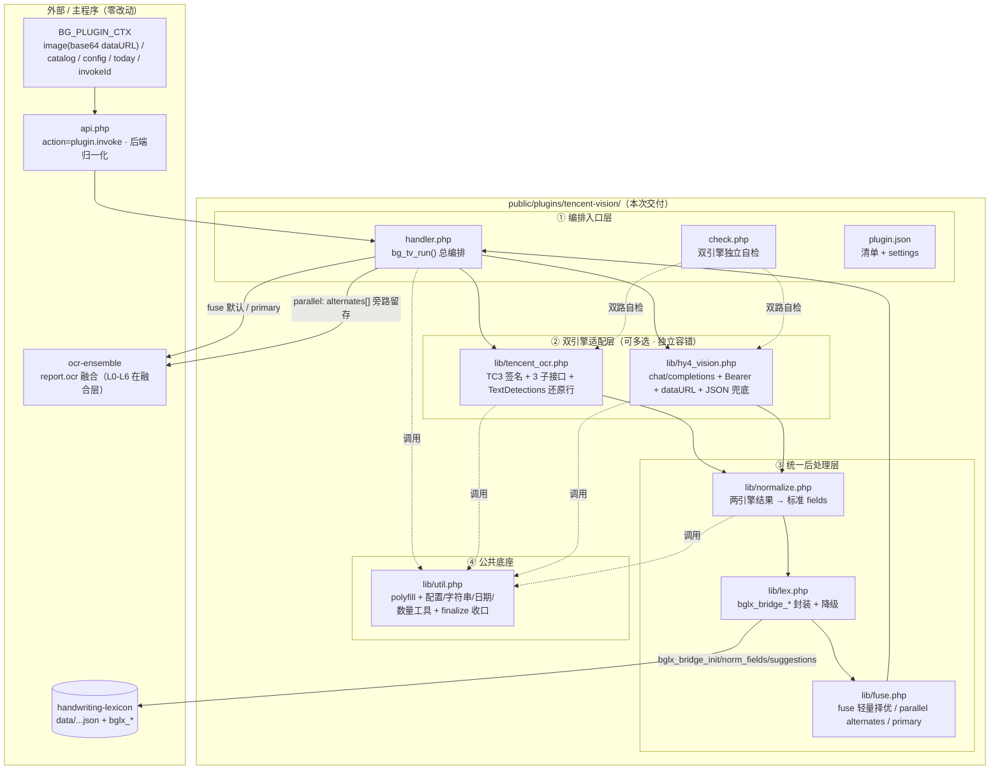
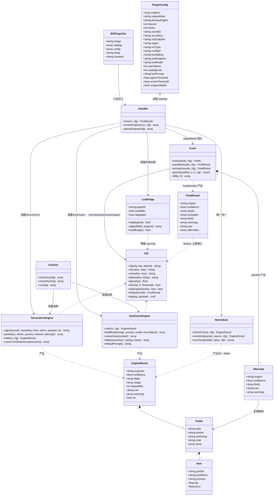
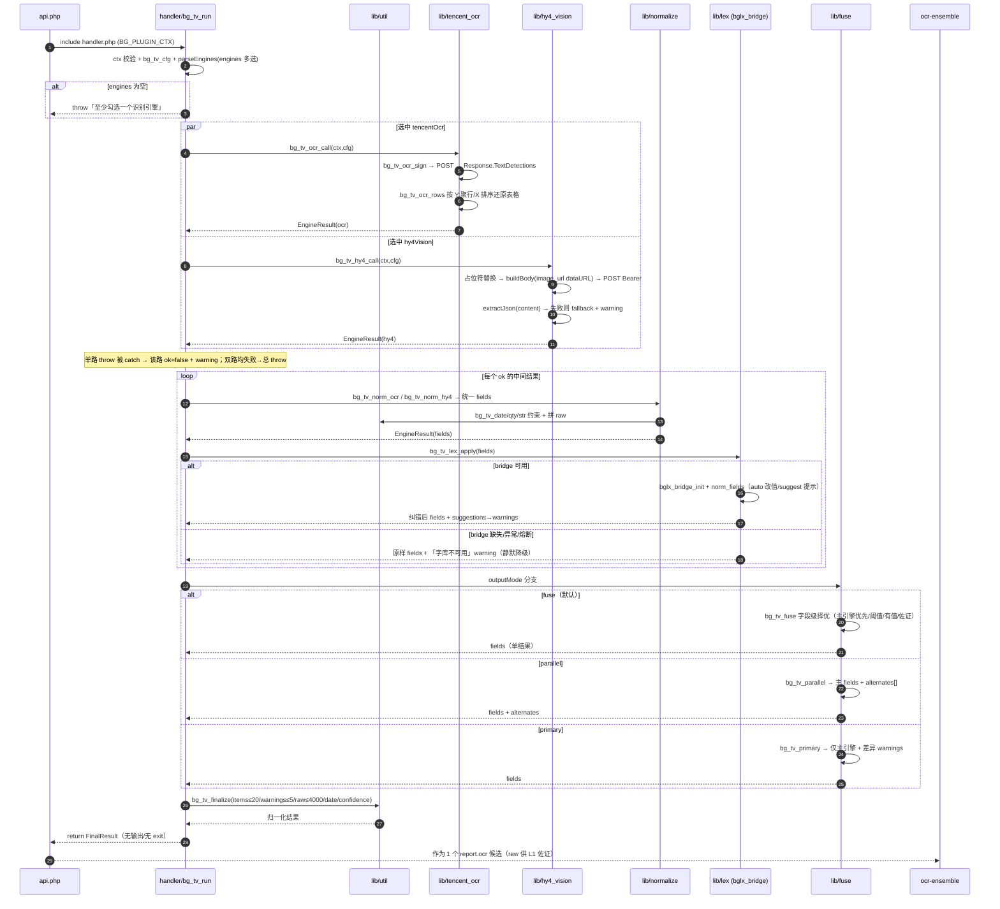
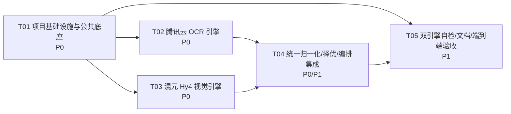

# 腾讯云多引擎视觉识别插件 · 系统架构设计与任务分解

| 项 | 内容 |
|---|---|
| 文档角色 | 系统架构设计 + 任务分解（承接 PRD，不推翻基线） |
| 架构师 | 高见远 |
| 需求基线 | 许清楚《腾讯云多引擎视觉识别插件 — 简单 PRD》（`/workspace/tencent-vision/PRD.md`，168 行） |
| 插件 id / 目录 | `tencent-vision`，落地于 `public/plugins/tencent-vision/` |
| 代码基线 | `tencent-ocr/lib.php`（TC3 签名）、`ocr-fusion/public/plugins/{qwen35-ocr,mimo-v26-flash}`（视觉模型样板）、`handwriting-lexicon/lib/bridge.php`（字库桥）、`ocr-ensemble/docs/ocs-contract.md`（OCS 接入契约）、`/tmp/bgdocs/docs_OCR插件接入文档.md` v2.6（官方契约） |
| 技术约束 | 纯 PHP 7.4+、零第三方依赖、`BG_PLUGIN_CTX` 契约、返回上限 `items≤20 / warnings≤5 / raw≤4000` |
| 文档状态 | 待评审（Q1–Q7 已给架构侧默认取值，见 §10） |

> **定位**：把 PRD 的业务目标（G1–G5）与需求池（R01–R15）翻译为**可直接编码的函数签名、文件结构、数据结构、算法伪代码与任务清单**。严格复用既有基线（TC3 签名、`bglx_bridge_*`、字段归一化工具），只做「一个插件目录内的双引擎编排 + 轻量择优」，**不**内嵌字库、**不**实现 L0–L6 全套融合、**不**使用 `ImageQuestion`、**不**新增前端。

---

## 1. 实现方案总览

### 1.1 分层架构图



### 1.2 单插件目录内如何组织「双引擎 + 统一后处理 + 字库桥 + 输出模式」

设计原则：**一个入口、两条可插拔引擎支路、一条统一后处理管道、三种输出收口**。

1. **一个入口**：`handler.php` 只做 `BG_PLUGIN_CTX` 校验 → 读 `engines` 多选 → 并行/串行调度 → 调统一后处理 → 按 `outputMode` 收口 → `return`。入口不写任何引擎细节。
2. **两条引擎支路**：`lib/tencent_ocr.php` 与 `lib/hy4_vision.php` 各自暴露**统一签名** `bg_tv_engine_xxx($ctx, $cfg) => EngineResult`，内部鉴权/重试/解析自成一体。引擎之间零耦合，任一路失败互不影响（R02）。
3. **一条后处理管道**：两路 `EngineResult` → `lib/normalize.php` 归一到统一 `fields` → `lib/lex.php` 逐路字库纠错 → `lib/fuse.php` 按 `outputMode` 收口。**字库在择优之前、各路分别纠一次**（保证 `alternates[]` 也是干净字段，且避免 fuse 后再纠破坏佐证）。
4. **三种输出收口**：`fuse`（默认，内部轻量字段级择优出单结果）/ `parallel`（主结果 + `alternates[]`）/ `primary`（仅主引擎）。三种模式共用 `bg_tv_finalize()` 统一施加归一化上限。

> 关键取舍：本插件**对外只声明 1 个 `report.ocr` 引擎**（Q4），内部双引擎差异通过 `engine`/`alternates[]`/`warnings` 表达；复杂 L0–L6 裁决仍交 `ocr-ensemble`，不重复造轮子。

---

## 2. 技术选型与约束

### 2.1 技术选型

| 维度 | 选型 | 理由 |
|---|---|---|
| 语言/运行时 | PHP 7.4+，纯过程式函数 + 关联数组，无命名空间 | 沿用插件机制；样板插件均为该风格 |
| 依赖管理 | **零 Composer / 零第三方库** | 插件目录即插即用；`function_exists` + 可选 `require` 模式已被现有插件验证可靠 |
| 架构模式 | 分层管道（Pipeline）+ 策略函数（每引擎一个适配器，每输出模式一个收口函数） | 每层可单测、可跳过、可降级 |
| 并发模型 | 首选 `curl_multi_*` 并行；无 curl 时串行降级 | R02 要求双路耗时≈`max(各路)`；`curl_multi` 是 PHP 标准扩展能力，零依赖 |
| 鉴权 | OCR=TC3-HMAC-SHA256 自签；HY4=Bearer Key | 复用 `lib.php` 签名；HY4 走 OpenAI 兼容接口 |
| 出网 | curl 优先，SSL socket 回退（照搬 `qwen35-ocr/shared.php` 的 `*_http_post`） | 兼容无 curl 环境；CA 用系统包 + 内置 `cacert.pem` |
| 文本处理 | `mb_*` 可选 + polyfill 回退（`preg_.../u`） | 兼容未装 mbstring 的部署（R 约束） |

### 2.2 硬约束与架构应对

| 约束 | 数值/规则 | 架构应对 |
|---|---|---|
| 上下文注入 | 仅 `$GLOBALS['BG_PLUGIN_CTX']` | 所有模块只读 ctx；不新增全局契约 |
| 明细条数 | `items ≤ 20` | `bg_tv_finalize()` 统一 `array_slice(..., 0, 20)` |
| 告警 | `warnings ≤ 5`，每条 ≤80 字 | 收口时去重、截断、复核类优先 |
| `raw` | ≤4000 字 | `bg_tv_cut($raw, 4000)`；保留图号/数量原文片段供 L1 佐证 |
| 置信度 | 0–1，3 位小数 | `round(clamp($c), 3)` |
| 日期 | 严格 `YYYY-MM-DD` 且真实 | `bg_tv_date()`（照搬 `qwenocr_date`），非法置空 |
| 两套密钥 | `secretId/secretKey`（OCR）与 `hy4ApiKey`（HY4）独立 | 独立自检、独立缺失提示、独立跳过 |
| 输入图片 | dataURL，JPG/PNG/WebP，≤8MB | 校验前缀与长度；OCR 传 `ImageBase64`，HY4 传 `image_url.url=dataURL` |
| ImageQuestion | **请求体禁止出现** | HY4 仅用 `chat/completions` + `image_url` + `text`，不调用旧 `ImageQuestion` 接口（R04） |
| 错误语义 | 单路失败 try/catch + warning 兜底；全部失败 `throw RuntimeException` | 与 OCS §7 一致（本插件对外作为 1 个引擎，内部两路消化） |

### 2.3 两套鉴权对照

| 项 | 腾讯云 OCR | 混元 HY4 |
|---|---|---|
| 鉴权头 | `Authorization: TC3-HMAC-SHA256 Credential=..., SignedHeaders=content-type;host, Signature=...` | `Authorization: Bearer <hy4ApiKey>` |
| 其他头 | `X-TC-Action / X-TC-Timestamp / X-TC-Version(2018-11-19) / X-TC-Region / Host / Content-Type` | `Content-Type: application/json` |
| 域名 | `https://ocr.tencentcloudapi.com`（`ocrEndpoint` 可覆盖，签名用 host 不含协议） | `https://api.hunyuan.cloud.tencent.com/v1/chat/completions` |
| 密钥来源 | 腾讯云 API 密钥（SecretId/SecretKey） | 混元控制台 API Key（独立于 SecretId/Key） |
| 自检探针 | 1×1 测试图 + `GeneralBasicOCR` | 文本最小请求「只回复两个字：正常」 |

---

## 3. 文件列表及相对路径

> 全部为**新建**，路径相对于项目根；插件目录 id 为 `tencent-vision`，与目录名严格一致（官方契约 §3.1 硬要求）。

### 3.1 目标目录树

```
public/plugins/tencent-vision/
├── plugin.json                      # 清单 + 四组 settings
├── handler.php                      # 编排入口（bg_tv_run）
├── check.php                        # 双引擎独立自检
├── README.md                        # 安装/配置/使用/排错
├── lib/
│   ├── util.php                     # polyfill + 配置/字符串/日期/数量 + finalize 收口 + 日志
│   ├── tencent_ocr.php              # TC3 签名 + 3 子接口 + TextDetections 还原行
│   ├── hy4_vision.php               # chat/completions + Bearer + 提示词 + JSON 兜底
│   ├── normalize.php                # 两引擎中间结果 → 标准 fields
│   ├── fuse.php                     # fuse/parallel/primary 三种输出收口
│   └── lex.php                      # bglx_bridge_* 封装 + 路径探测 + 降级
├── docs/
│   ├── integration.md               # 接入说明（OCS 契约对照 + ocr-ensemble 接入步骤）
│   └── hy4-prompt-tuning.md         # HY4 提示词模板调优与 JSON 稳定性说明
└── tests/
    ├── tencent_ocr.test.php         # 签名向量 / 3 子接口解析 / 行还原
    ├── hy4_vision.test.php          # JSON 抠取（围栏/文字）/ 文本兜底 / 中文错误映射
    ├── normalize_fuse.test.php      # 字段归一 / 择优规则 / 上限收口 / 降级
    └── fixtures/
        ├── ocr_text_detections.json # TextDetections 样例（三行 80/50/50）
        └── hy4_contents.json        # 模型返回样例（纯 JSON / ```json 围栏 / 纯文本）
```

### 3.2 文件职责明细

| 文件 | 职责 | 关键函数 / 键 |
|---|---|---|
| `plugin.json` | 声明 `capabilities:["report.ocr"]`、`entry`、`check`，四组 settings（通用/腾讯云 OCR/混元 Hy4/融合与阈值） | `engines`(multiselect) / `outputMode` / `primaryEngine` / `secretId` / `secretKey` / `hy4ApiKey` / `hy4Model` / `hy4Prompt` / `agreeThreshold` / `reviewThreshold` / `compareMode` |
| `handler.php` | ctx 校验、engines 多选解析、并行调度、调后处理管道、outputMode 收口、`return` | `bg_tv_run($ctx,$cfg)`、`bg_tv_invoke_engines()` |
| `check.php` | 双引擎各自「API 链接测试」：配置完整性、网络连通、真实探针调用 | `bg_tv_check_ocr()`、`bg_tv_check_hy4()`，返回 `{ok,message,details≤10}` |
| `lib/util.php` | 无依赖底座：配置读取/整型/布尔、`mb_*` polyfill、字符串/日期/数量归一、原文佐证、上限收口、旁路日志 | `bg_tv_cfg/int/bool/str/cut/date/qty/empty/same/raw_support/finalize/log` |
| `lib/tencent_ocr.php` | TC3 签名 + `bg_tv_post_api()`（网络类重试 1 次、4xx 不重试）+ 3 子接口 + `TextDetections` 按 Y 聚行还原表格 | `bg_tv_ocr_sign()`、`bg_tv_ocr_call()`、`bg_tv_ocr_rows()` |
| `lib/hy4_vision.php` | OpenAI 兼容 `chat/completions`，Bearer Key，dataURL 图片 + 提示词，`usage.*` 记录，JSON 抠取 + 文本兜底 | `bg_tv_hy4_call()`、`bg_tv_hy4_extract_json()`、`bg_tv_hy4_fallback()`、`bg_tv_hy4_default_prompt()` |
| `lib/normalize.php` | 把 OCR/HY4 各自中间结果映射为统一 `fields`，施加字段长/日期/数量约束，拼可读 `raw` | `bg_tv_norm_ocr()`、`bg_tv_norm_hy4()`、`bg_tv_norm_scalar()` |
| `lib/fuse.php` | 字段级轻量择优（主引擎优先 + 同意阈值 + 有值优先 + 原文佐证）、`alternates[]` 组装、`primary` 分支、差异对比 | `bg_tv_fuse()`、`bg_tv_parallel()`、`bg_tv_primary()`、`bg_tv_pick_value()`、`bg_tv_diff()` |
| `lib/lex.php` | 探测并引入 `bridge.php`，逐路 `norm_fields`，suggest 汇总为 warnings，失败静默降级 | `bg_tv_lex_init()`、`bg_tv_lex_apply()`、`bg_tv_lex_load_bridge()` |
| `README.md` | 安装（放入 `public/plugins/`）、配置、三种模式说明、排错、自检 | — |
| `docs/integration.md` | 与 `ocs-contract.md` §7 自检清单逐项对照；`ocr-ensemble.engines` 填 `tencent-vision` 的步骤 | — |
| `docs/hy4-prompt-tuning.md` | `{TODAY}/{CATALOG}` 占位符、JSON 字段名约束、围栏/兜底机制、模型名联调说明 | — |
| `tests/*.test.php` | 纯 PHP 断言脚本（`php tests/xxx.test.php`），覆盖签名、解析、择优、降级、上限 | — |

### 3.3 交付落地步骤

1. 在 `public/plugins/` 下新建 `tencent-vision/`（目录名＝`plugin.json.id`）。
2. 按 §3.1 放入全部文件；`lib/`/`docs/`/`tests/` 为插件自有目录，随插件整体拷贝。
3. 后端自动发现插件；设置页填两套密钥 → 点「API 链接测试」跑 `check.php` → 启用。
4. `ocr-ensemble` 的 `engines` 填 `tencent-vision` 即可纳入融合（或由自动发现纳入）。

---

## 4. 数据结构与接口（类图）

### 4.1 类图（Mermaid）



### 4.2 关键数据结构定义

**EngineResult（引擎中间结果，两路统一）**

```php
array(
    'engineId'   => 'tencentOcr',           // 或 'hy4Vision'
    'confidence' => 0.88,                   // 0~1，自报
    'fields'     => array(/* Fields */),
    'raw'        => '图号 TD24510R04 数量 80 …', // 必含图号/数量原文，供 L1
    'warnings'   => array('…'),
    'usage'      => array('prompt_tokens'=>0,'completion_tokens'=>0,'total_tokens'=>0), // OCR 恒 0
    'elapsedMs'  => 1234,
    'ok'         => true,
)
```

**Fields / Item（统一字段，与 OCS §3 完全一致）**

```php
'fields' => array(
    'date'     => '2026-11-20',   // 严格 YYYY-MM-DD，非法置空
    'worker'   => '张三',         // ≤40 字
    'workshop' => '一车间',       // ≤40 字
    'note'     => '',            // ≤100 字
    'items'    => array(
        array('partNo'=>'TD24510R04','partName'=>'固定块','process'=>'铣','qty'=>80,'price'=>null),
        // …最多 20 行；qty/price 为数值或 null
    ),
)
```

**Alternate（parallel 模式的各路留存）**

```php
'alternates' => array(
    array('engine'=>'腾讯云 OCR','confidence'=>0.91,'fields'=>/* Fields */,'raw'=>'…','warnings'=>[]),
    array('engine'=>'混元 Hy4','confidence'=>0.86,'fields'=>/* Fields */,'raw'=>'…','warnings'=>[]),
)
// 仅 parallel 模式输出；标准字段仍取主结果，不影响主程序解析（R09）
```

**FinalResult（对外返回，OCS 契约）**

```php
return array(
    'engine'     => 'tencent-vision/hy4Vision',  // 前缀由 primaryEngine 决定，≤40 字
    'confidence' => 0.88,
    'plugin'     => array('id' => 'tencent-vision'),
    'strengths'  => array('partNo', 'qty'),       // 可选能力标签
    'fields'     => array(/* Fields */),
    'warnings'   => array(/* ≤5，每条 ≤80 字 */),
    'raw'        => '…',                          // ≤4000 字
    'alternates' => array(/* 仅 parallel */),
);
```

**字库桥调用签名（只读，禁止内嵌字库）**

```php
bglx_bridge_init('tencent-vision', array('auto_min'=>0.85, 'suggest_min'=>0.6)) : bool;
bglx_bridge_norm_fields($fields, array('plugin'=>'tencent-vision')) : array; // {fields, changes, suggestions}
bglx_bridge_suggestions() : array;
bglx_bridge_status() : array; // available/degraded/failCount/version
```

---

## 5. 程序调用流程（时序图）



---

## 6. 关键算法设计

### 6.1 TC3-HMAC-SHA256 签名（复用 `tencent-ocr/lib.php`，函数前缀改为 `bg_tv_`）

关键步骤照搬基线（已验证），仅纳入本插件命名空间前缀：

```php
/**
 * 生成 TC3-HMAC-SHA256 Authorization 头。
 * 复用 tencent-ocr/lib.php:bg_tc_sign，逻辑逐行等价。
 */
function bg_tv_ocr_sign($secretId, $secretKey, $service, $host, $action, $payload, $timestamp) {
    $algorithm = 'TC3-HMAC-SHA256';
    $date      = gmdate('Y-m-d', $timestamp);                 // ① 签名日期必须 UTC
    // ② CanonicalRequest：method/uri/query + canonical headers + signed headers + payload hash
    $ch = "content-type:application/json; charset=utf-8\nhost:" . $host . "\n";
    $sh = 'content-type;host';
    $cr = "POST\n/\n\n" . $ch . "\n" . $sh . "\n" . hash('sha256', $payload);
    // ③ StringToSign：算法 + 时间戳 + credential scope + 规范请求哈希
    $scope = $date . '/' . $service . '/tc3_request';          // service 固定 'ocr'
    $sts   = $algorithm . "\n" . $timestamp . "\n" . $scope . "\n" . hash('sha256', $cr);
    // ④ 派生签名密钥：TC3Key → date → service → tc3_request
    $kDate    = hash_hmac('sha256', $date,    'TC3' . $secretKey, true);
    $kService = hash_hmac('sha256', $service, $kDate, true);
    $kSign    = hash_hmac('sha256', 'tc3_request', $kService, true);
    $sig      = hash_hmac('sha256', $sts, $kSign);
    // ⑤ 拼接 Authorization
    return $algorithm . ' Credential=' . $secretId . '/' . $scope
         . ', SignedHeaders=' . $sh . ', Signature=' . $sig;
}
```

调用要点（复用 `bg_tc_post_api`）：

- 请求头：`Authorization` + `X-TC-Action` + `X-TC-Timestamp` + `X-TC-Version: 2018-11-19` + `X-TC-Region` + `Host` + `Content-Type`。
- 子接口映射（R03）：`accurate→GeneralAccurateOCR`、`handwriting→GeneralHandwritingOCR`、`basic→GeneralBasicOCR`；高精度版按文档用 `ConfigID`，其余可带 `LanguageType`。
- 重试：`retries`（默认 1），仅对 curl errno ∈ `{7,28,52,55,56}` 重试；HTTP 4xx 与 `Response.Error` **不重试**（R07）。
- 错误映射：`AuthFailure*` →「密钥无效或未开通文字识别」；`InvalidParameterValue/MissingParameter` →「参数有误，可换识别类型或关多语」；网络类→「网络请求失败：…（已重试 N 次）」。

### 6.2 `TextDetections` 按 Y 聚行、按 X 排序还原表格

```php
/**
 * 把 TextDetections[] 还原为按阅读顺序的表格行（对齐报工单行结构）。
 * @return array 每行 {text:string, cells:array{text,x,y,w,h}}
 */
function bg_tv_ocr_rows($detections) {
    // 1) 展平为 cell：ItemPolygon 优先，Polygon 取外接矩形回退（照搬 lib.php）
    $cells = array();
    foreach ($detections as $d) {
        $text = trim((string)(isset($d['DetectedText']) ? $d['DetectedText'] : ''));
        if ($text === '') continue;
        list($x,$y,$w,$h) = bg_tv_poly_box($d);         // 统一外接矩形
        $cells[] = array('text'=>$text, 'x'=>$x, 'y'=>$y, 'w'=>$w, 'h'=>$h, 'cy'=>$y + $h/2);
    }
    if (!$cells) return array();

    // 2) 按中心 Y 排序 → 以「行高中位数 × 0.6」为容差聚行
    usort($cells, function($a,$b){ return $a['cy'] <=> $b['cy']; });
    $medianH = bg_tv_median(array_column($cells, 'h'));
    $tol = max(8.0, $medianH * 0.6);
    $rows = array(); $cur = array(); $anchor = null;
    foreach ($cells as $c) {
        if ($anchor === null || abs($c['cy'] - $anchor) <= $tol) {
            $cur[] = $c;
            $anchor = $anchor === null ? $c['cy'] : ($anchor + $c['cy']) / 2; // 滚动锚点抗轻微倾斜
        } else {
            $rows[] = $cur; $cur = array($c); $anchor = $c['cy'];
        }
    }
    if ($cur) $rows[] = $cur;

    // 3) 行内按 X 升序，拼文本（列间双空格），保留 cells 供字段定位
    $out = array();
    foreach ($rows as $row) {
        usort($row, function($a,$b){ return $a['x'] <=> $b['x']; });
        $texts = array_column($row, 'text');
        $out[] = array('text' => implode('  ', $texts), 'cells' => $row);
    }
    return $out;
}
```

行→字段映射（`bg_tv_norm_ocr`）：从行数组用「带标签优先 + 图号正则 + 数量尾数」解析 `date / worker / workshop / note / items`，规则与 `qwenocr_fallback` 一致（图号须命中零件库或形如图号串；数量取行内裸数字；表头/合计/签名行跳过）。潦草样例三行 `80/50/50` 应正确还原（R03 验收）。

### 6.3 HY4 提示词模板与严格 JSON 容错

**提示词设计**（默认模板＝PRD §4.4，落到 `bg_tv_hy4_default_prompt()`）：

- 明确「只输出一个 JSON 对象，不要解释、不要 markdown 代码块」。
- 给出输出结构示例，**字段名与契约完全一致**：`date/worker/workshop/note/confidence/items[{partNo,partName,process,qty,price}]`。
- 9 条识别规则（日期补全、图号优先用零件库、工序白名单、qty/price 纯数字、模糊字用 `?`、不编造）。
- 占位符：`{TODAY}` → ctx.today；`{CATALOG}` → 零件库前 `catalogLimit` 条「图号 | 名称 | 工序」文本（R11）。
- 字段名校验：`check.php` 扫描模板含 `{"date"`、`"items"`、`"partNo"` 等关键字，缺失给提示（R11 验收）。

**请求体（禁止 `ImageQuestion`）**：

```php
$body = array(
    'model'    => $cfg['hy4Model'],                 // 默认 hunyuan-vision
    'messages' => array(array('role'=>'user','content'=>array(
        array('type'=>'image_url','image_url'=>array('url'=>$image)), // dataURL，逗号为英文 ','
        array('type'=>'text','text'=>$prompt),
    ))),
    'max_tokens' => $cfg['maxTokens'],
    'stream'     => false,
);
// 无 ImageQuestion、无额外问答字段；Authorization: Bearer <hy4ApiKey>
```

**容错解析（照搬 `qwenocr_extract_json` → `bg_tv_hy4_extract_json`）**：

```php
function bg_tv_hy4_extract_json($text) {
    $t = trim((string)$text);
    if ($t === '') return null;
    if (preg_match('/^```[a-zA-Z0-9_-]*\s*(.*?)\s*```$/s', $t, $m)) $t = trim($m[1]); // 去 ```json 围栏
    $d = json_decode($t, true);
    if (is_array($d)) return $d;
    // 前后带说明文字：抠首个 {…} 或 […] 子串
    foreach (array(array('{','}'), array('[',']')) as $p) {
        $s = strpos($t, $p[0]); $e = strrpos($t, $p[1]);
        if ($s !== false && $e > $s) {
            $d = json_decode(substr($t, $s, $e - $s + 1), true);
            if (is_array($d)) return $d;
        }
    }
    return null;
}
// 仍失败 → bg_tv_hy4_fallback(content, catalog, today) 文本兜底
// 并写 warning「模型未返回结构化结果，明细按文本兜底解析，请逐条核对」（R10）
```

`usage.{prompt_tokens,completion_tokens,total_tokens}` 与 `elapsedMs` 由 `bg_tv_log('hy4_usage', ...)` 写旁路日志（R14，`invokeId` 关联，不进返回结构）。

### 6.4 `fuse` 模式字段级轻量择优（明确「轻量」边界）

> **不是** ocf 的 L0–L6：无 Dice 聚类、无字段级信誉、无校准、无 L4–L6 裁决；只做「两路之间的字段级择优」，复杂分歧留 `alternates[]` + warnings 给上层/人工。

```php
/**
 * 单字段择优，命中即止（优先级从上到下）：
 *   ① 有值优先 → ② 一致取主引擎 → ③ 原文佐证优先 → ④ 自报置信度高者优先（平局主引擎）
 */
function bg_tv_pick_value($field, $a, $b, $cfg) {
    $va = $a['fields'][$field]; $vb = $b['fields'][$field];
    if (bg_tv_empty($va) && bg_tv_empty($vb)) return '';
    if (bg_tv_empty($va)) return $vb;                       // ① 有值优先
    if (bg_tv_empty($vb)) return $va;
    if (bg_tv_same($va, $vb, $cfg['agreeThreshold']))      // ② 一致
        return $va;                                          //   取主引擎（$a 恒为主引擎）
    // ③ 原文佐证轻量校验：候选值（或其数字/图号片段）能否在该路 raw 找到
    $sa = bg_tv_raw_support($va, $a['raw']);
    $sb = bg_tv_raw_support($vb, $b['raw']);
    if ($sa && !$sb) return $va;
    if ($sb && !$sa) return $vb;
    // ④ 都有/都无佐证：自报置信度高者；相等取主引擎
    return ($a['confidence'] >= $b['confidence']) ? $va : $vb;
}

function bg_tv_fuse($results, $cfg) {
    list($a, $b) = bg_tv_order_by_primary($results, $cfg['primaryEngine']); // $a 恒主引擎
    $fields = array();
    foreach (array('date','worker','workshop','note') as $f) $fields[$f] = bg_tv_pick_value($f, $a, $b, $cfg);
    $fields['items'] = bg_tv_fuse_items($a['fields']['items'], $b['fields']['items'], $cfg); // 按 partNo 对齐后逐字段择优，≤20
    return $fields;
}
```

- `bg_tv_same`：数值用相对误差 `1 - |a-b|/max(|a|,|b|,1) ≥ agreeThreshold`；字符串用 Dice（uni+bi-gram），`≥ agreeThreshold` 视为一致。
- `bg_tv_raw_support`：从候选值取图号/数字片段做大小写不敏感包含判断；无佐证不直接剔除，只降权（避免误杀）。
- `compareMode=1`：把 `bg_tv_diff($a,$b)` 的差异字段写入 warnings（R12），默认关闭。

### 6.5 字库对接顺序（归一化后纠错，suggest 仅提示）

1. 每路 `EngineResult` 先经 `bg_tv_norm_*` 得到统一 `fields`。
2. `bg_tv_lex_apply($fields)`：`bglx_bridge_init('tencent-vision')` 幂等 → `bglx_bridge_norm_fields($fields, ['plugin'=>'tencent-vision'])`（`auto` 改值落到 items 的 `partNo/process/unit`；`suggest` 不改值）。
3. `bglx_bridge_suggestions()` 去重后并入 warnings（「字库建议：X→Y，请人工确认」）。
4. 纠错完成的各路 fields 再进入 `fuse/parallel/primary` 收口。
5. **禁止**内嵌任何字库逻辑：grep `lexicon.php|bglx_correct|bglx_norm|ALIAS_EXTRA` 命中必须为 0（R06）；`lib/lex.php` 只 `require bridge.php`。

### 6.6 失败降级矩阵

| 场景 | 检测 | 行为 | warnings / 错误 |
|---|---|---|---|
| OCR 密钥缺失 | `secretId/secretKey` 空 | 跳过 OCR 路；若只选 OCR → 总 throw | 「未配置 SecretId/SecretKey，已跳过腾讯云 OCR」/ throw「请先填写 SecretId 与 SecretKey」 |
| HY4 密钥缺失 | `hy4ApiKey` 空 | 跳过 Hy4 路；若只选 HY4 → 总 throw | 「未配置混元 API Key，已跳过 Hy4」/ throw「请先填写混元 API Key」 |
| engines 一个都不勾 | parseEngines 空 | 直接 throw（R01） | 「请至少勾选一个识别引擎」 |
| OCR 失败 / Hy4 成功 | catch OCR throw | 用 Hy4 单结果，`engine=…/hy4Vision` | 「腾讯云 OCR 调用失败：…（已由 Hy4 兜底）」 |
| Hy4 失败 / OCR 成功 | catch Hy4 throw | 用 OCR 单结果，`engine=…/tencentOcr` | 「Hy4 调用失败：…（已由 OCR 兜底）」 |
| 两路都失败 | 两路 `ok=false` | 总 throw（OCS §7 单路异常抛出） | 「腾讯云 OCR 与 Hy4 均失败：…」 |
| Hy4 非 JSON | `extractJson=null` | 文本兜底解析（R10） | 「模型未返回结构化结果，明细按文本兜底解析，请逐条核对」 |
| 网络超时/限流 | curl errno∈retryable / HTTP 429/5xx | 重试 `retries` 次（默认 1）后按路失败处理 | 「网络请求失败（已重试 N 次）/ 触发限流」 |
| HTTP 401/403/404 | 业务 4xx | 不重试，转中文提示 | 401/403「密钥无效或地域不匹配」；404「接口地址或模型名有误」 |
| 字库 bridge 缺失/异常/熔断 | `is_file=false`/`degraded` | 静默降级，字段原样返回（R06） | 「字库连接层不可用，已跳过纠错」 |
| 图片缺失/格式/过大 | ctx.image 校验 | throw（R05） | 「没有收到图片 / 格式不支持 / 图片过大」 |

### 6.7 并行调度伪代码（`curl_multi`）

```php
function bg_tv_invoke_engines($ctx, $cfg, $engines) {
    $jobs = array(); // id => ['url','headers','payload','timeout']
    foreach ($engines as $id) {
        if ($id === 'tencentOcr') $jobs[$id] = bg_tv_ocr_prepare($ctx, $cfg); // 含 TC3 签名
        if ($id === 'hy4Vision')  $jobs[$id] = bg_tv_hy4_prepare($ctx, $cfg);  // 含 Bearer
    }
    $results = array();
    if (function_exists('curl_multi_init') && count($jobs) > 1) {
        $mh = curl_multi_init(); $chs = array();
        foreach ($jobs as $id=>$j) { $ch = curl_init($j['url']); /* setopt: POST/HEADERS/TIMEOUT/SSL */ curl_multi_add_handle($mh,$ch); $chs[$id]=$ch; }
        do { $st = curl_multi_exec($mh,$running); if ($running) curl_multi_select($mh, 0.1); } while ($running && $st===CURLM_OK);
        foreach ($chs as $id=>$ch) { $results[$id] = bg_tv_engine_parse($id, curl_multi_getcontent($ch), curl_getinfo($ch), $cfg); curl_multi_remove_handle($mh,$ch); }
        curl_multi_close($mh);
    } else { // 无 curl / 单引擎：串行降级
        foreach ($jobs as $id=>$j) $results[$id] = bg_tv_engine_parse($id, bg_tv_http_fallback($j), $cfg);
    }
    return $results; // 每路 EngineResult（含 ok 标志），handler 逐路 try/catch
}
```

> 单路超时独立：每个 `curl` 句柄单独设 `CURLOPT_TIMEOUT=$cfg['timeout']`（默认 30），互不阻断（R02）。

---

## 7. 任务列表（有序、含依赖、验收点）

> 共 **5** 个任务，按依赖顺序排列；每个任务包含 ≥3 个相关文件，可批量实现。T01 为项目基础设施（配置 + 入口 + 公共底座），集中一次完成。

### 7.1 任务依赖图



### 7.2 任务明细

#### T01 · 项目基础设施与公共底座（P0）

- **涉及文件**：`plugin.json`、`handler.php`（骨架）、`lib/util.php`、`lib/lex.php`、`check.php`（骨架）
- **依赖**：无
- **实现要点**：
  1. `plugin.json` 落地四组 settings（PRD §4 全量键），`capabilities:["report.ocr"]`、`entry/check`、`multiselect` 的 `engines`（默认 `tencentOcr,hy4Vision`）、两套 `password` 密钥、`hy4Prompt` textarea 默认模板。
  2. `handler.php` 骨架：`BG_PLUGIN_CTX` 校验 + `bg_tv_run()` / `parseEngines()` / `invokeEngines()` 框架（引擎调用先留桩）。
  3. `lib/util.php`：`bg_tv_cfg/int/bool/str/cut/date/qty/empty/same/raw_support/finalize/log`；`mb_*` polyfill（UTF-8 字节回退）；`bg_tv_finalize` 施加全部上限。
  4. `lib/lex.php`：`bg_tv_lex_load_bridge()` 多候选路径探测（见 §9.4）+ `init/apply` 降级封装。
- **验收点**：`php -l` 全部通过；`plugin.json` 合法且 settings 键齐全；关闭两路引擎时 handler 报中文错误；`bg_tv_finalize` 对超长 items/warnings/raw 正确截断。

#### T02 · 腾讯云 OCR 引擎（P0）

- **涉及文件**：`lib/tencent_ocr.php`、`tests/tencent_ocr.test.php`、`tests/fixtures/ocr_text_detections.json`
- **依赖**：T01
- **实现要点**：
  1. 迁移 `bg_tc_sign/cfg/post_api/ocr` → `bg_tv_ocr_sign/cfg/post_api/call`，保持逐行等价；域名/Version/3 子接口/ConfigID/重试与 4xx 不重试照搬。
  2. `bg_tv_ocr_rows()` 按 Y 聚行、X 排序还原表格；`bg_tv_norm_ocr` 侧行→字段映射（与 fixture 对齐）。
  3. 错误映射为 PRD R07 中文提示；`raw` 拼接 `DetectedText` 含图号/数量（R13）。
- **验收点**：签名向量与 `lib.php` 对同一 payload 输出一致；1×1 测试图自检返回「签名与密钥有效」；fixture 三行数量 `80/50/50` 正确；请求头含 `TC3-HMAC-SHA256`；断网总请求 ≤2 次。

#### T03 · 混元 Hy4 视觉引擎（P0）

- **涉及文件**：`lib/hy4_vision.php`、`tests/hy4_vision.test.php`、`docs/hy4-prompt-tuning.md`
- **依赖**：T01
- **实现要点**：
  1. `bg_tv_hy4_call()`：`Bearer` + `chat/completions` + `image_url` dataURL；`usage.*`/`elapsedMs` 旁路日志。
  2. 默认提示词 + 占位符替换；`extractJson` 围栏/说明文字抠取；`fallback` 文本兜底 + warning。
  3. 中文 HTTP 错误映射（401/403/404/429/5xx）；请求体断言无 `ImageQuestion`。
- **验收点**：带 ```json 围栏返回能正确抠字段且 warning 含「文本兜底解析」提示场景正确；`{TODAY}/{CATALOG}` 被替换；改 `hy4Model` 后请求体用新值；`usage` 三项进日志；401→「密钥无效或地域不匹配」。

#### T04 · 统一归一化、择优与编排集成（P0/P1）

- **涉及文件**：`lib/normalize.php`、`lib/fuse.php`、`handler.php`（集成）、`tests/normalize_fuse.test.php`
- **依赖**：T02、T03
- **实现要点**：
  1. `bg_tv_norm_ocr/norm_hy4/norm_scalar` 统一字段；拼可读 `raw`（保留图号/数量）。
  2. `bg_tv_fuse/parallel/primary/pickValue/diff`：字段级轻量择优、alternates 组装、primary 差异提示；三种模式共用 finalize。
  3. `handler.php` 集成：并行调度 + 逐路 try/catch + 单路失败兜底 + 双路失败总 throw + outputMode 分派。
- **验收点**：三模式返回结构符合预期且 `parallel.alternates` 不影响标准字段解析；`items≤20/warnings≤5/raw≤4000/date` 严格；单路失败另一路正常返回；fuse 分歧按「主引擎→佐证→置信度」规则可得预期值；compareMode 开关生效。

#### T05 · 双引擎自检、文档与端到端验收（P1）

- **涉及文件**：`check.php`（完善）、`README.md`、`docs/integration.md`、`tests/fixtures/hy4_contents.json`
- **依赖**：T04
- **实现要点**：
  1. `check.php`：`bg_tv_check_ocr`（1×1 图探针 + SecretId 空检测）、`bg_tv_check_hy4`（文本最小请求 + Key 前缀/地址匹配）；details ≤10、每条 ≤160 字。
  2. 文档：安装/配置/三模式/排错；OCS §7 自检清单逐项对照；HY4 模型名与密钥归属联调说明。
  3. 端到端：按 PRD §5 流程跑通三种 outputMode，补 `hy4_contents.json` 样例（纯 JSON/围栏/纯文本）。
- **验收点**：清空 SecretId 自检返回「未配置 SecretId」；模拟 401 返回「密钥无效或地域不匹配」；OCS §7 清单逐项通过；grep 内嵌字库=0；`ocr-ensemble` 填入 id 后日志出现本插件候选且 raw 通过 L1 佐证。

---

## 8. 依赖包列表

**运行时：零第三方依赖（硬性）。**

| 类别 | 声明 | 说明 |
|---|---|---|
| PHP 扩展 | `curl`（可选，缺失走 SSL socket）、`hash`（TC3 签名必需）、`json`、`preg` | 均为 PHP 标准扩展；无 composer |
| 多字节 | `mbstring` 可选 | 缺失时由 `lib/util.php` 的 `mb_*` polyfill（`preg_.../u` + 字节回退）兜底 |
| 字库能力 | 仅 `handwriting-lexicon/lib/bridge.php`（内部插件，非第三方） | 可选 `require`，经 `bglx_bridge_*` 调用 |
| 出网 CA | 系统 `curl.cainfo`/`openssl.cafile` 或内置 `public/lib/cacert.pem` | 照搬 `lib.php:bg_tc_ca_file` 与 `qwenocr_ca` |

> 结论：交付物 **无 `composer.json`、无 `vendor/`、无外部库**；所有能力用 PHP 7.4 标准库实现。

---

## 9. 共享知识 / 跨文件约定

1. **函数前缀**：统一 `bg_tv_*`（bg=报工，tv=tencent-vision）。字库桥调用保留 `bglx_bridge_*` 原名。严禁新增无前缀全局函数（防同进程插件函数冲突）；引入文件加 `function_exists` / 常量守卫。
2. **返回结构收口**：所有分支最终必须经 `bg_tv_finalize()` 统一施加上限——`items≤20`、`warnings≤5` 每条 ≤80 字、`raw≤4000`、`date` 严格 `YYYY-MM-DD`、`confidence=round(clamp,3)`。任何子函数不得自行 `exit` 或输出内容。
3. **错误处理三层**：引擎调用 → try/catch + 另一路兜底，全失败 `throw RuntimeException`；字库 → 静默降级（`bglx_bridge_*` 内部已熔断），仅写 warning；配置/密钥 → 跳过对应路或明确 throw。统一 `error_log('[baogong] tencent-vision: …')`。
4. **PHP 兼容**：PHP 7.4+；不用命名空间、`??=`；箭头函数 `fn` 可用（7.4 特性），但为稳妥优先用匿名函数；`mb_*` 全部经 `bg_tv_str/bg_tv_cut` 包装。
5. **配置单一来源**：所有默认值集中在 `plugin.json` 的 `default` 与 `lib/util.php:bg_tv_cfg` 的兜底常量；算法函数内禁止魔法数字。
6. **原文佐证**：两路 `raw` 必须含识别到的图号与数量字符串（R13），这是 `ocr-ensemble` L1 硬约束的依据；fuse 后也要保证赢家值能在某路 raw 找到片段。
7. **可观测性**：`usage.*` 与各路 `elapsedMs` 走旁路 `error_log`（带 `invokeId`），不进返回结构，不突破上限（R14）。
8. **bridge 路径探测（本插件在 tencent-vision，bridge 在 handwriting-lexicon）**：

```php
function bg_tv_lex_load_bridge() {
    if (function_exists('bglx_bridge_init')) return true;
    $candidates = array(
        dirname(__DIR__, 2) . '/handwriting-lexicon/lib/bridge.php',                 // plugins 同级（标准布局）
        dirname(__DIR__, 3) . '/handwriting-lexicon/lib/bridge.php',                 // 上溯一级
        dirname(__DIR__, 4) . '/public/plugins/handwriting-lexicon/lib/bridge.php',  // 项目根布局
    );
    foreach (array_values(array_unique($candidates)) as $f) {
        if (is_file($f)) { require_once $f; break; }
    }
    return function_exists('bglx_bridge_init'); // 失败 → 静默降级，不影响识别
}
// 说明：__DIR__ = .../public/plugins/tencent-vision/lib；dirname(,2) 即 .../public/plugins/
```

9. **ImageQuestion 红线**：HY4 请求体只允许 `model/messages/model/max_tokens/stream`；`messages[].content` 只用 `image_url` + `text`。任何调用 `ImageQuestion` 接口或携带该字段的实现都视为违反 R04。
10. **与 ocs-contract §7 的一致性**：`plugin.json` 声明 `report.ocr`；handler 有 ctx 校验、末尾 `return` 无输出无 exit；字段齐全且上限达标；raw 保留图号/数量；字库仅经 bridge；单路（对外）异常 `throw`；可选 `strengths`。

---

## 10. 待明确事项（Q1–Q7 架构侧建议取值）

> 按 PRD 要求逐条给**默认值 + 理由**，不反问用户；评审可覆盖。

| # | 问题 | 架构侧默认取值 | 理由 |
|---|---|---|---|
| Q1 | 多选后行为模式 | **两者都支持**，`outputMode` 默认 `fuse` | 单结果符合单结果契约、开箱即用；已启用 `ocr-ensemble` 时切 `parallel` 留各路 |
| Q2 | 双引擎结果呈现 | 面板默认只显示主（融合）结果 + warnings 差异摘要；`compareMode=1` 才列差异字段 | 本插件不改前端；差异走 warnings 与旁路日志 |
| Q3 | 内部融合深度 | **只做轻量字段级择优**（有值/一致/佐证/置信度），不做 L0–L6 | 避免与 `ocr-ensemble` 职责重复；复杂裁决交融合层 |
| Q4 | 两路是否独立投票 | 一期按 **1 个 `report.ocr` 引擎**（id=`tencent-vision`）接入；各路存 `alternates[]` | 融合零改动接入；若未来需两路独立权重，再以 `plugin.id` 派生虚拟 id（如 `tencent-vision:ocr`），一期不做 |
| Q5 | HY4 提示词策略 | **单图直出 JSON**，`hy4Prompt` 默认 PRD §4.4 模板 | 链路最短、成本可控；按真实手写单评测后再决定是否引入 OCR 文本辅助 |
| Q6 | 单引擎对比模式 | P1 开关 `compareMode`，**默认关闭** | 仅供评测/排障，避免 warnings 与日志膨胀 |
| Q7 | Hy4 模型名与密钥归属 | 默认 `hunyuan-vision`；Hy4/TokenHub 实际模型 id **需用户提供以联调**；两套凭据**分别自检** | 默认名≠一定可用；两套密钥属不同控制台，独立自检可快速定位 401 是密钥还是地域问题 |

### 其他风险与缓解

| 风险 | 影响 | 缓解 |
|---|---|---|
| HY4 模型名默认值不满足联调 | 404/「不支持图像输入」 | 模型名可配；`check.php` 明确显示当前模型名；Q7 要求用户提供实际 id 后写入默认或设置 |
| 两套密钥归属混淆（OCR 用 SecretId/Key，HY4 用 Bearer Key） | 401 误判 | 设置页分组 +  placeholders 标注来源；自检分别显示两套凭据状态；错误提示区分「SecretId 无效」与「混元 Key 无效」 |
| ImageQuestion 下线 | 调用旧接口直接失败 | 仅用 `chat/completions` + `image_url`；测试断言请求体无 `ImageQuestion`；文档红线声明 |
| 双路并行 => 请求体过大 / token 超限 | HY4 拒绝或截断 | `catalogLimit` 默认 200（0–300）；`maxTokens` 默认 4096；`finish_reason=length` 写 warning |
| fuse 误杀正确值 | 择优取错 | 佐证只降权不硬剔除；有分歧时 `parallel` 可留 alternates 人工确认；`agreeThreshold` 可调（印刷 0.9/手写 0.8） |
| 字库 auto 改写破坏 raw 佐证 | L1 校验失败 | 字库在 fuse 前对逐路 fields 纠；raw 保留改写前原文片段；auto 只改 items 结构化字段 |
| 插件同进程函数重定义 | 致命错误 | `bg_tv_*` 前缀 + `function_exists` 守卫 + 引入常量守卫 |
| 图片 dataURL 逗号被转义 | 图片解析失败 | dataURL 原样透传，`json_encode` 用 `JSON_UNESCAPED_SLASHES`；断言逗号为英文 `,` |

---

## 附录 A · 需求覆盖速查

| 需求 | 落地任务 | 关键函数 / 位置 |
|---|---|---|
| R01 双引擎多选 | T01 | `plugin.json:engines`、`handler:parseEngines` |
| R02 并行调用 | T04 | `invokeEngines`(`curl_multi`) |
| R03 腾讯云 OCR | T02 | `bg_tv_ocr_sign/call/rows` |
| R04 混元 Hy4 | T03 | `bg_tv_hy4_call`（无 ImageQuestion） |
| R05 统一返回契约 | T01/T04 | `bg_tv_finalize`、ctx 校验 |
| R06 字库对接 | T01 | `lib/lex.php`（仅 bridge） |
| R07 健壮性/重试/中文错误 | T02/T03/T05 | `post_api` 重试、`check.php`、错误映射 |
| R08 可接入融合 | T04/T05 | `plugin.id`、`raw` 佐证、OCS §7 |
| R09 outputMode 三模式 | T04 | `fuse/parallel/primary` |
| R10 Hy4 输出兜底 | T03 | `extractJson/fallback` |
| R11 提示词可配 | T03/T05 | `hy4Prompt` 占位符、`check.php` 字段名校验 |
| R12 compareMode | T04 | `bg_tv_diff` |
| R13 raw 佐证 | T02/T03/T04 | 各路 raw 拼图号/数量 |
| R14 usage 可观测 | T03 | `bg_tv_log('hy4_usage')` |
| R15 多语 ConfigID / skipTls | T01/T02/T03 | `configId`、`skipTls` 调试开关 |
