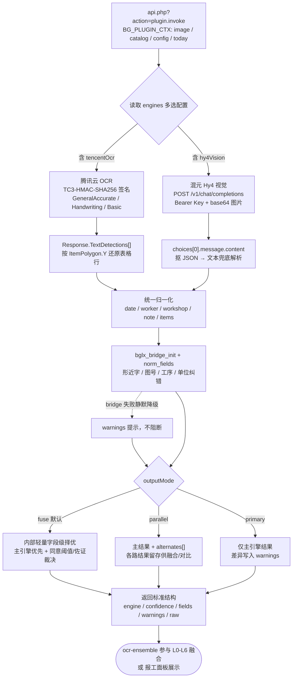

# 腾讯云多引擎视觉识别插件 — 简单 PRD

## 0. 项目信息

| 项 | 内容 |
|---|---|
| Language | 简体中文 |
| Programming Language | 纯 PHP、零第三方依赖（融入现有 PHP 插件体系；本次不新增前端） |
| Project Name | `tencent_vision`（插件目录 id 沿用生态约定：`tencent-vision`） |
| 原始需求 | 「开发腾讯云文字识别插件，除了 OCR 还要有 hy4 的 ai 识别，可多选识别引擎。」 |

**范围边界（不重复造轮子）**：不内嵌字库（走 `bglx_bridge_*`）；不实现 L0-L6 融合裁决（交 `ocr-ensemble`）；不使用预下线的 `ImageQuestion`；不新增前端展示页。

---

## 1. 产品目标

| # | 目标 |
|---|---|
| G1 | **双引擎一个入口**：在一个插件内同时提供「腾讯云 OCR（字符级精准、带坐标）」与「混元 HY4 视觉理解（语义级结构化）」，用户按需勾选启用。 |
| G2 | **并行调用、统一输出**：选中引擎并行调用、独立容错，各自归一化到报工系统标准返回结构，上层无需感知引擎差异。 |
| G3 | **融入现有生态**：经 `bglx_bridge_*` 做字库纠错；作为标准 `report.ocr` 引擎可被 `ocr-ensemble` 调度参与融合。 |
| G4 | **健壮可运维**：两套密钥独立自检；未配置、超时、限流、非 JSON 输出均有中文提示与安全降级。 |
| G5 | **高度可配置**：引擎组合、OCR 子接口、Hy4 模型名与提示词、阈值均可配，适配手写单/印刷单与不同部署形态。 |

---

## 2. 用户故事

1. 作为**车间文员**，我希望上传手写报工单后按需同时调用 OCR 和 Hy4 并拿到一份字段统一的报工结果，这样我不用逐行手工录入。
2. 作为**系统管理员**，我希望在设置页用多选勾选启用哪些引擎、分别填两套密钥，这样我能按成本与精度灵活组合（只开 OCR 省钱 / 双开提精度）。
3. 作为**融合引擎维护者**，希望本插件遵守 OCS 契约返回单结果并可被 `ocr-ensemble` 调度，这样融合层零改动即可纳入投票。
4. 作为**复核人员**，希望双引擎结果有分歧时保留各路原始结果与差异提示，这样我能快速人工确认，而不是被静默吞掉。
5. 作为**运维**，希望密钥缺失或接口报错时看到明确中文提示与自检结果，这样我能快速区分网络、密钥、模型名问题。

---

## 3. 需求池

| 编号 | 优先级 | 需求 | 验收标准 |
|---|---|---|---|
| R01 | P0 | 双引擎 + 引擎多选：`engines` 为 `multiselect`，选项 `tencentOcr`（腾讯云 OCR）、`hy4Vision`（混元 Hy4 视觉），默认全选，至少选 1 项 | 分别只勾 1 个、勾 2 个保存，handler 仅调用被勾选引擎；一个都不勾时 `check.php` 报中文错误 |
| R02 | P0 | 并行调用：选中 ≥2 引擎时并发请求（如 `curl_multi`），单引擎超时独立、失败互不影响 | 双引擎总耗时约等于 `max(各路耗时)` 而非求和；任一路抛异常另一路仍返回结果 |
| R03 | P0 | 腾讯云 OCR 引擎：复用 `/workspace/tencent-ocr/lib.php` 的 TC3-HMAC-SHA256 签名；域名 `ocr.tencentcloudapi.com`、`Version=2018-11-19`；可选 `GeneralAccurateOCR`/`GeneralHandwritingOCR`/`GeneralBasicOCR`；按 `TextDetections[].ItemPolygon.Y` 还原表格行 | `check.php` 用 1×1 测试图返回「签名与密钥有效」；潦草样例三行数量 80/50/50 正确；请求头含 `Authorization: TC3-HMAC-SHA256 ...` |
| R04 | P0 | 混元 Hy4 引擎：`POST https://api.hunyuan.cloud.tencent.com/v1/chat/completions`，`Authorization: Bearer <混元API Key>`；图片用 `image_url` data URL（逗号为英文 `,`）；模型名可配（默认 `hunyuan-vision`，Hy4/TokenHub 按控制台实际名填） | 返回 `choices[0].message.content` 能解析出字段；`usage.*` 记入日志；**请求体中不出现 `ImageQuestion`** |
| R05 | P0 | 统一返回契约：`return {engine, confidence, fields:{date,worker,workshop,note,items:[{partNo,partName,process,qty,price}]}, warnings, raw}`；校验 `BG_PLUGIN_CTX`，无输出、无 `exit` | items ≤ 20、warnings ≤ 5 且每条 ≤ 80 字、raw ≤ 4000 字、date 严格 `YYYY-MM-DD`；ocs-contract §7 自检清单逐项通过 |
| R06 | P0 | 字库对接：只调 `bglx_bridge_init/norm_fields/suggestions`，不内嵌任何字库逻辑 | grep `lexicon.php\|bglx_correct\|bglx_norm\|ALIAS_EXTRA` 为 0；bridge 缺失/异常时静默降级并写 warnings，不阻断识别 |
| R07 | P0 | 健壮性：两套密钥独立自检；网络类错误重试 1 次、HTTP 4xx 业务错误不重试；401/403/404/429/5xx 与 `Response.Error` 转中文提示 | 清空 SecretId 点链接测试返回「未配置 SecretId」；模拟 401 返回「密钥无效或地域不匹配」；断网总请求不超过 2 次 |
| R08 | P0 | 可接入融合：`capabilities` 含 `report.ocr`；`raw` 保留图号与数量原文片段；可选声明 `strengths` | 在 `ocr-ensemble` 的 `engines` 中填入本插件 id 后，融合日志出现本插件候选且通过 L1 佐证校验 |
| R09 | P1 | 输出模式 `outputMode`：`fuse`（默认，内部轻量字段级择优出单结果）/ `parallel`（主结果 + `alternates[]` 留存各路）/ `primary`（仅主引擎结果） | 三种模式分别返回预期结构；`parallel` 的扩展键不影响主程序对标准字段的解析；默认模式见待确认 Q1 |
| R10 | P1 | Hy4 输出兜底：` ```json ` 围栏与前后说明文字自动抠 JSON；仍失败走文本兜底解析并写 warnings | 构造带围栏返回，字段正确填入且 warnings 含「按文本兜底解析，请逐条核对」 |
| R11 | P1 | 提示词模板可配：`hy4Prompt` 支持 `{TODAY}` / `{CATALOG}` 占位符，JSON 字段名与契约一致 | 修改模板后请求体使用新模板；占位符被正确替换；字段名改动时 `check.php` 给出提示 |
| R12 | P1 | 单引擎对比模式 `compareMode`：开启后把各路字段级差异写入 warnings / 旁路 trace，默认关闭 | 开启且两路结果不同时 warnings 列出差异字段；关闭时不输出差异 |
| R13 | P1 | `raw` 佐证保留：OCR 拼接 `DetectedText` 原文；Hy4 保留模型原文与关键片段 | 两路 raw 均包含识别到的图号与数量字符串，满足融合层 L1 要求 |
| R14 | P2 | 可观测性：`usage.{prompt_tokens,completion_tokens,total_tokens}` 与耗时写旁路日志 | 日志含三项 token 数与各引擎耗时，可关联 `invokeId` |
| R15 | P2 | OCR 多语配置 `configId`、`skipTls` 调试开关 | 填 `MulOCR` 后请求携带 `ConfigID`；`skipTls` 仅调试生效 |

---

## 4. 插件配置项设计（settings）

设置页按「通用 / 腾讯云 OCR / 混元 Hy4 / 融合与阈值」四组展示；密钥类为 `password` 不回显；`check.php` 提供「API 链接测试」分别检测两套凭据。

### 4.1 通用

| key | type | 默认值 | 说明 |
|---|---|---|---|
| `engines` | `multiselect` | `tencentOcr,hy4Vision` | **核心**。勾选启用引擎：`tencentOcr`=腾讯云 OCR；`hy4Vision`=混元 Hy4 视觉理解。至少选 1 项 |
| `outputMode` | `select` | `fuse` | 多选后行为：`fuse`=并行调用后内部轻量字段级择优（单结果）；`parallel`=主结果 + `alternates[]` 各路留存；`primary`=仅主引擎结果。见 Q1 |
| `primaryEngine` | `select` | `tencentOcr` | 平局裁决时的主引擎，同时决定返回 `engine` 字段前缀；`tencentOcr` / `hy4Vision` |
| `timeout` | `number` | `30` | 单引擎超时（秒），网络慢可调至 45~60 |
| `retries` | `number` | `1` | 网络类错误重试次数；HTTP 4xx 业务错误不重试以免重复计费 |

### 4.2 腾讯云 OCR

| key | type | 默认值 | 说明 |
|---|---|---|---|
| `secretId` | `password` | 空 | 腾讯云 API 密钥 SecretId（仅 OCR 引擎使用） |
| `secretKey` | `password` | 空 | 腾讯云 API 密钥 SecretKey，仅存服务器 `data/plugins.json`，不回显 |
| `ocrEndpoint` | `text` | `ocr.tencentcloudapi.com` | OCR 接口域名，一般无需改；代理环境可填自建转发域名 |
| `region` | `text` | `ap-guangzhou` | OCR 地域，可选 `ap-shanghai`、`ap-beijing` 等 |
| `ocrType` | `select` | `accurate` | 子接口：`accurate`=高精度（推荐手写单，带坐标）/ `handwriting`=手写专用 / `basic`=标准版 |
| `configId` | `text` | 空 | 高精度版多语配置，填 `MulOCR` 可开 100+ 语种；一般留空 |
| `dateFallback` | `checkbox` | `1` | 未识别到日期时按当天补全 |

### 4.3 混元 Hy4

| key | type | 默认值 | 说明 |
|---|---|---|---|
| `hy4ApiKey` | `password` | 空 | 混元 API Key（Bearer，**独立于** SecretId/SecretKey），从混元控制台获取 |
| `hy4Endpoint` | `text` | `https://api.hunyuan.cloud.tencent.com/v1/chat/completions` | OpenAI 兼容接口地址，一般无需改 |
| `hy4Model` | `text` | `hunyuan-vision` | 视觉模型 id，官方确认 `hunyuan-vision`；Hy4 系列在 TokenHub，**按控制台实际模型名填写** |
| `maxTokens` | `number` | `4096` | Hy4 最大输出 Token，明细多时可上调 |
| `catalogLimit` | `number` | `200` | 注入提示词的零件库条数上限，0~300 |
| `hy4Prompt` | `textarea` | 见 §4.4 | 图生文提示词模板；保留 `{TODAY}` / `{CATALOG}` 占位符与 JSON 字段名 |
| `skipTls` | `checkbox` | 空 | 跳过证书校验，仅自签代理调试用，生产请勿勾选 |

### 4.4 `hy4Prompt` 默认模板

```text
你是工厂车间的「报工单」识别引擎。请识别图片中的手写/印刷报工单，只输出一个 JSON 对象，不要解释、不要 markdown 代码块。

输出结构：
{"date":"YYYY-MM-DD","worker":"报工人","workshop":"车间","note":"备注","confidence":0.9,"items":[{"partNo":"图号","partName":"零件名称","process":"工序","qty":12,"price":null}]}

识别规则：
1. date：取报工日期/填单日期，补全为 YYYY-MM-DD；只写月日时按当前年份补全；识别不到填空字符串。
2. worker / workshop / note：分别取报工人、车间、备注，没有则填空字符串。
3. items：每行一条报工明细，最多 20 行；表头行、合计行、小计行、签名行不算明细。
4. partNo / partName / process 优先采用「零件库」中完全一致的写法；库里没有的照单据原文填写，不得改写、缩写或编造。
5. process 只填工序名（车/铣/钻/磨/钳/热处理/电镀/装配等），无法判断填空字符串。
6. qty：本行数量，纯数字不带单位；看不清填 null，不要猜。
7. price：单价，纯数字；单据没有填 null。
8. confidence：0~1 之间，表示整单识别把握程度。
9. 模糊、遮挡、无法辨认的单字用英文问号 ? 代替；宁可留空也不要编造内容。

当前日期：{TODAY}
零件库（图号 | 名称 | 工序）：
{CATALOG}
```

### 4.5 融合与阈值

| key | type | 默认值 | 说明 |
|---|---|---|---|
| `agreeThreshold` | `number` | `0.85` | `fuse` 模式下字段一致判定阈值；印刷体 0.9，含手写可降到 0.8 |
| `reviewThreshold` | `number` | `0.6` | 自报置信度低于此值时提示人工复核 |
| `compareMode` | `checkbox` | 空 | 单引擎对比模式（P1）：输出各路字段差异到 warnings / trace |

---

## 5. 关键流程



---

## 6. 待确认问题

| # | 问题 | 选项 / 背景 | 产品建议 | 影响 |
|---|---|---|---|---|
| Q1 | **多选后行为模式** | ① 并行调用全部选中引擎、各自产出结果；② 内部融合成一个结果；③ 两者都支持 | **③ 两者都支持**，用 `outputMode` 切换，默认 `fuse`（开箱即用、符合单结果契约）；已启用 `ocr-ensemble` 时切 `parallel` | 决定返回结构与上层链路 |
| Q2 | **双引擎结果如何呈现给用户** | 只显示一份融合结果 / 分栏展示各引擎结果 / 差异摘要 + 可展开明细 | 面板默认只显示主（融合）结果 + warnings 差异摘要；`compareMode` 开启才展示分栏对比 | 需主程序/前端支持，本插件不改前端 |
| Q3 | **是否内部融合、融合到什么深度** | 完整 L0-L6 / 轻量字段级择优 / 完全不融合 | 只做**轻量字段级择优**，不做 L0-L6，避免与 `ocr-ensemble` 职责重复；复杂裁决交融合引擎 | 是否引入重复逻辑 |
| Q4 | **两路是否要独立参与融合投票** | 本插件作为 1 个 `report.ocr` 引擎返回单结果 / 两路注册为 2 个独立引擎 | 一期按 1 个引擎接入；若投票需要两路独立权重，需架构侧确认注册方式（如 `plugin.id` 区分） | 影响融合多样性与信誉权重 |
| Q5 | **HY4 提示词策略** | 单图直出 JSON / 两阶段（先 OCR 出文本再让 Hy4 校正）/ 图片 + OCR 文本双输入 | 一期**单图直出 JSON**，按真实手写单评测后再决定是否引入 OCR 文本辅助 | 提示词模板、成本与联调 |
| Q6 | **是否需要单引擎对比模式** | 常开 / 开关控制 / 不做 | 作为 P1 开关 `compareMode`，默认关闭，仅供评测与排障使用 | 日志与 warnings 体积 |
| Q7 | **Hy4 模型名与密钥归属** | `hunyuan-vision` 默认值是否满足一期联调？混元 API Key 与腾讯云 SecretId/Key 是否同一账号体系 | 默认 `hunyuan-vision`；Hy4/TokenHub 实际模型 id 请用户提供以便联调；两套凭据**分别自检** | 能否完成端到端联调 |
