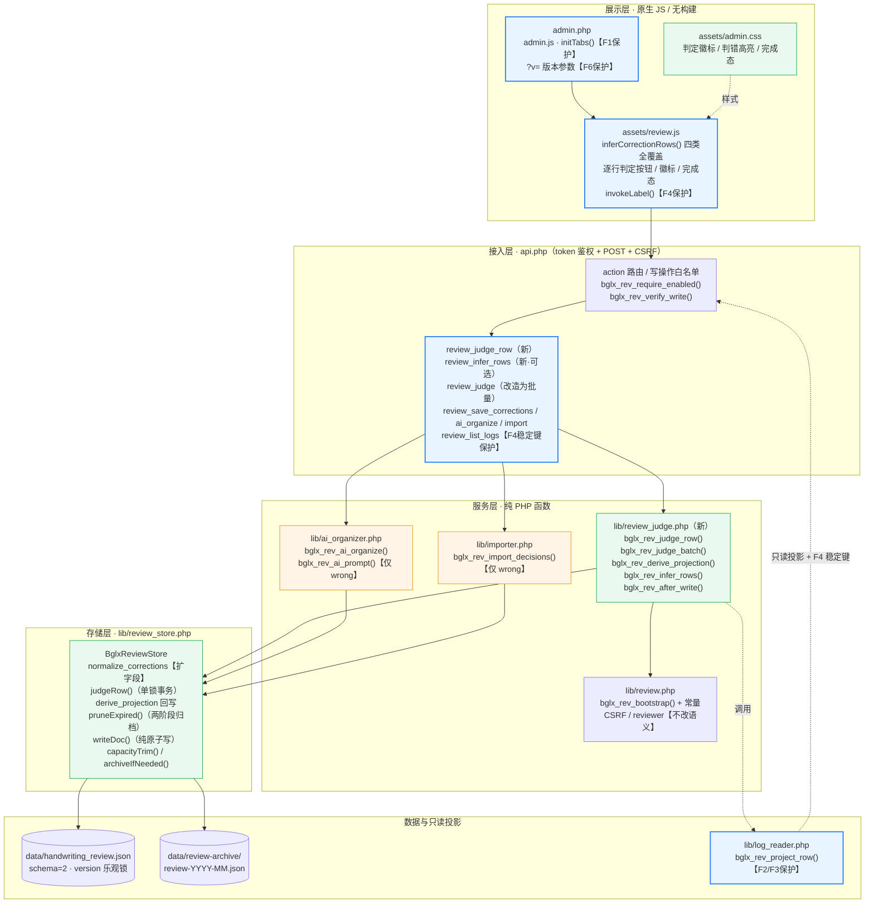
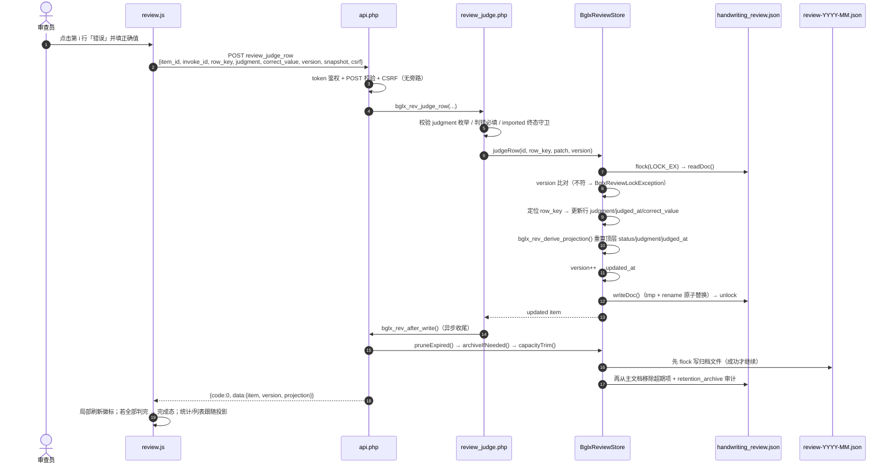
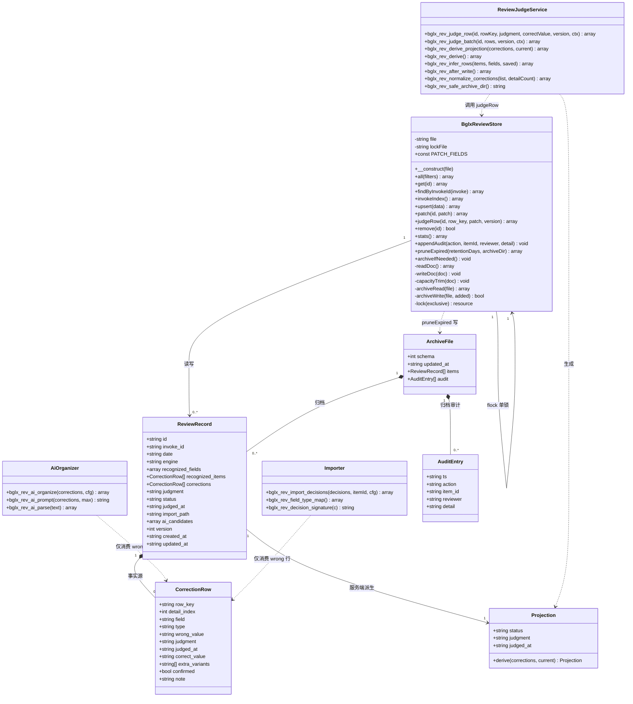
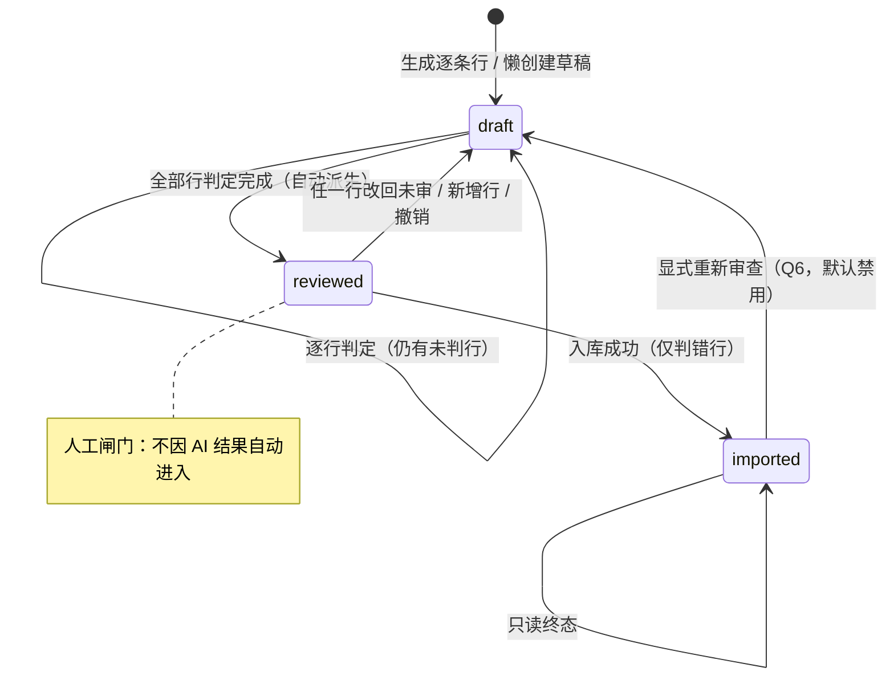
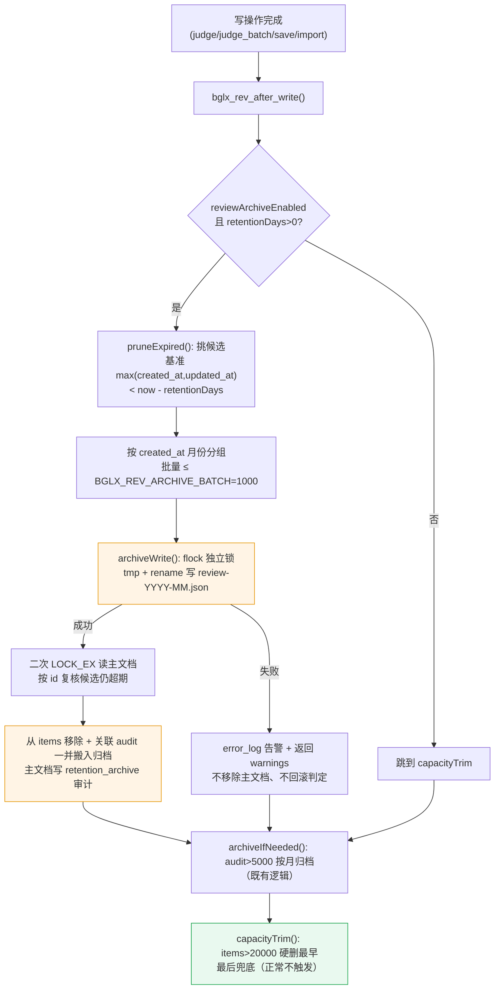
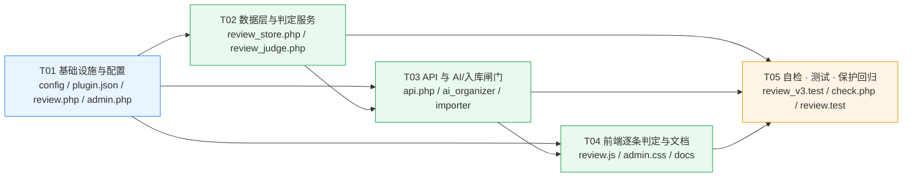

# 手写字词库审查工作台 v3 逐条判定改造 — 系统架构设计与任务分解

| 项 | 内容 |
|---|---|
| 文档类型 | 系统架构设计 + 任务分解（增量改造，基于 v3 PRD） |
| 架构师 | 高见远 |
| 上游基线 | 许清楚《v3 增量 PRD》（`PRD.md`，347 行） |
| 代码基线 | 作者 fixed 版 41 文件（`public/plugins/handwriting-lexicon/`），`api.php` 23,883 B / `review.js` 632 行 / `review_store.php` 24,989 B |
| 硬约束 | **作者 7 项修复零回退**（PRD §0 / 交接文档 §1、§6）；纯 PHP 零依赖；原生 JS 无框架 |
| 目标 | 判定粒度下沉到行、四类覆盖所有明细、90 天按月归档、AI/入库只吃判错行 |

---

## 阅读指引

- **Part A（§1–§8）**：架构设计——分层、选型、文件清单、类图、时序、派生与并发、四类算法、归档、AI 闸门。
- **Part B（§9–§11）**：任务分解——5 个任务、跨文件约定、Q1–Q8 架构建议取值。
- **保护清单**在 §3.2 与 §10.4 两处给出，工程师实现前必须先读。

---

# Part A · 系统设计

## 1. 实现方案总览

### 1.1 核心原则（一句话）

> **`corrections[].judgment` 是唯一事实源；顶层 `judgment` / `status` 是由事实源服务端派生的只读投影（保 F4 列表徽标/统计/筛选）；所有写操作走「行级改判 → 重算派生 → 顶层回写 → version++ → 原子写」的单锁事务。**

三条不可动摇的红线：

1. **作者 7 修复不可回退**：稳定键 `log-<sha1>`、no→partNo / proc→process 映射、match 空记录过滤、Tab 切换、目录默认值、缓存版本参数、主程序入口——见 §3.2 保护清单。
2. **人工闸门不绕过**：全部判完才派生 `reviewed`；AI 候选 `pending` + 人工勾选；`confidence ≤ 0.8`；不得自动入库。
3. **审计不硬删**：归档是「搬到 `review-YYYY-MM.json`」而非删除；先写归档文件成功，再从主文档移除。

### 1.2 分层架构图



### 1.3 事实源 → 投影的写入闭环



---

## 2. 技术选型与约束

| 约束项 | 取值 | 理由 / 落地方式 |
|---|---|---|
| 语言与依赖 | 纯 PHP ≥ 7.4、零 Composer 依赖、原生 JS（ES5 风格 `var`/`function`） | 沿用作者 fixed 版；群晖 PHP 8.2 与本地 8.5 均已验证，`php -l` 全绿 |
| 命名空间/前缀 | 函数 `bglx_rev_*`，类 `BglxReview*`，常量 `BGLX_REV_*` | 与既有 41 文件完全一致，不引入新前缀 |
| 鉴权 | `X-Bglx-Token` + 独立会话 `BGLXSESSID`；`BglxAuth::requireAuth()` | 复用 `lib/auth.php`，审查动作与词库动作共用一个实例，无旁路 |
| 写操作 | 强制 POST + CSRF nonce（`X-Bglx-CSRF` 或 `csrf` 参数），`hash_equals` 比对 | 复用 `bglx_rev_verify_write()`；新 action 必须加入 `$reviewWriteActions` 白名单 |
| 并发控制 | `BglxReviewLockException` → 错误码 `40901`；`version` 乐观锁，`row_key` 不参与冲突判定 | 沿用 `BglxReviewStore::patch()` 语义，不新造锁协议 |
| 文件原子写 | `flock(LOCK_EX)` + `tmp` + `rename` + `chmod 0664` | 沿用 `writeDoc()` 与 `archiveIfNeeded()` 的成熟写法 |
| 多字节字符 | `mb_*` polyfill 走 `bglx_str_len()` / `bglx_lower()` / `bglx_str_split()`（schema.php 已有分支） | 形近字单字符约束 `bglx_str_len($s) === 1`，不直接调 `mb_*` |
| 前端安全 | 用户数据一律 `textContent`，禁止 `innerHTML` 拼接 | 保持 review.js 现有安全约定（文件头注释） |
| 缓存刷新 | `admin.php` 的 `?v=` 递增为 `admin.js?v=1.2.0`、`review.js?v=1.2.0` | F6 保护：只递增版本号，不改引用结构 |
| 配置存储 | `lib/config.php` 默认表 + `plugin.json` settings 一一对应；运行值来自 `BG_PLUGIN_CTX['config']` / `data/plugins.json` | 新增 4 项；F5 的 `attachmentDirs`/`logDir` 默认值一个字都不动 |
| 归档目录穿越校验 | `reviewArchiveDir` 相对 `bglx_data_dir()` 解析，禁 `..`、禁绝对路径逃逸 | 复用 `bglx_rev_data_path()` + 新增 `bglx_rev_safe_archive_dir()` |
| 数据结构版本 | 文档 `schema`: `1` → `2`；`readDoc()` 兼容 1/2，写回统一 2 | 存量平滑迁移（PRD §7.5） |

### 2.1 架构模式

- 后端：**分层 + 事务脚本**（接入层 → 服务层 → 存储层），不引入 ORM/容器。
- 前端：**状态对象 + 声明式渲染函数**（`state` → `renderList()` / `select()` / `renderCandidates()`），逐条判定采用「事件委托 + 局部 DOM 更新」，**不整页重绘**判定区以外的节点。
- 一致性模型：**单文档单锁 + 乐观锁版本号**；归档为最终一致（写后收尾），失败告警不回滚。

---

## 3. 文件列表及相对路径

> 路径均相对 `public/plugins/handwriting-lexicon/`。状态：**改**=修改、**新**=新建、**保护**=不改动。

### 3.1 变更清单

| # | 文件 | 状态 | 职责 / 关键函数 | 任务 |
|---|---|---|---|---|
| 1 | `lib/review_judge.php` | 新 | 逐条判定服务：`bglx_rev_judge_row()`、`bglx_rev_judge_batch()`、`bglx_rev_derive_projection()`（短名 `bglx_rev_derive()`）、`bglx_rev_infer_rows()`、`bglx_rev_after_write()`、`bglx_rev_safe_archive_dir()` | T02 |
| 2 | `lib/review_store.php` | 改 | ① `bglx_rev_normalize_corrections()` 增 `row_key`/`detail_index`/`judgment`/`judged_at` 并做存量迁移；② `emptyDoc()/readDoc()` 支持 schema 2；③ `PATCH_FIELDS` 保持不开放 `id/created_at/version`；④ 新增 `judgeRow()` 单锁事务；⑤ 新增 `pruneExpired()` 两阶段归档 + `archiveRead/archiveWrite/capacityTrim()`；⑥ `writeDoc()` 拆出容量裁剪，变纯原子写 | T02 |
| 3 | `lib/review.php` | 改 | `bglx_rev_bootstrap()` 的 `require_once` 列表首位加入 `review_judge.php`（依赖 review_store.php 之后）；新增常量 `BGLX_REV_ARCHIVE_FAIL`、`BGLX_REV_IMMUTABLE`；**不触碰** CSRF / require_enabled / reviewer 三个函数体 | T01 |
| 4 | `lib/config.php` | 改 | `bglx_rev_defaults()` **追加** 4 项：`reviewRetentionDays=90`、`reviewArchiveEnabled=1`、`reviewArchiveDir=review-archive/`、`wholeImageJudgeEnabled=0`；**其余 24 项（尤其 attachmentDirs/logDir）原样** | T01 |
| 5 | `plugin.json` | 改 | `settings` 数组**追加**同 4 项（number / checkbox / text / checkbox）；**attachmentDirs=`images/attachments/`、logDir=`ocr-logs/` 保护** | T01 |
| 6 | `api.php` | 改 | ① `$reviewWriteActions` 加 `review_judge_row`/`review_infer_rows`/`review_judge_batch`（复用 `review_judge`）；② 新增 `review_judge_row`、`review_infer_rows` case；③ `review_judge` 改造为批量快捷（受 `wholeImageJudgeEnabled` 控）；④ `review_save_corrections` 保存后派生；⑤ `review_ai_organize` 入口过滤 wrong；⑥ `review_import_decisions` 人工路径过滤 wrong；⑦ 写动作成功后统一调 `bglx_rev_after_write()`；⑧ **稳定键生成段（352–363 行）与 `review_list_logs` 投影回显原样** | T03 |
| 7 | `lib/ai_organizer.php` | 改 | `bglx_rev_ai_prompt()` 入参契约增加「只含 wrong 行」断言（ defense-in-depth）；不改解析/`pending`/置信度逻辑 | T03 |
| 8 | `lib/importer.php` | 改 | `bglx_rev_import_decisions()` 增加 `only_wrong` 开关（默认对 manual 来源开启）；`bglx_rev_decision_signature()` 与 AI 签名逻辑不回退 | T03 |
| 9 | `assets/review.js` | 改 | ① `FIELD_LABELS` 保持四项无 qty；② 新增 `inferCorrectionRows(item)` 替换 `inferredCorrections()`（遍历全部明细、`row_key` 幂等合并）；③ `appendCorrectionRow()` 增判定按钮/徽标/`data-row-key`；④ `collectCorrections()` 输出 `row_key`/`judgment`；⑤ `select()` 的整图三按钮改为条件渲染（默认关闭）+ 完成态；⑥ 判定改调 `review_judge_row`；⑦ `invokeLabel()` / `bglx:tab` 监听不回退 | T04 |
| 10 | `assets/admin.css` | 改 | 新增 `.bglx-review-row-judged`、`.bglx-badge-wrong/correct/unreviewed`、`.bglx-review-done`、`.bglx-review-row-highlight` 样式，追加在文件末尾 | T04 |
| 11 | `check.php` | 改 | 新增第 11 项自检「v3 逐条判定与归档」，含 3 段：判定服务与派生函数存在性（I/U/D 三键）、归档目录可写、4 项配置值合法 + F5 默认值不漂移 | T05 |
| 12 | `docs/review-workflow.md` | 改 | 增「逐条判定与状态派生」「四类行生成」「90 天归档」三章；F5 目录默认值文字保护 | T04 |
| 13 | `tests/review_v3.test.php` | 新 | CLI 断言：四类全覆盖、row_key 幂等、派生判定表、乐观锁 40901、存量迁移、归档先写后移、AI 仅 wrong、审计守恒 | T05 |
| 14 | `tests/review.test.php` | 改 | 追加 F1–F7 保护回归断言（稳定键、映射、过滤、徽标、默认值、版本号、入口签名），原有断言不删 | T05 |

> **不在本次改动范围**：`lib/log_reader.php`（F2/F3 保护）、`assets/admin.js`（F1 保护）、主程序 `app.js`/`plugin-settings.js`/`layout.js`（F7 保护）、`lib/schema.php`/`lib/store.php`/`lib/bridge.php`/`lib/linker.php`/`lib/attachment.php`/`lib/auth.php`/`lib/http.php`。

### 3.2 保护清单（作者 7 项修复 · 零回退）

| # | 修复 | 保护文件与代码段 | 回归验证点（必跑） | v3 允许动作 |
|---|---|---|---|---|
| F1 | Tab 可切换 | `assets/admin.js` 的 `initTabs()` 全部；`review.js` 的 `bglx:tab` 监听（626–631 行） | 点击「审查工作台」标签 → 统计/筛选/空态出现，控制台无错 | ❌ 不触碰 |
| F2 | 字段映射 | `lib/log_reader.php` 的 `bglx_rev_project_row()`：`partNo←no/drawingNo/part_no/drawing`、`process←proc/procedure/processName`、`qty←quantity/count/num`、行级 date/worker/note 回填 | 用 `tests/fixtures/sample-fusion-trace.jsonl` 验证三条明细 `TD90535R184/铣光2/204` 等原样出现 | ✅ 逐条行**消费已归一化结果**，不重复映射 |
| F3 | 过滤 match 空记录 | `lib/log_reader.php` 的 `bglx_rev_log_matches()` 过滤分支 | 造 `kind=match` 行 → 不出现在 `review_list_logs`；分页 total 同步 | ❌ 不触碰 |
| F4 | 稳定键 + 回显 + invokeLabel | `api.php` 的 `review_list_logs` 中 `log-` + `substr(sha1($seed),0,20)` 段（352–363 行）；`review.js` 的 `invokeLabel()`（140–144 行）与列表徽标渲染（166 行） | 同一日志两次读取 key 相同；判「正确」后刷新徽标仍为「正确」；`log-*` 显示为「日志记录」 | ✅ 顶层 `judgment` 改为派生投影，但**列表徽标/统计/筛选照常工作** |
| F5 | 目录默认值 | `plugin.json` 的 `attachmentDirs=images/attachments/`、`logDir=ocr-logs/`；`docs/review-workflow.md` 对应文字 | `review_settings` 返回两目录 `true`、告警 0 | ✅ 新增 4 项另起 key；`lib/config.php` 里这两项旧字面值也**不改写**（线上以 plugin.json/ctx 为准） |
| F6 | 缓存版本参数 | `admin.php` 两处 `<script src="...?v=...">` | 部署后 `Ctrl+F5` 前版本号已变化（1.1.0/1.1.1 → 1.2.0） | ✅ 仅递增版本号，不改标签结构 |
| F7 | 主程序入口 + 下拉兼容 | 主程序 `app.js` / `plugin-settings.js` / `layout.js` / `plugin.php` 的 `is_scalar($o)` 分支 | 设置页出现「打开手写字词库管理」入口；「链接策略」等下拉非空 | ❌ 插件侧接口签名保持兼容，不改主程序 |

**实现前检查**：工程师在 T01/T03/T04 每次提交前，用 `git diff` 核对上述代码段的 SHA/行内容未变；T05 用断言固化。

---

## 4. 数据结构与接口（类图）

### 4.1 纠错行完整字段（`corrections[]`）

| 字段 | 类型 | 来源 | 含义 / 约束 |
|---|---|---|---|
| `row_key` | string | 新增 | `i:partNo` / `i:process` / `i:unit`；形近字记录级 `note:char`；**幂等键，唯一** |
| `detail_index` | int | 新增 | 对应 `recognized_items[]` 下标；形近字为 `-1` |
| `field` | string | 沿用 | `partNo` / `process` / `unit` / `char` |
| `type` | string | 沿用 | `drawing_alias` / `process_synonym` / `unit_synonym` / `char_confusion` |
| `wrong_value` | string | 沿用 | 识别值（自动带入，≤200 字） |
| `judgment` | enum | 新增 | `correct` / `wrong` / `unreviewed`（默认 `unreviewed`）— **唯一事实源** |
| `judged_at` | string | 新增 | 该行判定时间 `Y-m-d H:i:s`，未判为 `''` |
| `correct_value` | string | 沿用 | **仅 wrong 行非空**；correct/unreviewed 强制清空 |
| `extra_variants` | string[] | 沿用 | 补充变体，≤20 项 |
| `confirmed` | bool | 沿用 | 语义不变 |
| `note` | string | 沿用 | 备注，≤300 字 |

### 4.2 顶层派生字段与文档结构

| 字段 | 角色 | 写入方 | 备注 |
|---|---|---|---|
| `judgment` | 投影（兼容 F4） | 服务端 `bglx_rev_derive_projection()` | 前端永不作为事实传入 |
| `status` | 投影 | 同上 | `draft` / `reviewed` / `imported` |
| `judged_at` | 投影 | 同上 | 取所有行 `judged_at` 最大值 |
| `schema` | 版本 | `readDoc()` 兼容 1/2，写回 2 | 迁移标记 |
| `version` | 乐观锁 | store 内部 ++ | `row_key` 不参与冲突判定 |
| `audit[]` | 审计 | `appendAudit()` / 归档写入 | `retention_archive` 新增 |

### 4.3 类图



### 4.4 API 契约表

| action | 方法 | 入参（新增/变更） | 返回 `data` | 错误码 |
|---|---|---|---|---|
| `review_judge_row` | POST | `item_id`\|`invoke_id`、`row_key`、`judgment`、`correct_value?`、`note?`、`extra_variants?`、`version`、`snapshot` | `{item, version, projection}` | `40001`/`40401`/`40901`/`42201`/`41005` |
| `review_judge_batch`（即改造后的 `review_judge`） | POST | `rows:[{row_key,judgment,correct_value?}]`、`version` | `{item, version, projection, applied}` | 同上 |
| `review_infer_rows` | POST（可选） | `item_id`\|`invoke_id`、`snapshot` | `{rows:CorrectionRow[]}` | `40001` |
| `review_save_corrections` | POST | `corrections[]`（含 `row_key`/`judgment`）、`version` | `{item, version, projection}` | 同上 |
| `review_ai_organize` | POST | 同上 | `{candidates, wrong_rows}` | `41003` |
| `review_import_decisions` | POST | `source=manual` 时仅 wrong 行入库 | `{added,pending,skipped}` | `42201` |
| `review_list_logs` | GET | 不变 | 增加 `review_status`、`corrections`（含行级 `judgment`）回显 | — |

**统一信封**：`{code:int, message:string, data:object}`；`code=0` 为成功；`40901` 版本冲突前端提示「请刷新后重试」。

---

## 5. 状态派生与并发（重点）

### 5.1 派生函数 `bglx_rev_derive_projection($corrections, $current)`

**判定表（按优先级短路）**

| 优先级 | 条件 | `status` | `judgment` | `judged_at` |
|---|---|---|---|---|
| 1 | `$current.status === 'imported'`（且未显式重审） | `imported`（保持） | 沿用入库前投影 | 保持 |
| 2 | 无判定行（`count==0`）或存在任一 `judgment=unreviewed` | `draft` | `unreviewed` | `''` 或取已判行最大值 |
| 3 | 全部行 `correct`（`≥1` 行） | `reviewed` | `correct` | `max(行 judged_at)` |
| 4 | 存在任一 `wrong` 且全部已判 | `reviewed` | `wrong`（**wrong 优先聚合**） | `max(行 judged_at)` |

**伪代码**

```text
FUNCTION bglx_rev_derive_projection(corrections, current) -> Projection
    // 入口规范化：容忍 schema=1 的旧行（无 judgment）
    rows = NORMALIZE_JUDGMENTS(corrections)     // 见 §5.4 迁移规则
    IF current.status == 'imported' AND NOT current.reopened THEN
        RETURN { status:'imported',
                 judgment: current.judgment ?: 'wrong',
                 judged_at: current.judged_at ?: '' }

    total = COUNT(rows)
    unreviewed = COUNT(rows WHERE judgment == 'unreviewed')
    wrong      = COUNT(rows WHERE judgment == 'wrong')
    judgedAt   = MAX(row.judged_at WHERE judged_at != '')

    IF total == 0 OR unreviewed > 0 THEN
        status = 'draft'; judgment = 'unreviewed'
    ELSE IF wrong > 0 THEN
        status = 'reviewed'; judgment = 'wrong'
    ELSE
        status = 'reviewed'; judgment = 'correct'
    END IF

    // 兜底：派生异常时回退旧顶层值（PRD §7.5）
    IF status == NULL THEN status = current.status ?: 'draft'
    IF judgment == NULL THEN judgment = current.judgment ?: 'unreviewed'

    RETURN { status, judgment, judged_at: judgedAt }
END FUNCTION
```

**状态机（沿用 PRD §7.4，不改语义）**



### 5.2 逐条判定写入流程（单锁事务）

**不变量**：改行、重算派生、顶层回写、`version++`、原子写——**全部在同一把 `LOCK_EX` 内**完成，杜绝「判了行但顶层没同步」的中间态。

```text
FUNCTION BglxReviewStore::judgeRow(id, rowKey, patch, expectedVersion) -> item
    fp = LOCK(EX)                                   // BGLX_LOCK_TIMEOUT=3s
    TRY
        doc = readDoc()                             // schema 1/2 兼容
        idx = FIND doc.items WHERE id == id
        IF idx < 0 THEN THROW RuntimeException('审查记录不存在：' + id)

        base = doc.items[idx]
        actual = base.version ?: 1
        IF expectedVersion != actual THEN
            THROW BglxReviewLockException(...)       // → API 映射 40901

        // 1) 行级写：只改命中的 row_key
        rowIdx = FIND base.corrections WHERE row_key == rowKey
        IF rowIdx < 0 THEN THROW BglxValidationException('row_key 不存在')
        base.corrections[rowIdx].judgment     = patch.judgment
        base.corrections[rowIdx].judged_at    = (judgment == 'unreviewed') ? '' : NOW()
        base.corrections[rowIdx].correct_value = (judgment == 'wrong') ? TRIM(patch.correct_value) : ''
        IF HAS patch.note         THEN base.corrections[rowIdx].note = patch.note
        IF HAS patch.extra_variants THEN base.corrections[rowIdx].extra_variants = patch.extra_variants

        // 2) 重算派生 + 顶层回写
        proj = bglx_rev_derive_projection(base.corrections, base)
        base.judgment  = proj.judgment
        base.status    = proj.status
        base.judged_at = proj.judged_at

        // 3) 版本与审计
        base.version    = actual + 1
        base.updated_at = NOW()
        doc.items[idx]  = base
        doc.audit[] = AUDIT('review_judge_row', id, TRIM(patch.correct_value))

        // 4) 原子写（writeDoc 本版只做写，容量裁剪外移到 capacityTrim）
        writeDoc(doc)
    FINALLY
        UNLOCK(fp)
    RETURN base
END FUNCTION
```

**服务层守卫（调用 store 之前）**

```text
FUNCTION bglx_rev_judge_row(id, rowKey, judgment, correctValue, version, ctx) -> data
    IF judgment NOT IN {correct, wrong, unreviewed} THEN FAIL(40001)
    IF judgment == 'wrong' AND TRIM(correctValue) == '' THEN FAIL(42201, '判错必须填写正确值')
    IF judgment IN {correct, unreviewed} THEN correctValue = ''   // 服务端强清空
    item = ctx.item ?: store.get(id)
    IF item.status == 'imported' THEN FAIL(41005, '已入库记录为只读终态')
    IF item.schema == 1 THEN MIGRATE_ROWS(item)                  // §5.4
    updated = store.judgeRow(item.id, rowKey, {...}, version)
    store.appendAudit('review_judge_row', item.id, reviewer(), 'row='+rowKey+' → '+judgment)
    RETURN { item: updated, version: updated.version, projection: derive(updated) }
END FUNCTION
```

### 5.3 乐观锁与批量快捷

- **单行**：`version` 不匹配 → `BglxReviewLockException` → `api.php` 的 `catch` 已映射 `BGLX_REV_VERSION_CONFLICT = 40901`（无需新增 catch 分支）。
- **批量**（`review_judge`，R14）：**一次锁内改所有行、派生一次、`version++` 一次**，语义等价于逐条；避免 N 次锁导致版本抖动。
  ```text
  FUNCTION bglx_rev_judge_batch(id, rows, version, ctx)
      // rows: [{row_key, judgment, correct_value?}]
      VALIDATE_EACH(rows)                     // 同单行守卫
      LOCK(EX); doc = readDoc(); ...
      IF expectedVersion != base.version THEN FAIL(40901)
      FOR EACH r IN rows: APPLY_ROW(base, r)  // 不解锁、不 version++
      proj = derive(base.corrections, base); 回写; version++; writeDoc(doc); UNLOCK
      RETURN { applied: COUNT(rows), item, version }
  END FUNCTION
  ```
- **开关**：`wholeImageJudgeEnabled=false` 时，`review_judge` 直接返回 `41005`（"整图批量判定已关闭，请逐条判定"），前端不渲染三按钮。

### 5.4 存量迁移（schema 1 → 2）

```text
FUNCTION bglx_rev_normalize_corrections(list, detailCount) -> rows
    out = []
    FOR i, c IN ENUMERATE(SLICE(list, 0, 200)):
        IF NOT is_array(c) THEN CONTINUE
        // ① 补 row_key：按明细序 + field 生成
        rowKey = c.row_key ?: ( (c.field == 'char') ? 'note:char'
                                : (c.detail_index ?: '0') . ':' . c.field )
        // ② 补 judgment：correct_value 非空 → wrong；空 → unreviewed
        judgment = c.judgment IN {correct,wrong,unreviewed}
                   ? c.judgment
                   : ( TRIM(c.correct_value) != '' ? 'wrong' : 'unreviewed' )
        // ③ 补 judged_at：旧行无时间时，若判 wrong 用记录 updated_at，否则 ''
        judgedAt = c.judged_at ?: ( judgment == 'wrong' ? (ctx.updated_at ?: NOW()) : '' )
        // ④ 其余字段沿用 bglx_cut / bglx_variants 白名单截断（与现有一致）
        out[] = { row_key: rowKey, detail_index: c.detail_index ?: INFERIndex(rowKey),
                  field, type, wrong_value, judgment, judged_at: judgedAt,
                  correct_value, extra_variants, confirmed, note }
    // ⑤ 按 row_key 去重（保留首次出现），防止旧数据重复键
    RETURN DEDUP_BY(row_key, out)
END FUNCTION
```

- `readDoc()`：`schema` 缺失或 `1` → 内部按上表迁移后再交给调用方；`writeDoc()` 统一写 `schema=2`。
- 顶层 `judgment`：迁移时先读旧值作为兜底，`derive` 成功则以投影覆盖（PRD §7.5）。
- `version` 语义不变；`row_key` 不参与冲突判定。

---

## 6. 四类全覆盖算法

### 6.1 `inferCorrectionRows(items, fields, saved)`（前端）与 `bglx_rev_infer_rows()`（服务端）同构

> 两套实现**必须共享同一 `row_key` 规则**（见 §10.2）。服务端版本用于 `review_infer_rows` 与存量补齐；前端版本用于初始渲染。

```text
FUNCTION inferCorrectionRows(items, fields, saved) -> rows
    seedIndex = MAP_BY(saved, row_key)              // 存量索引，保留已判结果
    out = []
    FOR i, d IN ENUMERATE(items):                    // 遍历全部明细，不再只取 items[0]
        IF NOT is_object(d) THEN CONTINUE
        // 四类字段；qty 明确不生成
        candidates = [
            { field:'partNo',  type:'drawing_alias',   key: i + ':partNo',  val: d.partNo  ?: fields.partNo },
            { field:'process', type:'process_synonym', key: i + ':process', val: d.process ?: fields.process },
            { field:'unit',    type:'unit_synonym',    key: i + ':unit',    val: d.unit    ?: fields.unit }
        ]
        FOR EACH c IN candidates:
            IF TRIM(c.val) == '' THEN CONTINUE        // 空值跳过该行（G1 按"有值字段"计）
            row = {
                row_key:c.key, detail_index:i, field:c.field, type:c.type,
                wrong_value:STRING(c.val), judgment:'unreviewed', judged_at:'',
                correct_value:'', extra_variants:[], confirmed:false, note:''
            }
            out[] = seedIndex[c.key] ?: row          // ★ 幂等：存量整行优先，绝不覆盖已判结果
        END FOR
    END FOR

    // 形近字：默认记录级单行候选（Q2 方案 A）
    charVal = TRIM(fields.note ?: '')
    IF charVal != '' THEN
        charRow = { row_key:'note:char', detail_index:-1, field:'char',
                    type:'char_confusion', wrong_value:charVal,
                    judgment:'unreviewed', judged_at:'', correct_value:'',
                    extra_variants:[], confirmed:false, note:'' }
        out[] = seedIndex['note:char'] ?: charRow
    END IF

    // 保留存量中的"手工添加行"与"明细已删但已判行"，不丢数据
    FOR EACH s IN saved:
        IF NOT HAS_KEY(out, s.row_key) THEN out[] = s

    RETURN SLICE(out, 0, 200)                        // 与 store 200 条上限一致（Q8）
END FUNCTION
```

### 6.2 四类映射与覆盖度

| 明细字段（已归一化） | `field` | `type` | `row_key` | `wrong_value` | 正确值约束 |
|---|---|---|---|---|---|
| `partNo` | `partNo` | `drawing_alias` | `i:partNo` | `items[i].partNo` | 判错填正确图号 |
| `process` | `process` | `process_synonym` | `i:process` | `items[i].process` | 判错填正确工序 |
| `unit` | `unit` | `unit_synonym` | `i:unit` | `items[i].unit` → `fields.unit` | 判错填正确单位 |
| 形近字 | `char` | `char_confusion` | `note:char` | `fields.note` | **单字符约束** |
| `qty` | —— | —— | —— | **不生成** | 仅字段对照区只读展示（R05） |

**覆盖度验收（G1）**：3 条明细 ×（图号/工序/单位中有值的字段数）+ 形近字候选 = 生成行数；`appendCompareTable()` 中 `明细N.qty` 仍可见（该文件段不删）。

### 6.3 形近字来源说明（Q2 架构建议：先 A 后 B）

- 日志明细 `items[]` **无独立形近字字段**，只能从行级 `note` / `raw` 文本推断（v2 Q5 已标未决）。
- `lib/schema.php` 的 `bglx_validate_entry()` 要求 `char_confusion` 的 `standard` 与每个 `variant` 必须**单字符**（`bglx_str_len($s) === 1`），整句备注不能直接入库。
- 因此 v3 默认 **A 方案**：记录级 `note` 单行候选，且前端对 `char` 行做单字符提示；**B 方案**（`items[].note` 逐条 + `note/raw` 等长逐位拆对）列 P2，不在本次实现，避免无来源时凭空造词库污染。

---

## 7. 90 天归档算法

### 7.1 关键决策：先归档后裁剪、先写文件后移除

> **不可颠倒的两条顺序**
> 1. **先按天归档 → 再条数裁剪**（PRD §9）：`capacityTrim()` 从 `writeDoc()` 中拆出，由 `bglx_rev_after_write()` 最后调用。
> 2. **先写归档文件成功 → 再从主文档移除**（G4「审计丢失=0」）：防止归档写失败导致数据既不在主文档也不在归档文件。



### 7.2 伪代码 `pruneExpired(doc, retentionDays, archiveDir)`

```text
FUNCTION BglxReviewStore::pruneExpired(retentionDays, archiveDir) -> result
    IF retentionDays <= 0 OR NOT reviewArchiveEnabled THEN RETURN {skipped:true}
    cutoff = NOW() - retentionDays DAYS
    dir = bglx_rev_safe_archive_dir(archiveDir)       // 穿越校验，见 §10.2
    IF dir == NULL THEN RETURN {error:'归档目录非法'}

    // ── 阶段 1：只读挑候选（不持锁或持共享锁） ──
    fp = LOCK(SH); doc = readDoc(); UNLOCK(fp)
    expired = FILTER doc.items WHERE
              MAX(created_at, updated_at) < cutoff      // Q7 建议 max，避免误归档久未动的草稿
    expired = SLICE(expired, 0, 1000)                   // 单批上限
    IF expired == [] THEN RETURN {archived:0}

    ids = SET(row.id FOR row IN expired)
    groups = GROUP_BY(expired, row.created_at[0:7])     // YYYY-MM

    // ── 阶段 2：先写归档文件（失败即止，主文档不动） ──
    FOR (month, rows) IN groups:
        file = dir + '/review-' + month + '.json'
        auditRows = FILTER doc.audit WHERE item_id IN ids AND ts[0:7] == month
        payload = { schema:2, updated_at:NOW(), items:rows, audit:auditRows }
        IF NOT archiveWrite(file, payload) THEN
            error_log('[bglx-rev] 归档失败：' + file)
            RETURN { error:'归档写入失败', archived:0, warnings:['归档失败，判定已保存，稍后重试'] }
        END IF
    END FOR

    // ── 阶段 3：二次加锁复核并移除（并发安全） ──
    fp = LOCK(EX); doc = readDoc()
    removed = 0; movedAudit = 0
    FOR row IN expired:
        idx = FIND doc.items WHERE id == row.id
        IF idx < 0 OR MAX(row.created_at,row.updated_at) >= cutoff THEN CONTINUE  // 已被他人改动
        aRows = SPLICE_OUT(doc.audit, a WHERE a.item_id == row.id)
        payload = archiveRead(dir + '/review-' + row.created_at[0:7] + '.json')
        payload.audit = MERGE(payload.audit, aRows); archiveWrite(..., payload)  // 审计补齐
        SPLICE_OUT(doc.items, idx); removed++
    doc.audit[] = AUDIT('retention_archive', '', 'system',
                        '归档 ' + removed + ' 条，月份 ' + JOIN(KEYS(groups), ','))
    doc.schema = 2
    writeDoc(doc); UNLOCK(fp)
    RETURN { archived: removed, audit_moved: movedAudit, months: KEYS(groups) }
END FUNCTION
```

### 7.3 归档文件格式与兼容读

```json
{
  "schema": 2,
  "updated_at": "2026-11-25 10:02:11",
  "items": [ { "id": "RV-000001", "status": "reviewed", "corrections": [ ... ] } ],
  "audit": [
    { "ts": "2026-11-25 10:02:11", "action": "review_judge_row", "item_id": "RV-000001", "reviewer": "token:a1b2c3d4", "detail": "row=0:partNo → wrong" }
  ]
}
```

- `archiveRead($file)` 向前兼容：若解码为**纯数组**（既有 `archiveIfNeeded()` 写的 audit 列表），包装为 `{schema:1, items:[], audit:原数组}`；若为对象结构则原样返回。
- `archiveWrite($file, $payload)`：`$file . '.lock'` + `LOCK_EX` → 读旧 → 按 `item.id` 去重合并 `items`、按 `audit` 全量追加 → `tmp` + `rename`。
- `capacityTrim()`：原样搬移 `writeDoc()` 中 `count > 20000` 的裁剪逻辑 + `capacity_trim` 审计，仅调整调用点，**不改变裁剪口径**。
- 失败降级：归档异常只 `error_log` + 写入响应 `warnings`，不改变本次判定的 `code=0`（R13）。

---

## 8. AI 仅判错行（G5 红线）

### 8.1 服务端过滤（在 `review_ai_organize` 入口，非前端）

```text
FUNCTION wrong_rows_for_ai(item) -> rows
    all = item.corrections ?: []
    rows = FILTER all WHERE c.judgment == 'wrong'
                         AND TRIM(c.correct_value) != ''
                         AND c.correct_value 未超长
    // defense-in-depth：ai_organizer 内部再断言一次（§8.2）
    RETURN rows
END FUNCTION

CASE 'review_ai_organize':
    item = bglx_rev_api_target()
    wrongRows = wrong_rows_for_ai(item)
    result = bglx_rev_ai_organize(wrongRows, ...)      // ★ 判对行根本不进 prompt
    ...
```

**验收**：构造 1 条 `correct` + 1 条 `wrong` 的记录 → AI prompt 中只出现 wrong 行的 `wrong_value/correct_value`；`state.candidates` 数量与 wrong 行数正相关。

### 8.2 AI 红线（保持不变）

| 红线 | 实现位置 | 保障 |
|---|---|---|
| `pending` 强制 | `bglx_rev_resolve_status()` + `aiImportStatus=pending` 配置 | AI 结果不自动 `active` |
| `confidence ≤ 0.8` | `bglx_rev_ai_prompt()` 提示词 + `review.js` 候选卡固定 0.8 | 展示与落库一致 |
| 人工勾选 | `collectCandidateDecisions()` 仅 `accepted=true` 才提交 | 无勾选不入库 |
| 来源签名防伪造 | `bglx_rev_api_ai_signatures()` + `bglx_rev_decision_signature()` | 前端不能把 manual 伪装成 ai |

### 8.3 人工导入仅判错行（R07）

- `review_import_decisions` 的 `source=manual` 路径：服务端对 `decisions` 先过滤 `judgment=='wrong' && correct_value!=''`；带 `row_key` 的来自纠错行，走过滤；来自 AI 候选的（`source=ai` + 签名命中）走原有签名校验，两条路径互不误伤。
- 全部判正确 → `added=0`，前端提示「无判错行，未新增词条」；`status` 仍可派生为 `reviewed` 但不置 `imported`（无词条入库不应进终态，架构建议取值见 §11 Q6）。

---

# Part B · 任务分解

## 9. 任务列表（5 个任务，按实现顺序）

> 遵循「≤5 任务、每任务 ≥3 文件、按模块分组、依赖尽量扁平」：T02/T03/T04 的接口契约由 §10 固定，可并行开工；T05 统一回归。

### T01 · 项目基础设施与配置（P0）

| 项 | 内容 |
|---|---|
| 源文件 | `lib/config.php`、`plugin.json`、`lib/review.php`、`admin.php`（+ 常量落点 `lib/review_store.php` 顶部常量块） |
| 依赖 | 无 |
| 实现要点 | ① 四个新配置项写入两处默认表；② `bglx_rev_bootstrap()` 在 `review_store.php` 之后引入 `review_judge.php`（文件可先建空壳，T02 填充）；③ 新增 `BGLX_REV_ARCHIVE_FAIL=41006`、`BGLX_REV_IMMUTABLE=41005`；④ `admin.php` 版本参数递增到 `1.2.0` |
| 验收点 | `php -l` 全过；`plugin.json` 合法且 settings 计数 24→28；F5 两项默认值逐字未变；版本号已变化；`bglx_rev_setting_int('reviewRetentionDays',90)===90` |

### T02 · 数据层与判定服务（P0，核心）

| 项 | 内容 |
|---|---|
| 源文件 | `lib/review_store.php`、`lib/review_judge.php`（新建）、`lib/review.php`（引导，与 T01 协同） |
| 依赖 | T01 |
| 实现要点 | ① `normalize_corrections` 扩 4 字段 + 存量迁移 + row_key 去重；② `emptyDoc/readDoc` 支持 schema 2；③ `judgeRow()` 单锁事务（§5.2）；④ `bglx_rev_derive_projection()` 判定表（§5.1）；⑤ `pruneExpired/archiveRead/archiveWrite/capacityTrim` 两阶段归档（§7）；⑥ `writeDoc()` 拆出容量裁剪 |
| 验收点 | 判一行后顶层投影同步、version+1；并发改判返回 40901；旧行无 row_key 可迁移且不丢字段；91 天前行进归档文件且主文档无、审计守恒；`writeDoc` 仍原子（tmp+rename） |

### T03 · 服务端 API 与 AI/入库闸门（P0）

| 项 | 内容 |
|---|---|
| 源文件 | `api.php`、`lib/ai_organizer.php`、`lib/importer.php`、`lib/review_judge.php`（`after_write` 接线） |
| 依赖 | T01（契约）、T02（服务） |
| 实现要点 | ① 写白名单加 `review_judge_row`/`review_infer_rows`；② 新增两 case；③ `review_judge` 改造批量 + 开关守卫；④ `save_corrections` 后派生；⑤ `ai_organize`/`import_decisions` 过滤 wrong；⑥ 所有写动作收尾调 `bglx_rev_after_write()`；⑦ **F4 稳定键段原样保留** |
| 验收点 | 新 action 均 POST+CSRF；判错空值被 42201 拒绝；整图关闭时 `review_judge` 返回 41005；AI prompt 不含 correct 行；全判正确导入 `added=0`；`review_list_logs` 徽标/筛选仍工作 |

### T04 · 前端逐条判定 UI 与文档（P0）

| 项 | 内容 |
|---|---|
| 源文件 | `assets/review.js`、`assets/admin.css`、`docs/review-workflow.md` |
| 依赖 | T01（row_key 契约与配置）、T03（API 契约） |
| 实现要点 | ① `inferCorrectionRows()` 遍历全部明细 + 幂等合并（§6.1）；② 每行判定按钮/徽标/`data-row-key`，判错输入框高亮；③ `collectCorrections()` 带 `row_key/judgment`；④ 整图三按钮条件渲染（默认隐藏）+ 全部判完完成态；⑤ 新增 CSS；⑥ 文档三章；⑦ `invokeLabel()`/`bglx:tab` 不回退 |
| 验收点 | 3 条明细生成全部有值字段行；第 2/3 条字段可见；`qty` 不在下拉但在对照区；刷新逐行回显；全部判完显示「审查完成」；控制台无 XSS/无报错；F1 Tab 正常 |

### T05 · 自检、测试与保护回归（P0）

| 项 | 内容 |
|---|---|
| 源文件 | `tests/review_v3.test.php`（新建）、`check.php`、`tests/review.test.php`、`docs/review-workflow.md`（自检说明补一段） |
| 依赖 | T01、T02、T03、T04 |
| 实现要点 | ① v3 测试覆盖 G1/G2/G3/G4/G5 + 40901 + 迁移 + row_key 幂等；② `check.php` 第 11 项三段自检；③ `review.test.php` 追加 F1–F7 保护断言；④ 全量 `php -l` + JSON 校验 |
| 验收点 | `php tests/review_v3.test.php` 全 PASS；`php tests/review.test.php` 既有断言不退化；`check.php` 返回 `ok=true`；保护清单 7 项逐条有断言 |

### 9.1 任务依赖图



### 9.2 P0/P1/P2 与任务映射

| 需求 | 任务 | 优先级 |
|---|---|---|
| R01–R05（逐条/派生/覆盖/qty） | T02 + T04 | P0 |
| R06–R07（AI/入库仅 wrong） | T03 | P0 |
| R08–R09（90 天归档/审计不删） | T02 | P0 |
| R10–R11（存量兼容/7 修复不回退） | T02 + T05 | P0 |
| R12 乐观锁 40901 | T02 + T03 | P1（随 P0 一起交付） |
| R13 归档触发时机/批量 | T02 | P1 |
| R14 整图批量快捷（默认关） | T03 + T04 | P1 |
| R15 归档查询入口 | 不在本次任务（Q3 结论为暂不做） | P2 |

---

## 10. 共享知识 / 跨文件约定

### 10.1 命名与错误处理

- 函数前缀 `bglx_rev_*`；类 `BglxReview*`；常量 `BGLX_REV_*`；CSS 类 `bglx-review-*`。
- 错误码沿用：`40001` 参数、`40401` 不存在、`40901` 版本冲突、`41001` 未启用、`41003` AI 失败、`41004` CSRF；新增 `41005` 只读终态/整图关闭、`41006` 归档失败告警。
- 统一信封 `{code, message, data}`；前端 `api()` 已按 `code!==0` 抛错，新 action 不要返回裸数组。
- 时间统一 `bglx_now()`（`Y-m-d H:i:s`，Asia/Shanghai 由部署保证）；归档月份取字符串前 7 位。
- 文本截断统一 `bglx_cut()`；多字节长度统一 `bglx_str_len()`；变体解析统一 `bglx_variants()`。

### 10.2 row_key 契约（前后端必须逐字一致）

| 来源 | 格式 | 示例 |
|---|---|---|
| 明细字段 | `<detail_index>:<field>` | `0:partNo`、`2:process`、`1:unit` |
| 形近字 | 固定 `note:char` | `note:char` |
| 非法/缺失 | 服务端拒绝 `40001`，前端不生成 | —— |

- 前端 DOM：`row.dataset.rowKey = c.row_key`；判定按钮 `data-row-key`；`collectCorrections()` 输出 `{row_key, detail_index, field, judgment, correct_value, ...}`。
- 归档目录：`bglx_rev_safe_archive_dir()` 仅接受相对 data 目录且不含 `..` 的路径，默认 `review-archive/`；绝对路径仅允许 `bglx_data_dir()` 前缀。

### 10.3 顶层字段禁止前端写入

- 前端提交体**不得**包含顶层 `judgment` / `status` / `version` 作为事实（`version` 仅作乐观锁比对）；服务端在 `bglx_rev_derive_projection()` 后强制覆盖顶层字段。
- `PATCH_FIELDS` 不新增 `id`/`created_at`/`version`；`row_key` 只在 `corrections[]` 内部使用。

### 10.4 作者 7 修复保护清单（工程实现前必读，与 §3.2 一致）

1. **F1** `assets/admin.js::initTabs()` 与 `review.js` 的 `bglx:tab` 监听——不改。
2. **F2** `lib/log_reader.php::bglx_rev_project_row()` 映射链——不改；逐条行只消费其结果。
3. **F3** `lib/log_reader.php::bglx_rev_log_matches()` 的 match 过滤——不改。
4. **F4** `api.php` 稳定键 `log-` + `sha1` 段、`review.js::invokeLabel()`、列表徽标——不改逻辑；顶层 `judgment` 仅改写入方为派生。
5. **F5** `plugin.json` 的 `attachmentDirs=images/attachments/`、`logDir=ocr-logs/`——不改；`lib/config.php` 两键旧字面值也不改写。
6. **F6** `admin.php` 的 `?v=`——只递增，不改结构。
7. **F7** 主程序入口与 `is_scalar($o)` 兼容——插件侧接口签名不变，不改主程序。

> **回归命令**：`php -l` 全量 + `php tests/review.test.php` + `php tests/review_v3.test.php` + `check.php` 返回 `ok=true` + 浏览器实测 Tab/判定/徽标/分页。

---

## 11. 待明确事项：架构侧建议取值（不反问，直接定基线）

| # | 问题 | 架构侧建议取值 | 影响 / 落地 |
|---|---|---|---|
| Q1 | 整图三按钮是否保留 | **默认移除**；保留 `wholeImageJudgeEnabled=false` 兜底开关，开启时降级为「批量判正确/判错误」，本质 `bglx_rev_judge_batch()` 逐行写（R14） | 前端条件渲染；后端 `review_judge` 改造为批量并受开关守卫 |
| Q2 | 形近字行推断 | **方案 A**：记录级 `note` 单行候选，默认生成；方案 B（逐位拆对）列 P2 不实现；`char` 行前端强提示单字符 | 避免无来源造词库污染；符合 schema 单字符约束 |
| Q3 | 归档后能否查询 | **默认不在线查询**，仅落 `review-YYYY-MM.json`；R15 只读入口留 P2 | 本次不增 action；归档文件结构预留 `items`/`audit` 便于后续只读解析 |
| Q4 | 与日志/图片 14 天联动 | **不联动**：审查记录独立 90 天归档；在 `review.js` 详情区加提示「超 14 天原图已删，仅可审文字」（不动 F3 映射） | 纯前端文案，不改后端保留期 |
| Q5 | `retentionDays=0` 语义 | **禁用到期归档**，仅保留 `items>20000` 条数裁剪；允许管理员关闭，`check.php` 显示「到期归档已禁用」提示但不判 fail | `pruneExpired()` 首行短路；自检文案区分 |
| Q6 | `imported` 终态能否改判 | **默认只读**；显式重审（P2）需新增 `reopen` action 并清 `import_path`、防重复入库；本次不实现 | `bglx_rev_judge_row()` 守卫 `41005`；全判正确不置 `imported`（无词条入库） |
| Q7 | 归档基准时间 | **取 `max(created_at, updated_at)`**，避免误归档"久未动但仍在审"的草稿 | `pruneExpired()` 过滤条件；`check.php` 不额外校验 |
| Q8 | 逐条行上限 | **沿用 store 200 条/记录上限**；超限前端提示「明细过多，仅展示前 200 行」，不提升上限 | `inferCorrectionRows()` 与 `normalize_corrections()` 均 `SLICE(0,200)` |

### 11.1 其他风险与缓解

| 风险 | 等级 | 缓解 |
|---|---|---|
| 归档写文件与移除之间进程崩溃 | 中 | 采用「先写文件成功再移除」；最坏情况重复归档，由 `archiveWrite()` 按 `item.id` 去重合并，幂等 |
| 两审查员并发改同一行 | 中 | 单锁事务 + version 比对，后者收 40901 提示刷新 |
| 存量 schema=1 记录顶层 `judgment=correct` 但行全空 | 中 | 迁移按 `correct_value` 判：空 → `unreviewed` → 顶层回落 `draft`；徽标会由「正确」变「未审」，属**预期行为**，需在发布说明中告知；如需平滑，T02 可加一次性「旧顶层 correct → 全部行回填 correct」开关（默认关） |
| `qty` 被误加入词库 | 高 | `FIELD_LABELS` 与 `bglx_rev_field_type_map()` 均无 qty；测试断言 `qty` 不出现在四类 type |
| AI 判对行污染词库 | 高 | 服务端双层过滤（api + ai_organizer）；测试构造 correct 行验证 prompt 不含其值 |
| F4 徽标在派生后错位 | 高 | `review_list_logs` 仍返回顶层投影；`derive()` 后写回顶层；T05 浏览器回归 |
| 形近字整句备注违反单字符约束 | 中 | 前端 `char` 行输入提示 + 服务端 `bglx_validate_entry()` 既有校验，导入失败转 `pending` |

---

## 12. 交付验收清单（架构侧）

- [ ] `docs/system_design.md` 之外，本文件 `ARCHITECTURE.md` 已交付，含 ≥6 张 Mermaid 图、4 张判定/映射表、6 段伪代码。
- [ ] P0 需求 R01–R11 全绿；G1–G5 度量达标。
- [ ] 保护清单 F1–F7 逐条有回归断言，`git diff` 无保护段改动。
- [ ] `check.php` 返回 `ok=true`，新增第 11 项三段自检可见。
- [ ] 新版 zip 含 `review.js?v=1.2.0` / `admin.js?v=1.2.0`。
- [ ] `data/handwriting_review.json` 与 `data/review-archive/` 均不随包发布（沿用交接文档 §7.4）。

---

> **架构结论**：本次改造的本质是**把判定事实从记录顶下沉到行，并用服务端派生把顶层重新"算"出来**——既满足逐条判定、四类覆盖、自动完成态，又让作者 F4 的列表徽标/统计/筛选零改动继续工作。归档采用"先写文件后移除 + 先按天后条数"的双顺序，配乐观锁与 7 项保护清单，最小变更、可回滚、可验证。
