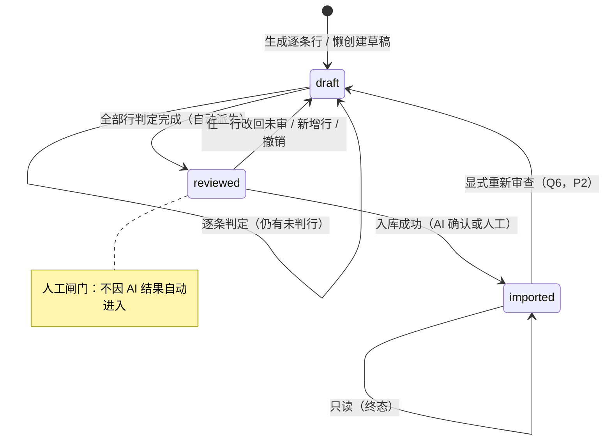

# 手写字词库管理插件 v2.0 审查工作台 — v3 增量 PRD

| 项 | 内容 |
|---|---|
| 文档类型 | 增量 PRD（仅描述本次三项改造；不重复 v2.0 已有功能，不含竞品/市场分析） |
| 撰写人 | 产品经理 许清楚 |
| 语言 | 简体中文 |
| 目标插件 | `handwriting-lexicon`（纯 PHP、零依赖，`public/plugins/handwriting-lexicon/`） |
| 基线版本 | 作者 fixed 版（`handwriting-lexicon-fixed.zip`，v1.1.x，已在群晖线上部署） |
| 变更性质 | 在作者 fixed 版上做**第三轮增量**：判定粒度下沉、四类全覆盖、90 天归档；**不推翻、不回退**作者 7 项修复 |
| 交付载体 | 新版插件 zip（含 `api.php`/`assets/review.js`/`lib/review_store.php`/`lib/config.php`/`plugin.json`/`docs`） |

---

## 0. 基线锁定：作者 7 项修复不可回退

> 本 PRD 全部改造在作者 fixed 版之上叠加。**下表 7 项必须保持现状**，任何改动若与之冲突，以本节为准。

| # | 作者修复 | 落地文件 | v3 约束 |
|---|---|---|---|
| F1 | 审查工作台 Tab 可切换（`initTabs()` + `bglx:tab` 事件） | `assets/admin.js` | 不触碰 |
| F2 | 识别明细字段映射 `no→partNo`、`proc→process`、`qty` 兼容 | `lib/log_reader.php` | 逐条行生成**消费已归一化字段**，不重复映射、不改映射链 |
| F3 | 过滤 `match` 空记录（仅留 `engine/ocr/fusion`） | `lib/log_reader.php` | 不触碰 |
| F4 | 稳定键 `log-<sha1>` + `judgment` 回显 + `invokeLabel()` | `api.php`、`assets/review.js` | 稳定键逻辑保留；顶层 `judgment` 由"事实源"降级为"派生投影"（见 §7.1），但**列表徽标/统计/筛选照常工作** |
| F5 | 目录默认值 `attachmentDirs=images/attachments/`、`logDir=ocr-logs/` | `plugin.json`、`docs` | 默认值**不改**，新配置项另起 |
| F6 | 脚本版本参数 `?v=...` | `admin.php` | 新增 v3 时**递增版本号**刷新缓存 |
| F7 | 主程序字库入口 + 下拉字符串兼容 | 主程序 `app.js` 等 | 不在插件包内，插件侧接口签名保持兼容 |

---

## 1. 项目信息与原始需求

| 项 | 值 |
|---|---|
| Language | 简体中文 |
| Programming Language | 纯 PHP + 原生 JS（零依赖、无构建，延续现有技术栈） |
| Project Name | `handwriting_lexicon_review_v3` |

### 1.1 原始需求复述（用户反馈要点）

> "还有如此多的数据但并没有都填充上，人工判定这一块是判定了整张图还是判定单一的识别结果，判定应该在逐条纠错里吧……如果图号错了我会判定错误然后输入正确值，如果正确就不需要填充，当所有条目我都判定完之后，再转为审查完成，还有审查记录保存多长时间。"

拆为三个必须解决的诉求：

| # | 诉求 | 现状（已核实） |
|---|---|---|
| P-1 | **数据没都填充**：3 条明细只填了第 1 条 | `review.js:332-352` `inferredCorrections()` 仅取 `item.items[0]`，生成 4 行（图号/工序/单位/形近字）；`FIELD_LABELS` 无数量 |
| P-2 | **判定粒度错位**：判定应在逐条纠错里，不是整图 | `judgment` 挂记录顶层；`review.js:464-481` 三按钮判整张图 |
| P-3 | **保留时长**：审查记录存多久 | `data/handwriting_review.json` 仅有条数裁剪（20000）+ audit 5000 按月归档；**无按天数过期**；日志 `keepDays=14`、旧批次原图已删 |

### 1.2 已确认决策（需求基线，不再讨论）

| # | 决策 |
|---|---|
| D1 | 判定粒度 = **逐条判定为准**：判"正确"不填值，判"错误"填正确值；顶层 `status` 由逐条结果派生，全部判完自动转"审查完成"；整图按钮移除或降级为批量快捷（见 Q1） |
| D2 | 纠错覆盖 = **四类词库字段全覆盖所有明细行**；`qty` **不纳入词库**，但仍在字段对照区只读展示 |
| D3 | 保留时长 = **90 天到期归档**：主文件保留 90 天，更早按月归档到 `data/review-archive/`，保留审计不硬删 |
| D4 | 落地 = **基于作者 fixed 版增量改**，保留 7 项修复，最小变更，交付新版 zip |

---

## 2. 产品目标（可量化）

| # | 目标 | 度量指标 | 目标值 |
|---|---|---|---|
| G1 | 识别数据零遗漏 | 一条日志中"已生成判定行的明细条数 / 日志实际明细条数" | **= 100%**（不再只填第 1 条） |
| G2 | 判定粒度正确 | 判定记录中"行级 judgment 条数 / 全部判定动作" | **= 100%**；整图级判定动作 = 0（除非 Q1 保留快捷） |
| G3 | 状态自动派生 | "全部判完后 status=reviewed 的记录 / 应转 reviewed 的记录" | **= 100%**；无人工点"完成" |
| G4 | 归档可控不丢审计 | 主文件超 90 天记录占比；归档后审计丢失条数 | 主文件超期记录 = 0；**丢失 = 0** |
| G5 | AI 输入纯净 + 不误伤正确行 | 送入 AI 的"判正确行"条数；AI 未经确认直入比例 | **= 0** 条；直入比例 **恒为 0** |

---

## 3. 用户故事（审查员视角）

| # | 用户故事 |
|---|---|
| US1 | 作为审查员，我希望打开一条日志后，**每一条明细都自动生成判定行**（图号/工序/单位各一行，形近字按来源生成），以便我逐条核对、不再漏掉第 2、3 条明细。 |
| US2 | 作为审查员，我希望对**每一行**点"正确/错误"：判正确的行不用填值，判错误的行才填正确值，以便判定与纠错合为一步、语义清晰。 |
| US3 | 作为审查员，当我把**所有行都判定完**后，系统**自动转为"审查完成"**，以便我无需再手动提交、且不会被误判为未审。 |
| US4 | 作为审查员，我希望点"AI 整理"时**只处理我判错的行**，判正确的行不被送去归纳，以便词库不被正确的识别值污染。 |
| US5 | 作为管理员，我希望审查记录**超过 90 天自动按月归档**且审计不丢，以便主文件轻量、历史可追溯，并与日志/图片保留期的影响有明确结论。 |

---

## 4. 需求池（P0 / P1 / P2）

> P0 = 本次必须交付；P1 = 应交付（可随 zip 一起）；P2 =  nice to have / 视待确认结论而定。

| 编号 | 需求 | 说明 | 优先级 | 验收标准 |
|---|---|---|---|---|
| R01 | 逐条判定下沉 | 每条判定行独立 `judgment`（correct/wrong/unreviewed），判错才填正确值 | P0 | 逐行点击可独立保存；判正确时 `correct_value` 为空仍可提交；刷新后逐行回显 |
| R02 | 移除/降级整图判定 | 删除 `review.js` 整图三按钮；顶层 `judgment` 不再由人工直接写 | P0 | 详情区无"正确/错误(整图)"按钮；列表徽标仍正确显示（由派生投影，F4 不回退） |
| R03 | 顶层状态派生 | `status` 由逐条结果计算：存在未判行→draft；全部判完→reviewed；已入库→imported | P0 | 所有行判完后无人工操作即变 reviewed；任一行改回未判则回落 draft |
| R04 | 四类覆盖所有明细 | 遍历 `items[]` 全部明细，按图号/工序/单位生成行，形近字按来源生成 | P0 | 3 条明细生成 ≥ 3×(有值字段数) 行；第 2、3 条字段出现在纠错区；`qty` 不出现在四类下拉 |
| R05 | 数量不入库但可见 | `FIELD_LABELS`/类型映射不含 qty；字段对照区保留 qty 只读 | P0 | 四类映射无 qty；字段对照区仍显示"明细N.qty" |
| R06 | AI 只处理判错行 | 服务端 `review_ai_organize` 过滤：仅 `judgment=wrong` 且填正确值的行进入 AI | P0 | 构造的 AI prompt 输入中无 correct 行；判对行不被归纳；AI 红线（pending/confidence≤0.8/人工勾选）不变 |
| R07 | 人工导入仅判错行 | `review_import_decisions` 仅接收判错行；正确行不产生词条 | P0 | 全部判正确的记录导入时新增词条 = 0；判错行正常入库 `source=ocr_feedback` |
| R08 | 90 天到期归档 | 超 `reviewRetentionDays`(90) 的记录按月归档到 `data/review-archive/review-YYYY-MM.json` | P0 | 造 91 天前记录触发归档；主文件不再含该记录；归档文件按 created_at 月份分组 |
| R09 | 审计不硬删 | 归档保留 `audit` 与条目原文，归档过程写一条 `retention_archive` 审计 | P0 | 归档前后审计条目总数守恒；归档文件含条目与审计明细 |
| R10 | 存量数据兼容 | 无 `row_key/judgment` 的旧纠错行按规则迁移（见 §7.5），顶层字段保留 | P0 | 加载 fixed 版历史记录不报错、不丢字段；旧行 `correct_value` 非空→视为 wrong |
| R11 | 稳定键与回显不回退 | `log-<sha1>` 合成键、字段归一化、`match` 过滤、Tab、目录默认值全部保持 | P0 | 回归验证作者交接文档 §6 全部验证项通过 |
| R12 | 状态派生乐观锁 | 逐条判定走 `version` 乐观锁；并发改判返回 40901 提示刷新 | P1 | 两审查员并发改同一行，后者收到 40901 |
| R13 | 归档触发时机 | 写操作后调用 `pruneExpired()`，批量上限受控，不阻塞 OCR 热路径 | P1 | 单次归档条数 ≤ `BGLX_REV_ARCHIVE_BATCH`；归档失败不阻断本次判定保存 |
| R14 | 整图批量快捷（可选） | 若 Q1 保留，则提供"批量判正确/批量判错误"按钮，本质为逐条写入 | P1 | 快捷操作逐行落 `judgment`，行为等价于逐条判定；默认关闭 |
| R15 | 归档查询入口 | 提供按月查看归档记录的只读入口 | P2 | 可按月份列出归档文件与条目数（结论待 Q3） |
| R16 | 形近字逐条推断 | 形近字按明细/备注逐位拆对生成行（规则待 Q2） | P2 | 有 note 时生成 char 行；无来源时不凭空生成 |

---

## 5. 配置项设计（settings）

> 仅**新增**配置项；作者 F5 的目录默认值**保持不变**。存放于 `lib/config.php` 默认表 + `plugin.json` 设置项，两侧一一对应。

### 5.1 新增配置项

| key | type | 默认值 | 说明 |
|---|---|---|---|
| `reviewRetentionDays` | int | `90` | 审查记录主文件保留天数；`max(created_at, updated_at)` 早于 N 天者归档。设 `0` 表示禁用到期归档（仅受条数上限约束） |
| `reviewArchiveEnabled` | bool | `true` | 到期归档总开关；关闭后仅保留既有条数裁剪 |
| `reviewArchiveDir` | string | `"review-archive/"` | 归档目录，相对 data 目录解析（即 `data/review-archive/`），做穿越校验 |
| `wholeImageJudgeEnabled` | bool | `false` | 是否保留整图批量快捷判定按钮（默认关，对应 Q1） |

### 5.2 保持不变的关键默认值（作者 F5）

| key | 默认值（不改） |
|---|---|
| `attachmentDirs` | `images/attachments/` |
| `logDir` | `ocr-logs/` |
| `reviewEnabled` | 由线上运行数据控制（当前已开） |
| `manualImportStatus` / `aiImportStatus` | `active` / `pending` |

> 配置总数由 24 项增至 28 项；`review_settings` 增加返回 `retentionDays`、`archiveEnabled`、`archiveDir` 供自检展示。

---

## 6. 关键流程（Mermaid）

```mermaid
flowchart TD
    A[主程序写识别日志<br/>data/ocr-logs/YYYY-MM-DD.jsonl<br/>items[].no/proc/qty + 行级 date/worker/note] --> B[审查工作台加载日志]
    B --> B1[F2 归一化 no→partNo / proc→process<br/>F3 过滤 match 空记录<br/>F4 生成 log- 稳定键]
    B1 --> C[逐条行生成器<br/>inferCorrectionRows 遍历全部 items]
    C --> C1[每条明细: partNo→图号行<br/>process→工序行 unit→单位行]
    C --> C2[形近字行: 按来源生成<br/>qty 不生成, 仅字段对照只读]
    C1 --> D[合并存量 corrections<br/>按 row_key 幂等, 保留已判结果]
    C2 --> D
    D --> E[逐条判定<br/>每行: 正确 / 错误 / 未审]
    E -->|正确| E1[correct_value 留空<br/>不计入入库/AI]
    E -->|错误| E2[填写 correct_value<br/>计入入库/AI]
    E1 --> F{所有行均已判定?}
    E2 --> F
    F -->|否| G[status = draft 审查中]
    F -->|是| H[status 自动派生 = reviewed 审查完成]
    G --> E
    H --> I{入库路径}
    I -->|AI 整理| J[服务端过滤:<br/>仅 judgment=wrong 行进入 AI]
    J --> K[AI 候选 pending + 人工勾选确认]
    I -->|人工直接导入| L[仅判错行转词条]
    K --> L
    L --> M[写入词库 source=ocr_feedback<br/>bridge 即时生效]
    M --> N[下次识别命中新词条]
    H -.写操作后触发.-> O[pruneExpired 到期归档<br/>超 90 天按月 → review-archive/]
    O --> P[审计不硬删 + 写归档审计]

    classDef fixed fill:#e8f4ff,stroke:#2b7fff;
    classDef guard fill:#fff4e5,stroke:#e69500;
    classDef store fill:#e9f9ef,stroke:#16a34a;
    class B1 fixed;
    class F,H,J guard;
    class M,N,P store;
```

> 三处人工闸门保留：`F`（全部判完才派生完成）、`E`（逐条判定）、`K`（AI 候选人工确认）；AI 不绕过审核（G5）。

---

## 7. 判定与状态数据模型

### 7.1 事实源与投影（核心设计）

| 层级 | 字段 | 角色 | 写入方 |
|---|---|---|---|
| 行级（事实源） | `corrections[].judgment` | **唯一事实源**，逐条判定的真实结果 | 逐条判定 API |
| 记录级（投影） | `judgment`（顶层） | **派生缓存**，仅供列表徽标/统计/筛选兼容（保 F4） | 服务端派生，禁止人工直写 |
| 记录级（投影） | `status`（顶层） | **派生状态**，由逐条结果计算 | 服务端派生，禁止人工直写 |

### 7.2 逐条判定行结构（在既有 `corrections[]` 上增量扩字段）

| 字段 | 来源 | 含义 |
|---|---|---|
| `row_key` | 新增 | 稳定键 `明细序号:字段`，如 `0:partNo`、`1:process`；形近字记录级用 `note:char` |
| `detail_index` | 新增 | 对应 `recognized_items[]` 下标（形近字为 `-1`） |
| `field` | 沿用 | `partNo`/`process`/`unit`/`char` |
| `type` | 沿用 | `drawing_alias`/`process_synonym`/`unit_synonym`/`char_confusion` |
| `wrong_value` | 沿用 | 识别值/错误值 |
| `judgment` | 新增 | `correct`/`wrong`/`unreviewed`（默认 `unreviewed`） |
| `judged_at` | 新增 | 该行判定时间 |
| `correct_value` | 沿用 | **仅判错行填写**；判正确行必须为空 |
| `extra_variants` / `confirmed` / `note` | 沿用 | 语义不变 |

```json
{
  "status": "reviewed",
  "judgment": "wrong",
  "corrections": [
    { "row_key": "0:partNo", "detail_index": 0, "field": "partNo", "type": "drawing_alias",
      "wrong_value": "TD90535R1S4", "judgment": "wrong", "judged_at": "2026-11-25 10:02:11",
      "correct_value": "TD90535R184", "extra_variants": [], "confirmed": true, "note": "" },
    { "row_key": "0:process", "detail_index": 0, "field": "process", "type": "process_synonym",
      "wrong_value": "铣光2", "judgment": "correct", "judged_at": "2026-11-25 10:02:15",
      "correct_value": "", "extra_variants": [], "confirmed": false, "note": "" },
    { "row_key": "1:partNo", "detail_index": 1, "field": "partNo", "type": "drawing_alias",
      "wrong_value": "TD90523R301", "judgment": "unreviewed", "judged_at": "",
      "correct_value": "", "extra_variants": [], "confirmed": false, "note": "" }
  ]
}
```

### 7.3 顶层 `status` / `judgment` 派生规则

| 条件（按优先级） | 派生 `status` | 派生 `judgment` |
|---|---|---|
| 已入库（保留原 `imported` 且未改判） | `imported` | 沿用入库前投影 |
| 存在任一 `judgment=unreviewed` 的行，或无任何判定行 | `draft` | `unreviewed` |
| 全部行 `judgment=correct`（≥1 行） | `reviewed` | `correct` |
| 存在任一 `judgment=wrong` 且全部行已判 | `reviewed` | `wrong` |

> 派生在每次 `patch/upsert` 写回前由服务端统一执行（新增 `bglx_rev_derive()`），前端不传 `status/judgment` 作为事实。

### 7.4 状态机



| 迁移 | 触发 | 写入 | 守卫 |
|---|---|---|---|
| draft→reviewed | 最后一行判定完成 | `status=reviewed`、`judged_at` | 所有行非 `unreviewed` |
| reviewed→draft | 行改判未审 / 新增行 | `status=draft` | 出现 `unreviewed` |
| reviewed→imported | 入库成功 | `status=imported`、`import_path` | 仅判错行、有正确值 |
| imported→draft | 重新审查 | 清 `import_path` | Q6，默认禁用 |

### 7.5 与既有 `corrections[]` 兼容 / 存量迁移

| 场景 | 规则 |
|---|---|
| 新记录 | 行含全部新字段，`judgment` 默认 `unreviewed` |
| fixed 版存量行（无 `row_key`/`judgment`） | `correct_value` 非空 → 视为 `wrong`（补 `judgment=wrong`、`row_key` 按明细序生成）；为空 → `unreviewed`；其余字段原样保留 |
| 顶层 `judgment` | 保留字段但改为派生；迁移时先读旧值，派生失败才回退旧值 |
| 文档 `schema` | 由 `1` 升为 `2`；`readDoc()` 兼容 1/2，写回统一 2 |
| 版本乐观锁 | `version` 语义不变；新增 `row_key` 不参与冲突判定 |

### 7.6 API 变更（均复用既有 action 命名与鉴权）

| action | 变更 | 要点 |
|---|---|---|
| `review_judge` | **改造为逐条** | 入参增 `row_key`、`judgment`；校验判错必填 `correct_value`；写回后调用 `bglx_rev_derive()` |
| `review_judge`（整图） | 移除或按 `wholeImageJudgeEnabled` 降级为批量 | 批量本质=逐行写 `judgment`（R14） |
| `review_save_corrections` | 增强 | 接收含 `row_key/judgment` 的行；保存后派生 `status` |
| `review_ai_organize` | 过滤输入 | 服务端仅取 `wrong` 行；判对行不进 prompt（R06） |
| `review_import_decisions` | 过滤 + 守卫 | 仅 `wrong` 行入库；正判记录新增词条=0（R07） |
| `review_list_logs` | 投影增强 | 返回逐条 `judgment` 供前端回显；`judgment` 筛选仍按投影工作（F4） |
| `review_stats` | 兼容 | 统计口径改为按行；顶层计数仍可展示（F4） |

---

## 8. 四类词条映射（覆盖所有明细行）

### 8.1 行生成规则

| 明细字段（已归一化） | 词条 type | 生成粒度 | wrong_value 来源 | 正确值填写 |
|---|---|---|---|---|
| `partNo`（图号） | `drawing_alias` | **每条明细一行** | `items[i].partNo`，空则跳过该行 | 判错填正确图号 |
| `process`（工序） | `process_synonym` | **每条明细一行** | `items[i].process`，空则跳过 | 判错填正确工序 |
| `unit`（单位） | `unit_synonym` | **每条明细一行** | `items[i].unit` → `fields.unit`（沿用 Q5 候选） | 判错填正确单位 |
| 形近字 | `char_confusion` | **记录级或逐位拆对**（Q2） | `fields.note` / `raw`（来源待定） | 判错填正确字（单字符约束见 `schema.php`） |
| `qty`（数量） | —— | **不生成** | 仅字段对照区只读展示（R05） | 不适用 |

### 8.2 `inferredCorrections()` → `inferCorrectionRows()` 变更要点

| 项 | 现状 | v3 |
|---|---|---|
| 遍历范围 | `items[0]` 仅第 1 条 | 遍历 `recognized_items[]` 全部（受 store 200 条上限） |
| 行标识 | 无稳定键 | `row_key = 明细序号:字段`，幂等合并存量行 |
| 重叠合并 | 直接返回存量，覆盖推断 | 以 `row_key` 为键：存量优先，新增缺失行，**不丢已判结果** |
| 形近字 | `fields.note` 单行 | 保留单行策略，来源规则待 Q2 定（P2） |

### 8.3 形近字来源问题说明

- 日志明细行 `items[]` 目前只有图号/工序/单位/数量结构，**无独立形近字字段**；形近字只能从行级 `note`/`raw` 文本推断（v2 Q5 已标记未决）。
- `schema.php` 约束 `char_confusion` 的 `standard` 与每个 `variant` **必须为单字符**，因此"整句备注"不能直接作为形近字行，必须拆成单字对。
- 结论：形近字行在 v3 中**默认仍按记录级 `note` 生成候选行**，逐位拆对策略列为 P2 + 待确认（Q2），避免无来源时凭空造词库污染。

---

## 9. 90 天归档设计

| 项 | 设计 |
|---|---|
| 保留基准 | `max(created_at, updated_at)` 早于 `now - reviewRetentionDays` 的记录进入归档候选 |
| 归档目录 | `data/review-archive/`，文件 `review-YYYY-MM.json`（按 `created_at` 月份分组），复用既有 `archiveIfNeeded()` 的按月文件命名与合并写法 |
| 归档内容 | 完整记录条目 + 关联审计明细；不硬删 |
| 触发时机 | 写操作后 `pruneExpired()`；与既有 `audit>5000` 归档、`items>20000` 裁剪并存，顺序：**先按天归档 → 再条数裁剪** |
| 批量上限 | 单次归档 ≤ `BGLX_REV_ARCHIVE_BATCH`(1000)，循环分批，避免长事务 |
| 失败降级 | 归档失败记录告警并返回错误码，**不回滚已完成的判定保存** |
| 审计 | 每次归档写一条 `retention_archive` 审计（归档条数、月份） |
| 与条数裁剪关系 | 超限裁剪（硬删最早条目）保持为最后兜底；因先按天归档，正常情况不会触发到硬删（改进项 P1） |
| 查询 | 归档后是否可查 → Q3；默认仅保留文件，不提供在线查询（R15/P2） |

---

## 10. 待确认问题

| # | 问题 | 产品倾向 / 候选方案 | 需谁拍板 |
|---|---|---|---|
| Q1 | 整图三按钮是否保留为批量快捷操作？ | 倾向**移除**（R02）；若保留则降级为"批量判正确/批量判错误"，默认 `wholeImageJudgeEnabled=false`，本质逐条写（R14） | 业务负责人 |
| Q2 | 形近字行如何从明细推断？ | 倾向 A：记录级 `note` 单行候选；B：`items[].note` 逐条 + `note/raw` 等长逐位拆对（受单字符约束）。先按 A 交付，B 列 P2 | 架构 + 业务 |
| Q3 | 归档后能否查询？ | 倾向默认仅落文件、不在线查询；如需查询另做只读入口（R15/P2） | 业务负责人 |
| Q4 | 与日志/图片 14 天保留期是否联动？ | 倾向**不联动**：审查记录按 90 天独立归档；但需在界面提示"超 14 天原图已删，仅可审文字"，避免审查员困惑 | 架构 + 运维 |
| Q5 | `reviewRetentionDays=0` 语义 | 定义为禁用到期归档（仅条数裁剪），需确认是否允许管理员关闭 | 管理员 |
| Q6 | `imported` 终态能否改判/重新审查？ | 倾向终态只读；如需改判走显式"重新审查"并防重复入库（P2） | 业务负责人 |
| Q7 | 归档基准时间取 `created_at` 还是 `updated_at`？ | 倾向取 `max(created_at, updated_at)`，避免误归档"久未动但仍在审"的草稿；需确认业务口径 | 业务负责人 |
| Q8 | 逐条判定行的上限（明细多时） | 沿用 store 200 条/记录上限；超限在界面提示，是否提升待定 | 架构 |

---

## 11. 交付与验收小结

| 项 | 结论 |
|---|---|
| 必交 | P0 全部（R01–R11）方可称本次改造完成 |
| 三条主线 | ① 逐条判定 + 状态派生（R01–R03）；② 四类全覆盖所有明细（R04–R05）；③ 90 天归档（R08–R09） |
| 红线 | 作者 7 项修复零回退（§0）；AI 只处理判错行且零直入（R06/G5）；审计不硬删（R09） |
| 兼容 | 存量记录平滑迁移（R10）；顶层字段保留为投影（§7.1） |
| 度量 | G1–G5 为验收基线，阈值随灰度数据校准 |
| 交付物 | 新版 zip + 递增脚本版本号（`?v=`）+ 更新 `docs/review-workflow.md`（逐条判定与归档章节） |
